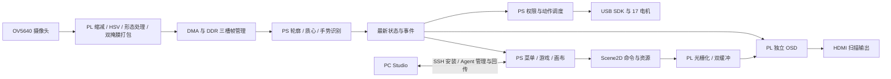

# GESTURE PLAY：PYNQ 手势交互与内容创作系统

平台：PYNQ-Z2 / Vivado 2026.1。使用说明见 [工程入口](../README.md)，发布检查见 [检查清单](submission_checklist.md)。

## 1. 选题、已有工作与工程贡献

目标是让玩家通过摄像头手势使用游戏、画布、视频和实体灵巧手，并让开发者从一套 PC Studio 完成内容构建、板卡部署和运行管理。关注的问题是：在双核 ARM 与有限 FPGA 资源上，输入、显示、视频和机械动作共享设备时如何保持可响应、可恢复。

PYNQ 已提供 Python Overlay、MMIO 和 DMA 基础设施；AMD 视频输入、AXI DMA、时钟与互连 IP 提供底层接口。本项目在这些组件上实现双掩膜视觉流水线、帧拥有权管理、Scene2D 命令式二维绘制、独立 OSD、统一交互状态机与 Studio 部署协议。第三方来源及许可随源码保留，许可说明见 [licensing.md](licensing.md)。相关平台及图像处理依据见本章末尾引用。

工程贡献在于：将有边界的硬件帧生命周期与软件最新状态消费结合；分离 HDMI 扫描、手位置覆盖与应用更新；以独占权限交接组织视频、回传、跟随和示范；让安装、启动、初始化和可回传状态在 Studio 中分别可见。系统通过统一初始化、状态检测与恢复流程管理各模块运行。

## 2. 固定配置与目录

| 项目 | 系统配置 |
| --- | --- |
| 板卡 / FPGA | PYNQ-Z2 / xc7z020clg400-1 |
| 硬件工具 / ID | Vivado 2026.1 / 0xC0061000 |
| 板端运行环境 | Python 3.10、PYNQ 3.1 |
| PC 验证环境 | Windows、Python 3.13、PySide6 |
| 图像 / 显示 | 640×360 双掩膜；320×180 逻辑图形放大到 1280×720 HDMI |

源码、报告和验证位置由 [README](../README.md) 对照官方推荐目录。`board/runtime` 为 SHA 绑定的运行包，硬件板测与公开媒体验证见验证汇总；`src/studio` 为配套 PC；`build/hardware/c6_latency` 包含完整集成 XPR。完整复现按 README 中的构建和部署入口执行，开发脚本另作实现参考。

## 3. 功能框图与划分依据

逐像素固定规则和稳定扫描适合 PL；可迭代的轮廓判别、界面和内容逻辑留在 PS。控制与状态通过 AXI-Lite MMIO，图像和绘图命令通过批量 DMA。视觉结果以最新状态供多个消费者独立读取，灵巧手调度与视觉采集解耦。交互采用相机手势与物理按键，Game1 技能由 BTN0/BTN1 触发。

视觉前端用 2×2 区域缩减、HSV 判定、9×9 膨胀与 5×5 高斯处理形成原始/滤波掩膜。上下文携带 epoch、frame_id、config_id 与阈值；流水对齐与包校验避免把不同帧拼接。PS 从滤波轮廓与原始掩膜提取位置、凸包和凸缺陷等特征。识别采用颜色分割与几何特征判别；光照、肤色阈值和遮挡构成其适用条件。

三槽帧拥有权以授予数 G、释放数 R 维持 0≤G−R≤3；CPU 领取必须等 RGB、掩膜与状态三路完成，释放需匹配 epoch/frame_id。源关闭先在帧边界结束接入，再联合流水线和 DMA 排空；退出流程以硬件释放确认为完成条件。

Scene2D 将清屏、矩形、贴图和图块命令编译为 PL 绘制工作。双逻辑帧缓冲约 115,200 B；前后台在消隐期交接，完成序号区分命令接收、渲染与呈现。OSD 单独读取最新手位置，使手圈刷新独立于游戏更新。详细硬件原理和五张设计图见[详细设计报告](reference_v2_design/gesture_play_v2_junior.pdf)；配套引用已移入 [本包证据索引](../data/reference_evidence_index.json)。

## 4. 界面、机械动作与恢复

主菜单和 GAME/VIDEO 列表用握拳确认；返回停留 2 秒并显示环形进度。游戏有全屏暂停、重玩、回菜单和结果页。画布用握拳选择/连续绘制，图案合并到固定大小像素存储；相册只保存最新作品，重新初始化清空。四游戏工程和 PC 示例位于 `src/studio/games_gesture`，构建和安装走 Studio。

灵巧手在启动时检查，正常播放不持续轮询位置反馈。有效姿态的 3 秒窗口从批准时计算，动作完整结束且窗口到点后消费最新状态；同态可保持，default 不另占 3 秒。视觉过期进入可恢复等待，恢复后直接消费最新状态。示范独占执行 0–9＋比心，每项先回 default，HDMI 显示对应像素手。

视频拥有图形输出期间暂停普通应用交互；相机回传优先最新帧，HDMI 显示暂停页并保留手圈，灵巧手可跟随。关闭回传时完成板端输出交接和原页面恢复。页面切换、视频释放和手模式交接采用明确的状态与重试路径，资源释放确认后再授予下一使用者。

Studio 区分 SSH 可达、启动/初始化、Agent READY 与回传。统一“启动／连接项目”按钮会连接已有实例、等待启动锁或启动已安装项目；“安装完整项目”替换板端候选。板卡受管服务沿 active.json 开机自启动，USB 手缺席时，界面与内容功能继续运行。项目采用常驻运行模式。

## 5. 性能、资源与优化证据

当前 GPU 以三项机制降低绘制周期：描述符缓存复用同一图块信息，像素流水线重叠取数与写入，条件双像素合并满足边界与掩码条件的相邻像素。三个配置使用相同接口、输入和参考结果，便于逐级观察优化收益。

| 同输入场景（100 MHz，周期） | 基线 | 缓存＋流水线 | 再加条件双像素 |
|---|---:|---:|---:|
| 32×16 不透明图块 | 4653 | 813 | 557 |
| 32×16 透明掩码图块 | 4653 | 781 | 525 |
| 320×180 清屏/矩形/Blit | 58929 | 57909 | 28974 |

13 组输出 CRC 和写入数全部一致。优化释放核内绘制时间，保持原有图像语义与帧边界呈现；表中为 RTL 内核周期，应用更新率和相机帧率采用各自的实测口径。

| 完整实现资源与时序 | 基线 | 缓存＋流水线 | 再加条件双像素 |
|---|---:|---:|---:|
| LUT | 32570 | 32268 | 32860 |
| FF | 47672 | 47402 | 47464 |
| 占用 Slice | 13136 | 13145 | 13178 |
| BRAM36 等价 | 89.5 | 89.5 | 87.5 |
| DSP | 20 | 20 | 20 |
| WNS / WHS（ns） | +0.011 / +0.050 | +0.002 / +0.032 | +0.001 / +0.050 |

三项配置相对基线增加 290 个 LUT（0.89%），减少 208 个 FF 和 2 个 BRAM36 等价，DSP 数量不变。控制时钟 100 MHz、HDMI 像素时钟 74.25 MHz；三者 TNS/THS 均为零。当前 Slice 占用为 99.08%，建立裕量 1 ps，继续扩展时应重新检查完整实现。I/O 与异步约束的具体覆盖范围保留在时序报告中。

完整场景、构建参数、资源报告和板测链路见 [GPU 优化与验证](gpu_optimization.md)。基线 DCP 和报告保留在 `build/rebuilt`、`build/reports/frozen_*`，当前默认安装硬件在 `board/runtime/overlay`。

下表保留应用层和较早 GPU 阶段的优化数据，分别对应其原实验范围。

| 优化及测量范围 | 优化前 | 优化后 | 解释 |
| --- | ---: | ---: | --- |
| PC 120 次悬停的背景上传次数 | 120 | 1 | 静态背景驻留，悬停仅追加边框命令 |
| 同一 PC 解释器，悬停渲染中位数 | 1.89735 ms | 0.0802 ms | PC 端场景生成耗时，测量范围为同一解释器 |
| 同一 PC 解释器，绘画渲染中位数 | 1.86595 ms | 1.56735 ms | 固定像素画布，不累积无限对象 |
| 历史 GPU P0→P4 LUT | 14,025 | 14,966 | 阶段模块实现数据，与当前完整集成结果分列 |
| 历史 GPU P0→P4 BRAM | 62 | 60 | 与资源/时序原表一同保留 |

原始 CSV、图表及方法见 [性能报告](reference_v2_performance/performance_resource_report.pdf) 及同目录 data。表中数据按实验版本和测量范围使用；整机指标与模块指标分列。

## 6. 验证结果

[发行验收](../sim/evidence/v3_release/acceptance-summary.json)覆盖标准安装、视频与回传恢复、灵巧手启动检查及自启动连接。各项记录保留测试配置和执行范围。

[验证汇总](validation.md)包含当前 653 个运行文件校验、Studio 169 项离线回归、三配置对照仿真、Vivado 工程重建及实现检查。新增硬件通过四游戏 PC/PYNQ 回放比较与现场菜单、游戏、返回和灵巧手跟随短测。RTL 场景验证、软件回归和板端结果分别记录，便于定位对应层级。

## 7. 环境准备与运行

1. 准备 PYNQ-Z2、相应摄像头、HDMI 显示器、网线；使用灵巧手时需要对应 USB 手、独立电源及配套标定。新接入的机械手需完成独立标定。
2. 在短英文路径解压本包，安装 Python 3.13 与 Vivado 2026.1；按 README 创建 PC 虚拟环境、安装 extras，运行 `tools/verify_package.py` 和 `tools/check_runtime.py`。
3. 运行 `tools/start_studio.py`，先在 PC 打开各游戏示例、构建验证；通过 Studio 选择板卡。SSH 主机密钥和登录密钥由本机用户设置，包内不分发私钥。
4. 已安装 PYNQ 3.1 和项目依赖的板卡，配置直连地址/SSH 别名后，在 Studio“安装完整项目”选择 `board/runtime`，核对安装回执和 READY，再使用统一启动按钮。首次受管自启动配置可参考 `src/development/tools/install_studio_autostart.py --help` 及配套 systemd 文件；显式传入 `--candidate board/runtime` 选择本仓库运行包；工具的默认候选路径属于开发环境。首次使用先准备基础服务，并在其停止状态下执行安装。
5. 首次准备板卡时，按 [部署说明](../board/README.md)配置 PYNQ 基础环境、网络、相机接线、Python 依赖和灵巧手标定。
6. 硬件开发直接打开集成 XPR；从零构建使用 README 的 `build_hardware.tcl`，输出新目录。先检查报告和导出接口，再安排单独上板验收；重建产物独立验收后再用于部署。
7. 上板观察顺序：加载页→主菜单→各游戏与暂停/返回→画布保存/相册→视频/回传恢复→示范与跟随。实体动作需有人观察且范围清空。完成后使用 Studio 正常停止，保留卸力/释放回执。

## 8. AI 协作与技能复用

[协作记录](ai_collaboration.md) 提供提示词、模型答复与反馈修正过程；[技能报告](../skill/report.md) 提供提炼方法和实验结果。发布条件见 [检查清单](submission_checklist.md)。

## 9. 参考资料

- PYNQ Overlay、MMIO 与 DMA：[PYNQ documentation](https://pynq.readthedocs.io/)。
- 轮廓、形态学与颜色转换：[OpenCV documentation](https://docs.opencv.org/4.x/)。
- 工程构建与时序：[AMD UG901](https://docs.amd.com/r/en-US/ug901-vivado-synthesis)、[UG904](https://docs.amd.com/r/en-US/ug904-vivado-implementation)、[UG906](https://docs.amd.com/r/en-US/ug906-vivado-design-analysis)。
- 第三方代码来源与许可：[许可说明](licensing.md)。
