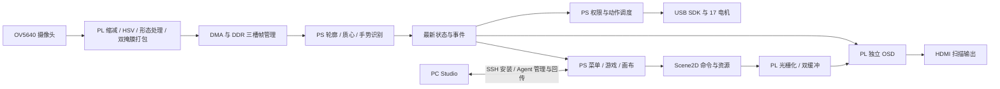

# GESTURE PLAY v3.0：PYNQ 手势交互与内容创作系统

版本：v3.0，PYNQ-Z2 / Vivado 2026.1。使用说明见 [工程入口](../README.md)，发布检查见 [检查清单](submission_checklist.md)。

## 1. 选题、已有工作与工程贡献

目标是让玩家通过摄像头手势使用游戏、画布、视频和实体灵巧手，并让开发者从一套 PC Studio 完成内容构建、板卡部署和运行管理。关注的问题是：在双核 ARM 与有限 FPGA 资源上，输入、显示、视频和机械动作共享设备时如何保持可响应、可恢复。

PYNQ 已提供 Python Overlay、MMIO 和 DMA 基础设施；AMD 视频输入、AXI DMA、时钟与互连 IP 提供底层接口。本项目在这些组件上实现双掩膜视觉流水线、帧拥有权管理、Scene2D 命令式二维绘制、独立 OSD、统一交互状态机与 Studio 部署协议。第三方来源及许可随源码保留，许可说明见 [licensing.md](licensing.md)。相关平台及图像处理依据见本章末尾引用。

工程贡献在于：将有边界的硬件帧生命周期与软件最新状态消费结合；分离 HDMI 扫描、手位置覆盖与应用更新；以独占权限交接组织视频、回传、跟随和示范；让安装、启动、初始化和可回传状态在 Studio 中分别可见。v3.0 主要完善启动与恢复链路，硬件仍为 R23b2。

## 2. 固定配置与目录

| 项目 | 本候选基线 |
| --- | --- |
| 板卡 / FPGA | PYNQ-Z2 / xc7z020clg400-1 |
| 硬件工具 / ID | Vivado 2026.1 / 0xC0061000 |
| 发布版本 | v3.0，Git c1412d1b1e24f0998a575ac6e0fb7fa778cc5dec |
| 板端 / 灵巧手 | R15b / R16；Python 3.10、PYNQ 3.1 |
| PC 验证环境 | Windows、Python 3.13、PySide6 |
| 图像 / 显示 | 640×360 双掩膜；320×180 逻辑图形放大到 1280×720 HDMI |

源码、报告和验证位置由 [README](../README.md) 对照官方推荐目录。`board/runtime` 为 SHA 绑定的已验收运行包；`src/studio` 为配套 PC；`build/hardware/c6_latency` 是从实际 R23b2 工程恢复的完整集成 XPR。历史开发脚本不作为当前复现入口。

## 3. 功能框图与划分依据

逐像素固定规则和稳定扫描适合 PL；可迭代的轮廓判别、界面和内容逻辑留在 PS。控制与状态通过 AXI-Lite MMIO，图像和绘图命令通过批量 DMA。视觉结果供多个消费者读取，灵巧手不反向占有视觉输入队列。真实应用不使用声音输入，Game1 技能由 BTN0/BTN1 触发。

视觉前端用 2×2 区域缩减、HSV 判定、9×9 膨胀与 5×5 高斯处理形成原始/滤波掩膜。上下文携带 epoch、frame_id、config_id 与阈值；流水对齐与包校验避免把不同帧拼接。PS 从滤波轮廓与原始掩膜提取位置、凸包和凸缺陷等特征。算法不属于神经网络推理；识别性能仍受光照、肤色阈值和遮挡影响。

三槽帧拥有权以授予数 G、释放数 R 维持 0≤G−R≤3；CPU 领取必须等 RGB、掩膜与状态三路完成，释放需匹配 epoch/frame_id。源关闭先在帧边界结束接入，再联合流水线和 DMA 排空，不能把进程退出等同于硬件已释放。

Scene2D 将清屏、矩形、贴图和图块命令编译为 PL 绘制工作。双逻辑帧缓冲约 115,200 B；前后台在消隐期交接，完成序号区分命令接收、渲染与呈现。OSD 单独读取最新手位置，游戏未更新不等于覆盖圈停止。详细硬件原理和五张设计图见保留版本标识的 [v2 设计报告](reference_v2_design/gesture_play_v2_junior.pdf)；配套引用已移入 [本包证据索引](../data/reference_evidence_index.json)。

## 4. 界面、机械动作与恢复

主菜单和 GAME/VIDEO 列表用握拳确认；返回停留 2 秒并显示环形进度。游戏有全屏暂停、重玩、回菜单和结果页。画布用握拳选择/连续绘制，图案合并到固定大小像素存储；相册只保存最新作品，重新初始化清空。四游戏工程和 PC 示例位于 `src/studio/games_gesture`，构建和安装走 Studio。

灵巧手在启动时检查，正常播放不持续轮询位置反馈。有效姿态的 3 秒窗口从批准时计算，动作完整结束且窗口到点后消费最新状态；同态可保持，default 不另占 3 秒。视觉过期进入可恢复等待，恢复后重新接受新状态，不回放队列。示范独占执行 0–9＋比心，每项先回 default，HDMI 显示对应像素手。

视频拥有图形输出期间暂停普通应用交互；相机回传优先最新帧，HDMI 显示暂停页并保留手圈，灵巧手可跟随。关闭回传需要完成原页面恢复，不能只关闭 PC 窗口。页面切换、视频释放、手模式交接都有明确状态和重试路径；硬件资源未确认释放时不能通过忽略故障并发重用。

Studio 区分 SSH 可达、启动/初始化、Agent READY 与回传。统一“启动／连接项目”按钮会连接已有实例、等待启动锁或启动已安装项目；“安装完整项目”替换板端候选。板卡受管服务沿 active.json 开机自启动，USB 手缺席时允许界面降级运行。不存在固定实验总时限。

## 5. 性能、资源与优化证据

以下资源由本次重新打开**发布包中的同一个 routed DCP**提取，不是开发中间版本。DCP SHA256：`0688c599283d48ce765ca098013aa79ecb46d350f04c76f6ca1dd7aeea6f44c2`。

| 资源或时序 | 最终 R23b2 |
| --- | ---: |
| LUT | 32,570 / 53,200（61.22%） |
| FF | 47,672 / 106,400（44.80%） |
| 占用 Slice | 13,136 / 13,300（98.77%） |
| BRAM 36K 等价 | 89.5 / 140（63.93%） |
| DSP | 20 / 220（9.09%） |
| WNS / WHS / WPWS | +0.011 / +0.050 / +0.538 ns |
| TNS / THS | 0 / 0 |
| 布线错误 | 0 |

报告：[utilization](../build/reports/frozen_utilization.rpt)、[timing](../build/reports/frozen_timing.rpt)、[clocks](../build/reports/frozen_clocks.rpt)、[DRC](../build/reports/frozen_drc.rpt)、[route](../build/reports/frozen_route.rpt)。控制域 100 MHz、HDMI 像素 74.25 MHz；摄像输入端约束名 `vid_pclk` 的 10 ns 不能当作实测帧率。720p60 是扫描时序，也不等于游戏或 PC 回传每秒更新 60 次。

Slice 使用已很紧，不能只用 LUT 百分比判断余量。DRC 没有 Error/Critical Warning，但存在异步控制、DSP 流水和时钟连接等 Warning；时序检查还有输入/输出延迟未约束项。报告保留原始警告，尚未形成逐项豁免依据，见缺项清单。

| 优化及测量范围 | 优化前 | 优化后 | 解释 |
| --- | ---: | ---: | --- |
| PC 120 次悬停的背景上传次数 | 120 | 1 | 静态背景驻留，悬停仅追加边框命令 |
| 同一 PC 解释器，悬停渲染中位数 | 1.89735 ms | 0.0802 ms | CPU 生成场景基准，不是 PYNQ 实测帧率 |
| 同一 PC 解释器，绘画渲染中位数 | 1.86595 ms | 1.56735 ms | 固定像素画布，不累积无限对象 |
| 历史 GPU P0→P4 LUT | 14,025 | 14,966 | 不同于当前完整集成硬件，仅用于追溯该阶段取舍 |
| 历史 GPU P0→P4 BRAM | 62 | 60 | 与资源/时序原表一同保留 |

原始 CSV、图表及方法见 [性能报告](reference_v2_performance/performance_resource_report.pdf) 及同目录 data。表中数据按实验版本和测量范围使用；整机指标与模块指标分列。

## 6. 验证与实测边界

发布时记录见 [acceptance-summary.json](../sim/evidence/v3_release/acceptance-summary.json)：包含标准整包安装、视频→相机回传→恢复视频→回菜单、灵巧手启动检查、自启动实例连接；同时明确本次发布没有重新逐项真人验收全部游戏/电机，也没有全新 SD 安装验证。历史真人结果保留在发布源码/验收记录，不能替代这些缺项。

本次整理新增验证见 [validation.md](validation.md)：冻结运行包 651 文件校验、独立 Studio 169 项离线回归、隔离配置启动、Vivado 工程恢复/新综合/实现验证。测试路径使用本包，不靠正在运行的板卡补结果。RTL testbench 与原验证资料一并保留；没有宣称做了摄像头模拟电气接口到完整 Linux 用户程序的全系统仿真。

## 7. 从零复现路径

1. 准备 PYNQ-Z2、相应摄像头、HDMI 显示器、网线；使用灵巧手时需要对应 USB 手、独立电源及配套标定。未知新手不能直接套用现有机械标定。
2. 在短英文路径解压本包，安装 Python 3.13 与 Vivado 2026.1；按 README 创建 PC 虚拟环境、安装 extras，运行 `tools/verify_package.py` 和 `tools/check_runtime.py`。
3. 运行 `tools/start_studio.py`，先在 PC 打开各游戏示例、构建验证；通过 Studio 选择板卡。SSH 主机密钥和登录密钥由本机用户设置，包内不分发私钥。
4. 已安装 PYNQ 3.1 和项目依赖的板卡，配置直连地址/SSH 别名后，在 Studio“安装完整项目”选择 `board/runtime`，核对安装回执和 READY，再使用统一启动按钮。首次受管自启动配置可参考 `src/development/tools/install_studio_autostart.py --help` 及配套 systemd 文件；必须显式传入 `--candidate board/runtime`，不采用工具中的历史默认候选。该安装工具还要求基础服务已存在且处于停止状态，因此不能当作全新 SD 一键安装器。
5. 全新 SD 的 PYNQ 基础系统、额外 Python/SDK 库和首次网络/相机安装，现有资料尚未做到陌生用户可一次完成且有实测证明。此步骤明确未闭环，不能把第 4 步的“已有依赖板卡”当作从零验证。
6. 硬件开发直接打开集成 XPR；从零构建使用 README 的 `build_hardware.tcl`，输出新目录。先检查报告和导出接口，再安排单独上板验收；重建产物独立验收后再用于部署。
7. 上板观察顺序：加载页→主菜单→各游戏与暂停/返回→画布保存/相册→视频/回传恢复→示范与跟随。实体动作需有人观察且范围清空。完成后使用 Studio 正常停止，保留卸力/释放回执。

## 8. AI 协作与提交状态

[协作记录](ai_collaboration.md) 提供提示词、模型答复与反馈修正过程；[技能报告](../skill/report.md) 提供提炼方法和实验结果。发布条件见 [检查清单](submission_checklist.md)。

## 9. 参考资料

- PYNQ Overlay、MMIO 与 DMA：[PYNQ documentation](https://pynq.readthedocs.io/)。
- 轮廓、形态学与颜色转换：[OpenCV documentation](https://docs.opencv.org/4.x/)。
- 工程构建与时序：[AMD UG901](https://docs.amd.com/r/en-US/ug901-vivado-synthesis)、[UG904](https://docs.amd.com/r/en-US/ug904-vivado-implementation)、[UG906](https://docs.amd.com/r/en-US/ug906-vivado-design-analysis)。
- 第三方代码来源与许可：[许可说明](licensing.md)。
