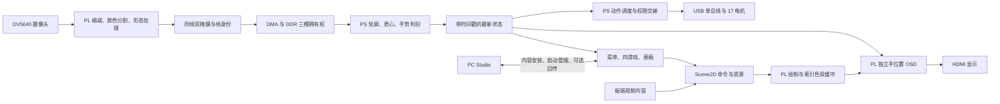
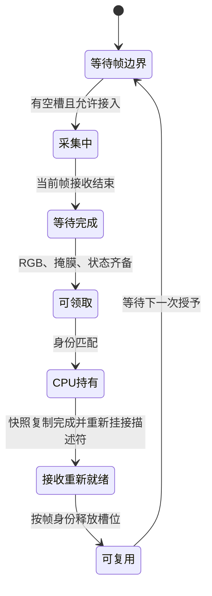
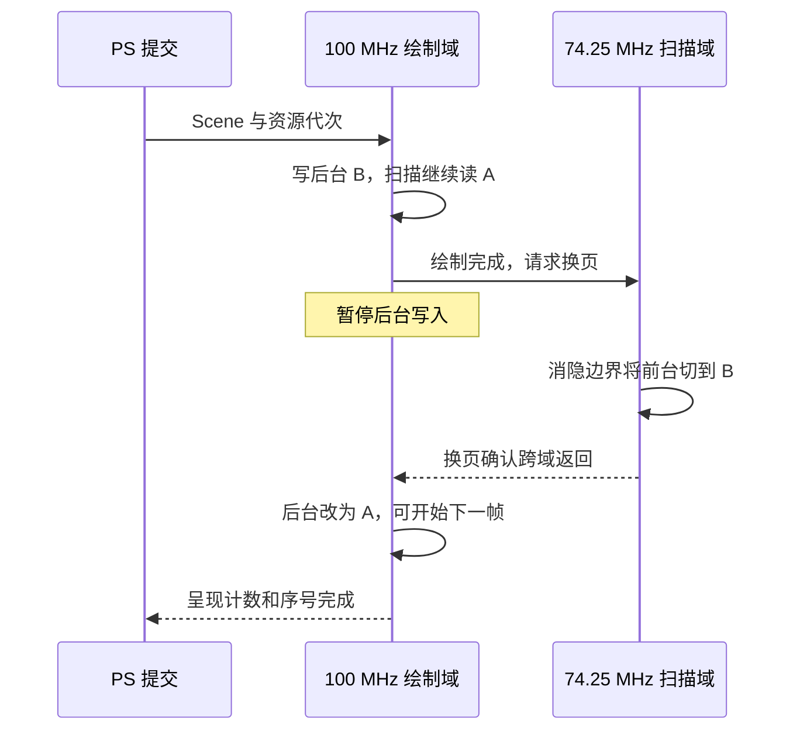
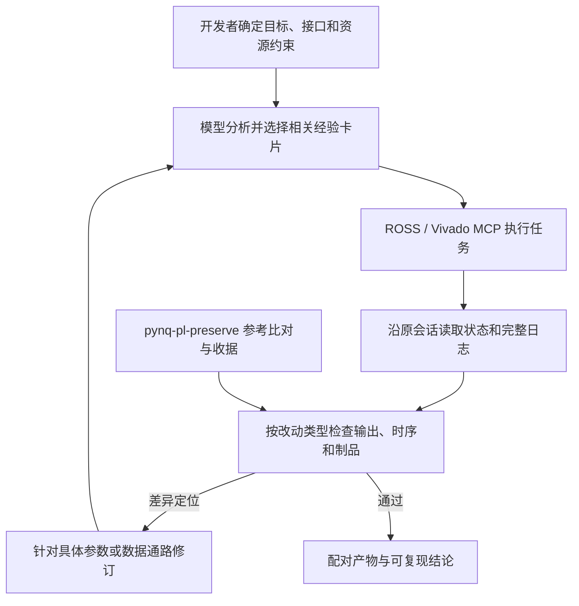

# 设计报告与大模型协作记录

## 基于 PYNQ 的灵巧手交互与二维渲染加速

**项目名称：GESTURE PLAY**  
**平台：PYNQ-Z2 / XC7Z020CLG400-1；Vivado 2026.1；PYNQ 3.1**  
**系统组成：流式视觉前端、Scene2D 二维 GPU、HDMI 交互、17 电机灵巧手、PC Studio**

### 摘要

本项目面向桌面体感交互与机器人教学，在单块 PYNQ-Z2 上实现从摄像头输入到屏幕交互及实体手动作的完整系统。设计围绕有限计算与片上存储资源展开：将颜色分割、形态处理等规则化视觉运算放入 PL 流水线，PS 完成轮廓与手势判别；识别结果通过最新状态接口，同时服务于 HDMI 手位置覆盖、游戏操作和灵巧手跟随。命令式 Scene2D GPU 在片上索引色双缓冲中绘图，通过消隐期握手呈现完整帧。描述符缓存、像素流水和条件双像素逐级减少重复访问与等待，同输入图块场景由 4653 降至 557 周期，三项优化后的完整实现比基线增加 0.89% LUT，并减少 2 个 BRAM36 等价。灵巧手采用单总线寻址、启动检查、分阶段播放及已确认目标去重，配对用例中写包数减少 34.31%。PC Studio 将内容创作、测试、打包、部署与运行管理接入同一套硬件接口。开发过程中以实际约束引导大模型提出候选，以输出对照、故障注入及实现报告完成筛选，并将验证方法提炼为可迁移的 PYNQ Skill。本文给出设计取舍、接口、性能与资源对照、真实协作记录及从源码到板端运行的复现步骤。

**关键词：视觉算子硬件加速；二维渲染；灵巧手交互**

### 阅读导航

| 阅读目标 | 章节 |
| --- | --- |
| 理解问题、已有工作与项目贡献 | 第 1 章 |
| 查看系统组成、软硬件分工与接口 | 第 2 章 |
| 理解视觉、帧管理、GPU 及独立 OSD | 第 3 章 |
| 理解灵巧手、交互与 Studio 的完整运行流程 | 第 4 章 |
| 核对性能、资源、正确性与实板结果 | 第 5、6 章 |
| 查看提示词、模型回答、修订及 Skill 验证 | 第 7、8 章；[ROSS 工具经验](#ross-tools)、[Skill 联合使用](#ross-skill) |
| 配置环境、重建三种硬件并运行项目 | 第 9 章 |
| 查看扩展方向、要求对照及参考文献 | 第 10、11 章 |

本报告为完整设计主入口。专题报告、CSV、源码与原始回执按章节就近引用；当前运行配置和资源数据采用三配置集成验证结果，设计阶段实验保留其对应输入与测量范围。

## 1 选题背景与设计目标

### 1.1 要解决的问题

体感游戏、机器人示教与可视化实验常由摄像头程序、图形程序和机械手控制器分别完成。将这些功能放到同一块嵌入式板卡后，困难从“单模块能否运行”转为“多个模块如何共享时间、存储和设备”：图像处理不能因游戏暂时停止刷新而积压，视频切换不能留下旧的图形提交线程，机械动作执行期间也不能把早已过时的手势排队播放。

PYNQ-Z2 的 ARM 处理系统适合运行 Python 应用、组织状态机和管理外设；可编程逻辑适合规则化像素运算与持续视频时序。项目据此建立两条硬件数据通路——视觉预处理与二维绘制——并让屏幕交互和实体手共享同一份识别结果。普通使用只需板卡、摄像头、显示器及灵巧手；PC 用于内容开发、安装和可选回传。

### 1.2 已有工作与本项目的位置

PYNQ 提供 Overlay、MMIO、DMA 等硬件访问框架，OpenCV 提供颜色转换、轮廓与几何特征运算。Pynq_Gesture_Detect 为手势识别提供算法参考，PYNQ-ComputerVision 展示视觉算子硬件化的方法；PainterEngine 相关 FPGA 实现为指令分发与绘制控制提供架构参考。ORCAHand 的机械结构、orca_core 及 SCS225 适配资料提供灵巧手的结构与基础控制支持。

这些工作解决了平台访问、识别、绘图或机械控制中的不同部分。本项目进一步处理它们在单板内协同运行的接口与生命周期：设计双掩膜输出及帧身份校验，建立多消费者最新状态接口；用命令与资源驱动片上绘图，将扫描、应用绘制与手位置覆盖分开；通过单一设备所有者组织跟随、示范、视频及回传的切换。第三方贡献与本项目实现分别列于[参考项目与致谢](../../README.md#参考项目与致谢)，代码许可见[许可说明](licensing.md)。

### 1.3 需求如何转化为设计

| 需求 | 设计选择 | 验证方法 |
| --- | --- | --- |
| 一次识别，同时操作屏幕和实体手 | 稳定分类、位置与帧身份组成共享状态，各消费者独立读取 | 连续三态切换、页面返回后的跟随、输入边界回归 |
| 应用繁忙时仍能观察手位置 | 扫描末端独立 OSD；位置提交采用有限握手与有效期 | OSD 仿真、HDMI 与真实手势联调 |
| 控制视觉积压与帧复用风险 | PL 三槽拥有权；PS 仅保留一个最新待处理快照 | 帧身份、复位、关闭、异常释放等场景验证 |
| 在有限 BRAM 上完成多个图形应用 | 320×180 索引色画面、片上双缓冲、共享 Scene2D 接口 | 图形结果检查、视频/游戏/画板路径验证 |
| 优化后保持通用绘图能力 | 缓存、流水与条件双像素，透明/翻转/裁剪保持原语义 | 三配置同输入的写入数、CRC 与周期对照 |
| 灵巧手跟随不拖慢图形应用 | 独立动作调度、正常播放不持续读取位置、目标去重 | 内存串口配对、协议测试及实体动作验收 |
| 其他开发者能够添加内容并部署 | GamePlugin、素材转换、PC 示例与 Studio 标准安装 | PC/PYNQ 逐 tick 对照、安装及恢复回执 |

项目贡献体现在三个相互配合的层面。首先，以帧身份、有限缓冲和最新状态消费管理视觉数据，从硬件接入到软件消费形成完整生命周期。其次，以紧凑指令、索引色存储和分层流水提高绘制效率，同时用消隐换页与独立 OSD 保持交互反馈。最后，将内容开发、设备权限交接和可恢复运行纳入同一套工程流程，使新增应用可以复用固定的视觉和图形硬件。

## 2 系统架构、软硬件划分与接口

### 2.1 功能框图



摄像头的像素先进入 PL，经过预处理与 DMA 写入 DDR 后由 PS 识别。应用内容反向由 PS 组织成指令和资源，经 DMA 交给 PL 绘图。灵巧手走 USB 串口，独立 OSD 走 MMIO；三者共享识别状态，但不共享必须依次消费的事件队列。

### 2.2 软硬件划分依据

| 执行位置 | 任务 | 放在该侧的理由 |
| --- | --- | --- |
| PL 视觉通路 | 摄像头流接入、2×2 缩减、HSV 掩码、形态处理、双掩膜对齐、帧标识 | 逐像素规则固定，适合行缓冲和流水；直接接收相机流 |
| PS 视觉判别 | 轮廓选择、质心、凸包/凸缺陷、类别稳定化 | 目标数量有限，规则易迭代，便于与 OpenCV 结果核对 |
| PL 图形与显示 | 指令执行、图块/精灵绘制、索引色缓冲、消隐换页、OSD、HDMI 时序 | 扫描需持续输出；绘制具有固定访存与像素运算模式 |
| PS 应用与外设 | 菜单、游戏、画板、视频调度、灵巧手控制、恢复与所有权管理 | 分支与生命周期逻辑较多，需要灵活维护 |
| PC Studio | 内容创作、PC 测试、素材转换、打包、安装及运行状态显示 | 将内容生产开销移出板端，使运行硬件保持通用 |

这里的视觉硬件加速是将与 OpenCV 处理链相对应的部分运算重新实现为流式 RTL。OpenCV 的轮廓等后处理仍在 PS；硬件结构、位宽、窗口、边界和停顿行为由工程显式设计。

### 2.3 运行配置与跨模块契约

| 参数 | 当前配置 |
| --- | --- |
| FPGA / 工具 | XC7Z020CLG400-1 / Vivado 2026.1 |
| PS / 板端环境 | 双核 Cortex-A9；PYNQ 3.1、Python 3.10 |
| PC 环境 | Windows、Python 3.13、PySide6 |
| 控制及绘制时钟 | 100 MHz |
| HDMI 像素时钟 | 74.25 MHz；1280×720、60 Hz 扫描 |
| 视觉工作尺寸 | 640×360；由 1280×720 相机图像作 2×2 区域缩减 |
| 图形工作尺寸 | 320×180；每逻辑像素对应 4×4 HDMI 输出像素 |
| 当前 GPU 配置 | 描述符缓存、像素流水、条件双像素开启；上传/渲染重叠关闭 |
| 集成硬件标识 | `BUILD_ID = 0xC0061000`；具体配置另由配套清单与文件摘要区分 |

| 接口 | 内容与交接条件 |
| --- | --- |
| PL 内部 AXI4-Stream | `valid/ready` 成功握手才前进；停顿时像素、边界标记和相关窗口状态保持 |
| DMS1 → PS | 同帧原始/滤波掩膜、尺寸、`epoch/frame_id/config_id`、状态和 CRC；包验证后形成快照 |
| PS → Scene2D | 64 B 头部＋最多 128 条、每条 32 B 命令；素材/地图/调色板以 generation 管理 |
| PS → OSD | AXI-Lite 影子寄存器＋提交握手；忙时跳过本次提交，后续发送最新位置 |
| PS → 灵巧手 | 1 Mbaud、8N1、带 ID 和校验的单总线位置写入及 ACK |
| Studio → PYNQ | SSH 管理安装与启动，Agent 提供运行状态和可选回传；连接状态与项目 READY 分开显示 |

三个硬件配置保持同一软件 ABI。`BUILD_ID` 用于接口识别，优化开关、bit/HWH 配对和 SHA-256 用于区分实际制品；仅看 ID 不能判断当前启用了哪些优化。

## 3 PL 关键设计

### 3.1 视觉前处理：在流中完成固定像素运算

视觉数据通路依次完成区域缩减、颜色空间判断、原始掩膜生成、形态处理及双掩膜对齐。2×2 区域缩减对每个颜色通道计算 `(a+b+c+d+2)>>2`，用相邻行缓存完成平均，降低后续运算和传输的像素数量。

颜色掩码采用 HSV 范围判断。默认范围为 H=0～20、S=20～255、V=70～255，其中 H 使用 0～179 标度；这些阈值用于肤色分割，可结合照明条件调整。配置在帧边界锁存，保证同一帧内阈值一致。原始掩膜以 0/255 表示像素是否属于目标区域。

滤波分支先作 9×9 二值膨胀，再作 5×5 可分离平滑，改善轮廓连接。当前 RTL 每轴定点系数为 `[51,51,52,51,51]/256`；输出行为按该实际系数和边界规则验证。原始分支通过 FIFO 补偿延迟，与滤波分支按同一像素位置配对。两类结果各有用途：滤波掩膜用于寻找连续轮廓，原始掩膜用于所选轮廓内的像素统计。

PS 从滤波掩膜提取候选轮廓，按面积、与前一目标的重叠及中心距离选择连续目标；再从凸包面积差、凸缺陷数量、角度和深度判别握拳、剪刀、张手。最近 5 个已处理帧中，同类至少 3 票且当前检测相符时确认类别；明确无手或目标跳变时清除历史。位置有效性与类别有效性分开维护，使暂时不确定的类别不妨碍位置显示。

原始掩膜保留阈值分割信息，滤波掩膜提供连通结构；双路输出使软件能够根据任务分别选择统计输入。算法仍属于颜色分割与几何特征识别，使用时需保证手部进入画面、照明与阈值相适应。实现和字段说明见[视觉技术说明](figures/vision_dual_follow_handoff/TECHNICAL_NOTES.md)。

### 3.2 双掩膜编码与帧拥有权

每帧 DMS1 载荷为 `640×360×2 = 460800 B`，加 64 B 尾部后共 460864 B。内存按“原始像素 0、滤波像素 0、原始像素 1、滤波像素 1……”排列。尾部为 16 个小端 32 位字，携带 magic `0x31534D44`、帧号、配置号、epoch、宽高、像素数、载荷长度、状态、阈值与格式；最后一字为 CRC32，覆盖载荷与前 15 个尾部字。

数据到达不等于该槽已经可以安全复用。帧管理器为三个 DDR 槽记录身份与完成状态，用授予数 G 和释放数 R 维持：

**`0 ≤ G − R ≤ 3`**

CPU 领取前需等待对应 RGB、掩膜及状态完成；释放时核对 `epoch/frame_id`，区分复位前后的同号槽位。接收描述符重新就绪后才允许后续槽位循环使用，避免软件释放与硬件写入发生错序。没有空槽时，在完整帧边界跳过输入，保持已有帧的完整性。



系统关闭视觉时先停止新帧接入，在帧边界结束当前帧，再等待源、跨域计数、流水线、DMA 和已领取槽位共同收敛。PS 将数据复制为独立快照后及时释放硬件槽位；后续识别只保留一个最新待处理快照。这样，轮廓处理变慢时会减少中间帧的消费，而不会无限扩展队列或把旧图像逐帧补做。

这一层设计分别解决传输完整性、存储复用和处理新鲜度。相关 RTL 为[帧拥有权](../src/development/rtl/vision_streaming/vision_frame_owner.sv)、[源接入](../src/development/subprojects/hdmi_input_osd/latency_rtl/admission_r01/vision_source_admission.sv)及[采集生命周期](../src/development/subprojects/hdmi_input_osd/latency_rtl/admission_r01/vision_capture_lifecycle.sv)。

### 3.3 Scene2D：以命令和驻留资源组织二维绘制

PS 将界面转化为 CLEAR、FILL_RECT、BLIT_INDEX4、DRAW_TILE_LAYER、END_FRAME 等命令。一个 Scene 包固定为 4160 B，由 64 B 头部和 4096 B 命令区构成；头部包括 frame_id、submit_seq、命令数量及所依赖的资源 generation。PL 验证完整包后切换命令 bank，并在资源代次匹配、绘制空闲且没有待呈现帧时启动执行。

例如，绘制位于 `(10,20)`、尺寸 `32×16`、颜色 token 为 `F7` 的矩形：

| 32 位字 | 数值 | 含义 |
| --- | --- | --- |
| word 0 | `0x00000004` | FILL_RECT 操作码 |
| word 1 | `0x000000F7` | 颜色 token |
| word 2 | `0x0014000A` | 高 16 位 y，低 16 位 x |
| word 3 | `0x00100020` | 高 16 位 height，低 16 位 width |
| word 4～7 | `0` | 保留 |

素材使用 INDEX4，每字节保存两个 4 bit 色号，偶数 x 放低半字节，奇数 x 放高半字节；色号序列 `[1,2,3,4]` 编为 `21 43`。帧缓冲每像素保存一个 8 bit token：高 4 位选择调色板组，低 4 位选择颜色，再查表生成 RGB24。透明色通过写使能屏蔽，保留后台原像素。

静态图集与地图驻留后，常规交互主要更新绘制命令。4160 B Scene 相当于同尺寸 RGB24 整帧 172800 B 的约 2.41%；这是资源已驻留时的传输字节对照。视频逐帧变化的素材仍需上传，按调色板、图集与 Scene 的实际需求组织，目标播放节拍为 30 fps。

### 3.4 双缓冲与呈现：把“绘制完成”和“显示完成”分开

图形前后台各为 `320×180×8 bit`，逻辑总容量 112.5 KiB。相同尺寸的 RGB888 双缓冲为 337.5 KiB，因此索引色表示减少 66.67% 的像素存储字节。颜色仍由 RGB24 调色板输出，应用可以更新素材与调色板；该容量对照不包含命令、图集、元数据和 BRAM 分配取整。



换页请求和确认通过各自时钟域的同步链传递。像素域已切到 B、确认尚未回到写域时，两个 bank 指针可能暂时都指向 B；此时写入已停止。正确性依赖“交接期间无写入”与 `present_pending` 门控，而非简单要求两个指针在所有周期都不同。

软件等待 render 和 present 的计数及序号共同满足条件。序号可能提前锁存，因此仅看到目标序号不能认定已经显示。错过当前消隐边界时，扫描继续显示旧完整帧，下一次消隐再切换。Atlas、Tilemap、Palette 和 Framebuffer 各自有提交条件，运行时先排空旧提交、确认资源代次，再启动依赖这些资源的新 Scene。完整时序及包编码见[GPU 缓冲技术说明](figures/gpu_buffer_timing_handoff/TECHNICAL_NOTES.md)。

### 3.5 缓存、流水和条件双像素的组合

**描述符缓存**复用同一图块的属性，完整地址 tag 防止别名命中；新命令及复位使缓存失效。它复用少量寄存器，不增加一份完整图块地图。

**像素流水**将请求、响应与写入交叠，地址、有效位、色号及透明状态随像素传递。结束和边界切换时排空在途数据，保证最后一个像素及其状态不会遗漏。描述符供数稳定后，流水可以持续推进；前端仍重复读取时，单独加流水的收益受限。

**条件双像素**利用 INDEX4 一个源字节内的相邻色号。只有目标地址对齐、源数据和行/图块边界允许时才合并写入；两个 lane 保留独立有效掩码。奇数宽度、边界及不满足条件的情况走单像素路径，透明、翻转、裁剪和有序 CRC 保持原语义。

三个机制分别减少重复读取、等待周期和有效写入拍数，组合收益通过同负载消融验证。发布配置提供三条可重建路径：基线、缓存＋流水、再加条件双像素。第 5 章列出周期、完整实现资源和时序，避免只用局部吞吐推断整机应用帧率。

### 3.6 独立 OSD：让交互反馈不依赖应用绘制

手位置 OSD 位于帧缓冲扫描之后、HDMI 编码之前，根据最新位置比较当前像素坐标，直接覆盖圆环与中心点。它不重绘帧缓冲，也不为每个画面增加一套应用绘图命令。

PS 以影子寄存器提交坐标、状态、序号和有效期；忙时跳过一次提交，下一次仍写最新值。像素域在帧边界接收一致快照，避免坐标与颜色来自不同更新。新序号才重装有效期，输入过期后隐藏标记，防止重复提交旧状态造成永久残影。

普通状态显示亮绿色固定大小圆环，握拳变亮红并缩小外圈，类别不确定时仍可显示有效位置。当前普通圆环外/内半径为 48/42 输出像素，握拳为 32/26；中心点另行覆盖。HDMI 扫描为 60 Hz，位置提交目标为 30 Hz，而新识别结果频率取决于视觉链路，三者在软件和测量中分别处理。

## 4 PS 交互、灵巧手与 Studio

### 4.1 最新状态如何服务多个消费者

识别结果包含来源身份、帧序号、原始时间、位置、类别及有效性。菜单、游戏、OSD 和灵巧手分别观察同一份最新状态；一个消费者读取不会删除另一个消费者所需的信息。应用将状态转换为自己的事件，例如握拳确认、移动方向或返回区域停留。

灵巧手另外记录“已观察”和“已执行”边界：动作期间可以更新候选，但不提前把该帧标记为已消费。动作完成且调度周期到点后，直接判断最新候选，不补做中间每个手势。来源暂时过期时进入可恢复等待；新鲜有效输入恢复后继续跟随。位置范围、类别不确定与明确无手分别处理，减少边缘定位和类别闪烁对姿态切换的干扰。

### 4.2 单总线控制与动作调度

PYNQ 经 USB 串口接入一条带 ID 的舵机总线，控制 17 个 SCS225 电机。舵机使用独立电源，位置控制由舵机内置控制器完成；系统不增加另一个应用级主控来解析手势。启动时完成模型、标定和电机检查，随后按姿态表执行动作。

数据包结构为 `FF FF | ID | LENGTH | INSTRUCTION | PARAMETERS | CHECKSUM`，`LENGTH = 参数字节数 + 2`，校验为 ID 至参数末字节之和取反后的低 8 位。ID=1、目标位置=2048、时间=0、速度=500 的位置写入示例为：

```text
TX   FF FF 01 09 03 2A 08 00 00 00 01 F4 CB
ACK  FF FF 01 02 00 FC
```

该配置的寄存器多字节参数采用高字节在前。每次事务为 13 B 写入＋6 B ACK，1 Mbaud、8N1 下仅按串行位数推导为 190 μs，不包含 USB、系统调度与机械运动时间。保留 ACK 可确认命令事务；正常播放不持续轮询电机位置。启动检查与退出卸力仍有独立确认步骤。

姿态转换分阶段经过 default、中点或目标；每次手势批准时记下 `t_approve`，占用窗口为 t（当前默认 3 s）。下一姿态允许开始的条件是：

**`当前动作已完成 且 now ≥ t_approve + t`**

如果动作早于截止完成，则保持目标至到点；若动作本身更久，则等当前动作完整结束。到点直接读取最新状态：同姿态保持，新姿态开始下一完整转换，明确无手返回 default，default 本身不另加一个占用窗口。已成功写入且 `(目标位置, 速度)` 未改变的电机不重复发送；事务异常时清空目标缓存，确保恢复后重新下发。

0–9＋比心示范作为独占动作序列，每项先回 default，HDMI 显示对应像素手；正常跟随与示范由同一串口所有者交接。编码、时序和配对数据见[灵巧手通信技术说明](figures/hand_communication_handoff/TECHNICAL_NOTES.md)。

### 4.3 界面、游戏、画板与相册

主菜单和 GAME/VIDEO 列表采用目标区域内握拳确认，进入下一级后重新建立确认状态，防止一次持续握拳连穿多级页面。返回键采用停留 2 s，环形边框显示进度；游戏中先进入全屏暂停页，再选择继续、重玩或回菜单。结果页区分成功和失败，并提供后续操作。

画板右侧选择图形与大小，左侧绘图区用握拳连续放置，短握拳形成单个图案。画面保存在固定尺寸像素画布中，重复绘制合并到现有图像，避免把每次盖章永久累积为独立渲染对象。静态界面与图集驻留，悬停主要更新边框或局部命令。返回页可以清空、保存或回菜单；相册仅保存最近一次作品，重新初始化清空。

四游戏共享视觉输入和 Scene2D 输出。人物移动、跳跃及物理按键技能按各游戏规则映射；游戏逻辑 tick 与输入时间分开，短时没有新识别结果时按各自有效期处理。进入页面、切换内容与重新初始化使用加载页反馈当前阶段，阻塞操作由工作线程执行，界面继续呈现状态。

### 4.4 资源占用与可恢复交接

资源管理优先明确“谁拥有设备、何时可以转交”。图形 sink 由一个生产者提交；串口由一个动作所有者控制。页面切换停止旧生产者，等待在途任务收敛，排空图形提交或完成动作取消，再授予下一个使用者。等待有截止与状态记录，恢复动作在管理流程中重试，不在帧循环里持续增加高频探测。

| 使用场景 | 图形与视觉安排 | 灵巧手安排 |
| --- | --- | --- |
| 主菜单、GAME/VIDEO 列表、游戏运行中 | 页面绘制和独立 OSD；识别结果供交互 | 普通三态跟随 |
| 游戏暂停页、画布及相册 | 保留页面操作和独立 OSD | 暂停普通跟随，退出后按目标页面恢复 |
| 视频播放 | 视频独占图形提交；保留相机与 OSD 所需链路 | 暂停普通跟随，退出后恢复 |
| 0–9＋比心示范 | HDMI 同步显示当前示范姿态 | 示范独占，取消/结束后交回普通模式 |
| PC 相机回传 | HDMI 暂停页面交互和游戏更新，保留 OSD；PC 接收相机画面 | 保留跟随；关闭回传后按页面恢复；被中止的示范返回主菜单 |
| 重新初始化 | 独立 Loading 页面，按阶段重建视觉及设备状态 | 重新检查并恢复适用模式 |

这些安排将高负荷场景错开，减少无用图形更新、图像复制和电机读取。启动时分阶段完成显示、视觉与设备检查；正常运行保留轻量状态，不持续开启测试探针。可恢复等待、设备缺席和致命初始化错误分别呈现状态，使恢复有明确入口。

### 4.5 Studio 从内容开发到板端运行

Studio 的 PC 示例使用与板端一致的 GamePlugin 接口，开发者先在 PC 验证输入和关卡，再构建包并安装到 PYNQ。视频批量转换为板端接受的资源格式，安装结果记录各项完成状态和文件摘要。

运行管理区分 SSH 板卡可达、项目已安装、初始化中、Agent READY、回传开启。即使板端仅运行基础系统，Studio 仍能通过 SSH 安装项目；统一启动入口连接已有实例或启动已安装项目，遇到启动锁时等待并显示阶段，而非重复拉起多个进程。受管服务根据活动安装记录开机启动。

安装新内容前，标准加载流程请求旧实例正常退出，等待图形、视觉及机械设备释放，再切换候选和启动新实例。软件将“已接受停止请求”和“资源实际释放”分开确认；日志及回执保留未完成步骤，供恢复流程使用。第 9 章提供环境、构建、安装、自启动及正常停止的操作命令。

## 5 优化与性能资源结果

### 5.1 评价方法与指标

优化从“减少重复工作、缩短核内等待、控制并发负荷”三个层面展开。视觉侧先剖析前处理耗时，再把规则的逐像素计算组织为 PL 流水；GPU 先保持绘制结果一致，再逐级启用缓存、流水线和条件双像素；灵巧手与画布则复用已建立的会话和资源，减少重复计算、传输及轮询。

各类结果按测量对象分别记录：GPU 使用相同输入的 RTL 周期；视觉使用板端新识别结果的帧号增量与窗口时长；软件使用 CPU 时间或场景生成时间；硬件资源使用完整系统实现报告。100 MHz 核心时钟下，每周期为 0.01 μs；HDMI 的 60 Hz 表示输出扫描配置，应用更新率另由实际运行决定。

### 5.2 视觉前处理下沉

原路径的 300 个不同帧号的结果样本表明，颜色掩码及同帧参考检查、形态学是主要开销。颜色阶段原本还包含 PL 颜色核事务，因而优化重点是将往返式处理重组为采集侧连续流，并使 PS 直接接收原始、滤波双掩码。PL 完成缩减、颜色阈值和邻域运算，PS 继续完成轮廓选择、形状统计与手势判定。

| 原路径阶段 | 中位数 / ms | P95 / ms | 下沉后的职责 |
| --- | ---: | ---: | --- |
| 输入准备 | 19.870 | 25.700 | PS 对收到的双掩码进行方向处理 |
| 颜色掩码与同帧参考 | 66.940 | 74.390 | PL 连续输出掩码 |
| 形态学 | 32.230 | 36.430 | PL 行缓冲与邻域滤波 |
| 轮廓选择 | 4.520 | 8.700 | 保留于 PS |
| 形状统计 | 0.029 | 0.033 | 保留于 PS |

来源：[阶段统计 CSV](reference_v2_performance/data/vision_stage_profile.csv)、[原始剖析记录](reference_v2_performance/evidence/docs/vision_latency_acceleration_plan_20261023.md)。该组采样为 60.101 秒窗口中的无手结果；分位数按各阶段独立计算。

历史菜单运行记录中，原路径的两个窗口为 **5.56、6.11 fps**，下沉后的两个窗口为 **18.27、21.18 fps**。这些记录展示了前处理重分配后的识别结果产出能力；它们来自不同阶段的输入和并发负载，保留各自窗口口径，不合成为同一输入的加速比。来源：[完整技术报告第 3.3.4 节](PYNQ的多模态GPU渲染游戏技术报告.pdf)、[板端窗口记录](reference_v2_performance/evidence/docs/bringup/2026-10-23_pynq-z2_r20_board_test.md)。位置发布与手势稳定判定分别推进，使短暂分类变化时仍能保持手部位置反馈。

### 5.3 GPU 的分层优化与同输入对照

描述符缓存复用同一图块的属性，并在新命令边界失效，使资源更新及时可见；像素流水线让坐标、索引、地址和有效位同步推进；条件双像素在对齐、边界和有效性均满足时一次提交两个像素，分别处理透明掩码，其余情况沿用单像素路径。三者分别改善重复取数、阶段串行等待和写入吞吐。

公开源码提供三种配置：基线 `baseline`，缓存与流水线配置 `cache_pipeline`，三项配置 `cache_pipeline_pair`。三者采用相同寄存器、指令格式和 PS 软件，上传/渲染重叠均保持关闭。以下对照使用实际发布 RTL、相同测试台及输入，100 MHz 下计量从绘制开始到完成的核内周期。

| 绘制负载 | 基线 / 周期 | 缓存＋流水线 / 周期 | 三项优化 / 周期 | 基线到三项的耗时下降 |
| --- | ---: | ---: | ---: | ---: |
| 小型 Blit | 97 | 44 | 40 | 58.76% |
| Blit 混合指令 | 138 | 90 | 87 | 36.96% |
| Tile 资源更新，第 0 帧 | 301 | 205 | 197 | 34.55% |
| 32×16 不透明 Tile | 4653 | 813 | 557 | **88.03%** |
| 32×16 透明掩码 Tile | 4653 | 781 | 525 | **88.72%** |
| 320×180 清屏／矩形／Blit，第 0 帧 | 58929 | 57909 | 28974 | **50.83%** |

来源：[逐帧测量数据](../data/gpu_optimization/measurements.csv)及[对应仿真日志](../data/gpu_optimization/)。13 组对照的输出 CRC、像素写入数量均一致，测试台同时检查预期输出。独立源码包重新运行对照后，周期与校验值一致。

不透明 Tile 耗时由 **46.53 μs 降至 5.57 μs**；混合光栅场景由 **589.29 μs 降至 289.74 μs**。前者主要受益于描述符复用和阶段并行，后者更依赖相邻像素写入，说明不同优化对应不同瓶颈。核内周期不包含主机资源上传、PS 调度及等待显示边界的时间，这些环节由整机测试覆盖。

### 5.4 完整系统资源与时序

三配置均针对 PYNQ-Z2 的 `xc7z020clg400-1` 完成全量综合和实现，工具为 Vivado 2026.1，PL 控制时钟为 100 MHz、像素时钟为 74.25 MHz。

| 实现配置 | LUT | FF | Slice | BRAM36 等价块 | DSP | WNS / WHS（ns） |
| --- | ---: | ---: | ---: | ---: | ---: | --- |
| 基线 | 32570 | 47672 | 13136 | 89.5 | 20 | +0.011 / +0.050 |
| 缓存＋流水线 | 32268 | 47402 | 13145 | 89.5 | 20 | +0.002 / +0.032 |
| 三项优化 | 32860 | 47464 | 13178 | 87.5 | 20 | +0.001 / +0.050 |

来源：[资源数据](../data/gpu_optimization/resources.csv)、[完整实现报告](../build/reports/gpu_optimization/)。这些数值覆盖视觉、渲染、接口和控制模块。三项配置较基线增加 **290 个 LUT（0.89%）**，减少 208 个 FF 和 2 个 BRAM36 等价块，DSP 数量保持不变。所有配置布线错误为 0，DRC 无 Error／Critical Warning；已约束路径 TNS、THS 为 0，WPWS 为 +0.538 ns。三项配置 Slice 使用率为 99.08%，后续模块扩展据完整路径报告重新评估布局和时序；报告同时保留 I/O 延迟与异步控制等检查项。

逻辑帧缓冲采用 320×180、每像素 1 字节索引色，双缓冲共 **112.5 KiB**；相同尺寸 RGB888 双缓冲需要 337.5 KiB。索引色减少片上存储需求，调色板保留颜色可配置能力，完整帧边界交换保证扫描侧读取已经绘制完成的帧。

### 5.5 灵巧手通信与软件负荷

动作目标在初始化时转换为电机原生编码，播放时发送阶段目标并等待，同一有效会话复用控制器；相同目标成功写入后进入缓存。正常播放保留每颗电机的 ACK 校验，按阶段等待让出 CPU，退出时执行卸力及读回确认。这使运行期通信集中于目标改变。

同用例离线测试分别从 default 开始，对四种目标各连续播放两次，比较全量阶段写入与跳过不变目标：

| 指标 | 全量写入 | 跳过不变目标 | 减少 |
| --- | ---: | ---: | ---: |
| 位置写包 | 306 | 201 | 34.31% |
| TX＋ACK 总量 | 5814 B | 3819 B | 34.31% |
| 理想串行线时间 | 58.14 ms | 38.19 ms | 34.31% |

来源：[配对数据](figures/hand_communication_handoff/data/comparison_metrics.csv)、[SDK 测试原件](figures/hand_communication_handoff/data/raw/verification-final.json)。每笔为 13 B 位置命令和 6 B ACK，1 Mbaud、8N1 按每字节 10 bit 计算线时间；动作等待、USB 调度和机械运动另计。测试汇总四个独立用例，启动和退出事务不在该计数内。

板端四姿态历史测试同时记录了软件负担的变化：

| 驱动实现 | 动作段墙钟 / s | CPU 时间 / s | 单核等效占用 |
| --- | ---: | ---: | ---: |
| 插值写入 | 6.600 | 3.655 | 55.37% |
| 阶段目标 | 9.149 | 1.656 | 18.10% |
| 阶段目标＋轻量审计 | 9.038 | 1.441 | 15.94% |

来源：[三轮原始记录](figures/hand_communication_handoff/data/raw/)、[汇总数据](figures/hand_communication_handoff/data/comparison_data.json)。单核等效占用按 CPU 时间／墙钟时间计算。各轮起点与等待策略不同，因此保留墙钟时间展示调度取舍；同用例通信量则由上表单独比较。

### 5.6 画布与后台调度

画布将持久背景与实时指示分离，背景不变时复用资源，只更新边框等少量绘制命令。相同 PC 解释器、每组 120 帧的配对基准得到：

| 指标 | 原路径 | 资源复用后 | 改善 |
| --- | ---: | ---: | ---: |
| 悬停背景上传次数 | 120 | 1 | 减少 99.17% |
| 悬停场景生成中位耗时 | 1.89735 ms | 0.08020 ms | 减少 95.77% |
| 绘制场景生成中位耗时 | 1.86595 ms | 1.56735 ms | 减少 16.00% |

来源：[配对测试原件](reference_v2_performance/evidence/build/studio-v2/canvas-benchmark.json)。该计时覆盖 PC 端场景生成，GPU 与网络分别执行各自的测量。持续叠加的绘画内容保存在固定画布资源中，避免随笔画数量增加重复重建整个场景。

回传后台采用事件通知，在约 4.008 秒的板端 ARM 空闲组件对照中，编码进程主动上下文切换由 40 次变为 0，转发线程由 391 次变为 4；两轮均正常收到测试帧并完成清理。该结果体现减少空闲唤醒的效果，按需预览与视觉识别分别管理生命周期。来源：[窗口数据](reference_v2_performance/data/preview_idle.csv)及[原始组件记录](reference_v2_performance/evidence/build/r30-arm-idle-r20.json)。

## 6 验证与整机结果

### 6.1 分层验证

验证依次覆盖数据格式、RTL 边界、软件状态机和实际部署。像素流测试核对帧标记、有效位、背压及完整输出；GPU 对照核对输出一致性后统计周期；Studio 测试覆盖停止、安装、启动、重连及异常恢复；真人测试确认手势交互与机械姿态。

| 层次 | 验证内容 | 结果及原件 |
| --- | --- | --- |
| 视觉数据与状态 | 双掩码长度、CRC、身份检查；分类待定时位置仍有效；OSD 忙时跳过、旧结果不续期 | [构造数据与规则验证通过](figures/vision_dual_follow_handoff/data/verification.json) |
| 视觉三槽拥有权 | 帧授予、RGB／掩膜／状态完成、CPU 领取释放及关闭边界 | [14 个场景、184 项检查通过](../sim/evidence/frame_owner_result.txt) |
| GPU 三配置 | 相同场景与资源输入，比较预期像素、写入数及 CRC | [13 组结果一致](../data/gpu_optimization/measurements.csv) |
| Studio | 安装、启动、连接、内容流、UI、自启动及清理 | [169 项通过](../sim/evidence/normalized_studio.xml) |
| 硬件实现 | 三配置综合、布线、配套产物与时序检查 | [三配置完整报告](../build/reports/gpu_optimization/) |

软件恢复验证覆盖视频加载期间权限交接、预览关闭后恢复菜单、手侧故障重新检查、清理失败退避重试等情况。由现有 owner 完成释放，再建立新会话；正常跟随期间不增加状态轮询。这些状态机测试使恢复路径与正常路径同时进入回归，见[恢复验证原件](../sim/evidence/v3_release/menu-video-preview-recovery/frozen.xml)。

### 6.2 PC 与 PYNQ 同包回放

三项优化配置使用相同游戏包、相同输入序列分别在 PC 和 PYNQ 执行，逐 tick 比较游戏状态及场景输出。自动回放阶段关闭实体动作，随后由真人单独验收画面与灵巧手。

| 游戏 | 一致的逻辑 tick | 通过断言 |
| --- | ---: | ---: |
| Game1 | 181 | 4 |
| Game2 | 959 | 12 |
| Game3 | 150 | 4 |
| Game4 | 301 | 4 |
| 合计 | **1591** | **24** |

来源：[回放摘要及文件摘要](../sim/evidence/gpu_optimization/game_replay_summary.json)，同目录保留各游戏输入、PC／PYNQ 结果及比较报告；[测试包与回放脚本](../sim/evidence/gpu_optimization/)可重新执行该项检查。回放比较的是给定输入下的逻辑一致性，实际输入延迟和画面表现由现场交互确认。

### 6.3 Studio 部署与真人验收

两种优化配置分别通过 Studio 标准安装及启动，保持内容库完整，启用灵巧手并关闭图像回传，真人操作期间使用真实摄像头输入。现场检查菜单握拳选择、游戏移动与跳跃、返回以及灵巧手三态连续切换，两轮反馈均为“操作、画面和灵巧手均正常”。结果与硬件、运行包 SHA-256 一并保存在[板端验收记录](../sim/evidence/gpu_optimization/board_acceptance.json)，可对应到具体 bit/HWH/XSA。

菜单、游戏、视频、画布及灵巧手展示共用同一输入与渲染接口；早期集成验收还覆盖四游戏 16 条 PC／PYNQ 用例、60 项真实 GPU 检查、18 项实体串口检查及 Studio 重连，见[集成验收原件](reference_v2_performance/evidence/build/studio-v2/acceptance-summary.json)。当前三配置以相同软件接口承接这些应用，再通过上述同包回放与真人验收检查硬件替换后的运行行为。

三项配置完成本轮测试后，经 Studio 板端管理接口正常停止；验收记录的 `final_shutdown` 确认视觉资源释放、串口关闭及 17 个电机全部卸力。部署、运行、交互与退出均有明确完成状态，构成可重复执行的整机验证流程。

## 7 大模型协作：由设计判断形成可验证实现

团队负责确定应用行为、接口、资源预算和现场验收条件，大模型辅助分析数据通路、实现候选及边界用例。每次修改以源码和工具结果收敛：先描述需要保持的行为，再建立同输入对照，最后检查资源、时序与整机交互。以下引文为真实对话节选；其后的实现过程和实验结果为技术整理。

### 7.1 协作工作流与任务分工

协作按“需求与约束—候选实现—独立检查—修订复验—系统集成”推进。模型可分别承担模块分析、实现、验证及文档整理；共同依据是固定输入、冻结参考和明确的通过条件。

| 环节 | 团队与模型的具体工作 | 检查依据 |
| --- | --- | --- |
| 确定目标 | 团队明确通用 Scene 接口、手势状态语义与资源预算；模型拆分待解决的瓶颈 | 接口、状态机和同负载场景 |
| 形成候选 | 在独立目录修改局部数据通路，保留可选择的配置 | 原版与候选源码、参数 |
| 验证反馈 | 运行 XSim、综合与布局布线，独立核对输出和报告 | 有序像素写入、CRC、资源和关键路径 |
| 修订复验 | 根据差异定位坐标、尾界、参考依赖或交接状态，补对应边界用例 | 相同激励下的回归结果 |
| 集成复用 | 经 Studio 标准入口安装并完成真人验收，把有效方法整理为脚本与 Skill | 制品摘要、板端收据、可复跑入口 |

### 7.2 GPU：在资源约束下选择并行层次

开发者，2026-10-03：

> 根据我们的需求，分析gpu提升并行的优化方法以及可行性和资源占用

GitHub Copilot 答复节选：

> 推荐路线：Tile 描述符缓存 → Blit/Tile 单像素流水化 → 条件性 2 像素/拍 → 上传与渲染重叠。暂不优先采用多绘图核。

开发者进一步限定：

> 确保不会大量占用pl资源和影响gpu的通用性，仍可以实现不同游戏的渲染，然后开始优化

模型据此提出复用已有描述符寄存器，并用完整地址 tag、有效位和命令边界失效管理缓存；浅流水随像素传递目标地址、颜色和有效标志；双像素仅在源字节、目标对齐和同行边界允许时启用。路线将优化落在复用、流水和写入宽度上，保持原有指令及素材接口。

时序分析进一步推动实现修订。Tile 单像素流水的逐像素定位链包含源坐标和尾界计算，修订时将源原点与描述符水平终点提前锁存；有序写入及 CRC 回归保持一致，该阶段局部 OOC 建立／保持裕量为 +0.281／+0.121 ns。双像素引入两次有序 CRC 更新后，采用由原 CRC 函数生成的固定 GF(2) 掩码及并行 XOR 归约，并用独立逐 bit 参考检查 lane 顺序、透明像素和取消前缀。由此形成“报告定位具体路径—局部结构修订—黄金结果复验”的闭环。

早期缓存实验记录了核心测试 156→138 周期、局部增加 27 LUT／25 FF，为后续组合验证提供依据。当前发布系统采用缓存、流水及条件双像素的三配置对照，完整实现与板测数据见本报告的优化结果部分；上传重叠作为另行归档的扩展机制，三种发布配置均保持关闭。设计过程见[阶段实验汇总](gpu_ai_preparation/evidence/docs/gpu_ai_optimization_p0_p4_summary.md)，当前数据见[GPU 优化与验证](gpu_optimization.md)。

### 7.3 灵巧手：把动作事件修订为最新状态消费

开发者，2026-10-29：

> 3s后无论是否有手势变化都要变成/保持新识别的手势

模型答复节选：

> 我会把 UNKNOWN 改为保持上一已识别姿态；明确无手时才回 default，仍只保留最新状态，不排队。

开发者补充：

> default是不需要保持时间的

这一讨论将控制目标明确为“到期采用最新有效状态”。离线复现进一步定位到记账边界：动作期间到达的新帧已被记录为“观察过”，恢复可执行状态后又被当成重复帧跳过。修订将“已观察帧”与“已消费帧”分开，忙时更新单个最新槽，执行边界再核对来源身份、原始时间和动作资格。

在离线用例的时间线中，10.00 s 批准握拳，12.95 s 到达剪刀，13.00 s 恢复可执行后直接消费该帧，其年龄仍为 50 ms。分类不确定、明确无手与位置有效性也分别处理：不确定时保持，明确无手回默认，位置在边缘不再清除可靠分类。测试覆盖连续切换、截止时机、闪烁和来源恢复，随后通过 Studio 完成真人三态切换。该经验形成[实时输入卡片](../skill/pynq-debug-cards/references/input.md)，对应[最新状态消费实现](../src/hand/src/pynq_usb_hand/gesture_consumer.py)及[控制器测试](../src/hand/tests/test_controller.py)。

### 7.4 Skill：通过校准与依赖复核完善检查机制

开发者，2026-10-31：

> 继续，但是验证场景选取pynq的pl比较好

模型于 2026-11-01 说明实现方案：

> 它会读取原模块的完整输入／输出声明，给现有测试台挂上原版参考实例，并核对实际参数，避免漏比端口或用错参数后误报通过。

工具首先以未修改 RTL 校准绑定，再比较正确变体和受控故障变体。反馈表明，包完成时的 CRC、字节数与包数断言覆盖了传输结果，复位输出则需要增加观察点；由此补充全输出比较、实际参数核对及正常结束检查。依赖复核又明确了冻结范围：参考和候选应各自完整，不能共同依赖正在修改的头文件。工具据此对共享宏、头文件和子 IP 等超出当前范围的输入在生成阶段提示，保留可独立比较的叶模块。

模型复验反馈节选：

> 修订后的完整复跑已通过：原测试、28,761 次附加全输出比较和资源／时序门槛均正常

修订结果随后由独立使用者配置上传模块实验，并在迁移目录重新执行，形成从模型建议到可交付工具的验证链。真实对话与源码索引见[大模型协作记录](ai_collaboration.md)，实验结果见[Skill 报告](../skill/report.md)。

<a id="ross-tools"></a>

### 7.5 ROSS 工具使用经验：从调用记录到工程判断

本项目通过 AMD ROSS 的 Vivado MCP 执行 Tcl、观察会话和命令状态、运行综合与实现并读取工具输出。本机使用 Vivado 2026.1 和 Vivado AI Extension 2026.9.1；Copilot 使用扩展提供的工具，Codex 通过 VS Code 工具桥访问同一类工具。ROSS 提供工具连接与领域能力，开发者确定设计目标和验收标准，模型依据实际返回结果选择后续操作。官方接口关系见 [AMD Vivado MCP 文档](https://github.com/Xilinx/ross-ai-assistant/blob/main/docs/getting-started/vivado-mcp.md)。

工程记录同时保存调用、执行状态、错误文本及后续验证。综合和布线可能长于单次调用等待窗口，因此运行中回执用于续接原任务；执行结束后，继续核对功能断言、时序报告和目标制品。这样的记录可以解释一次修改为什么成立，也为后续 Skill 提供具体的触发条件与完成条件。

以下案例来自 2026-11-04 GPU 集成复验阶段的实际 Vivado MCP 会话；参数、返回码、诊断及复验结论按原记录保留，机器路径用角色占位符替换。结构化摘录、命令编号与来源摘要见 [MCP 调用案例](../skill/pynq-debug-cards/sources/ross_mcp_cases.json)。这些记录与第 7.2 节的早期优化设计讨论分别对应设计形成和集成验证两个阶段。

**案例一：工程状态改变后，确认预检确实重新执行。** 综合运行复位后，需要对当前状态重新预检；相同 `source` 文本命中工具的短期判重。原会话中的两个关键回执如下：

```text
命令 15  source <candidate>/recovery_preflight.tcl
code=0, elapsed=0
SKIPPED (duplicate): This command already completed successfully 70 seconds ago.

命令 16  source -notrace <candidate>/recovery_preflight.tcl
code=0, elapsed=0.038 s
THREE_RECOVERY_PREFLIGHT_PASS
```

本次先确认 `reset_run` 已改变工程状态，再以合法调用重新完成预检，随后启动综合。E01 将“请求返回正常”和“当前阶段已经实际执行”分开判断，并要求阶段标记与产物共同对应当前任务。运行中的任务则继续沿原句柄观察。

**案例二：批量仿真按各测试顶层绑定参数，并读取完整结束结果。** 一批仿真的前项已经输出 PASS，后续展开仍报告：

```text
命令 1  source <verification>/verify_pair.tcl
code=1
ERROR: [XSIM 43-3281] Parameter/Generic TILE_DESCRIPTOR_CACHE_ENABLE  specified in commandline not found in design.
```

定位到不同测试顶层具有不同参数接口后，对 `tb_scene2d_clear_fill_renderer` 只传入其声明的测试参数，在 core 顶层保留缓存、流水和双像素组合参数。修订后的批次回执为：

```text
命令 3  source <verification>/verify_pair_r2.tcl
code=0
会话返回节选：GPU_CACHE_SIM_PASS=tile_cancel_1
完整原生日志：GPAIR_SIM_COMPLETE
```

由于会话输出被截断，最终完成标记从完整日志读取。E04 在执行前核对参数和顶层接口，E02 在执行后核对整个批次的结束与断言；这将模型的参数建议落实为实际测试实例的检查。

**案例三：按当前时序状态选择签核路径。** 缓存＋流水配置在布局布线后物理优化阶段已得到 WNS=+0.002 ns、WHS=+0.032 ns。旧签核脚本随后重复执行针对另一实现的局部布线修补，完整日志出现保持时序违例，当前命令终止：

```text
命令 30  source <candidate>/continue_full_build.tcl
code=1，完整日志：CACHE_PIPELINE_FLOW FAILED: Timing failed: min

命令 31  source <candidate>/recover_signoff.tcl
code=0
CACHE_PIPELINE_SIGNOFF_COMPLETE
```

修订从已通过的 `postroute_physopt` 检查点继续，保留时序、布线与导出检查，仅移除不适用于当前实现的局部修补步骤。恢复过程保持 RTL 和约束不变，最终产物绑定该已检查设计。这个案例将“修复动作依据当前路径证据触发”与 E02、H20 的结果和制品检查结合，减少对已完成阶段的重复扰动。

这些经验归纳为三个可复用动作：执行前明确会话、参数与阶段；运行中沿原任务观察，避免重复提交；结束后按领域结果验收，并将通过检查的设计与导出产物绑定。E01–E04 处理工具调用，E05–E08 与 H20 处理工程和制品身份，组成 ROSS 工具使用的项目经验层。

## 8 PYNQ Skill：工程经验的提炼、验证与复用

### 8.1 两类能力及其关系

技能包面向 PYNQ／Zynq 工程，分别提供 PL 行为保持检查和系统问题定位方法。入口按症状选择资料，使模型在需要时读取对应规则，并把处理结果落实到可观察的完成条件。

| 组成 | 输入与工作方式 | 交付结果 |
| --- | --- | --- |
| `pynq-pl-preserve` | 冻结原版、候选 RTL、既有测试台及 JSON 配置；生成参考实例与全输出监视器 | 仿真脚本、源码摘要、完整日志及验证收据 |
| `pynq-debug-cards` | 按工具调用、构建制品、启动连接、资源交接、实时输入五组选择卡片 | 20 张含症状、处理步骤、完成条件和适用条件的诊断卡片 |

PL 校验器将重复编写参考实例、连线与日志检查的工作自动化；卡片将具体工程观察提炼为跨题目可复用的排查路径。例如，工具请求返回成功后仍核对领域结果，bit/HWH 导出核对同次构建身份，异步交接区分请求接受与资源实际释放，实时输入区分最新观测与已经消费的状态。各卡关联[来源映射](../skill/pynq-debug-cards/origins.json)，适配新项目时采用其实际地址、接口与状态字段。

### 8.2 实验设计与已验证效果

实验一选用真实上传模块 `scene2d_upload_sink`，沿用发送字符串 `123456789` 的测试台。原版用于绑定校准；变体 A 仅重命名内部寄存器；变体 B 将 `completed_crc32` 的复位值从 0 改为 1。三者接受相同激励，分别运行原包完成断言和 Skill 检查。

| 对象 | 原包完成断言 | Skill 全输出比较 |
| --- | --- | --- |
| 原版 | 通过 | 通过，完成绑定校准 |
| A：内部寄存器重命名 | 通过 | 4 个输出、20 次采样比较通过 |
| B：复位值单点改变 | 通过 | 首次采样 5.001 ns 定位 `completed_crc32` 差异 |

该对照展示了复位行为检查的增量覆盖，定位到具体输出和时刻。B 的单项校验返回非零代表检出预设故障；便携实验入口同时核对三组原断言及三组保持性检查，六次仿真全部符合预期后给出整体 PASS。原始差异见[仿真日志](../skill/validation/evidence/consumer/variant_b/simulate.log)，迁移复跑见[结果收据](../skill/validation/evidence/delivery_replay/result.json)。

实验二将工具用于 `scene2d_return_source` 的资源优化，边界激励覆盖反压、部分数据拍、忙时启动及复位恢复，完成 28,761 次全输出比较。

| 指标 | 原版 | 优化后 |
| --- | ---: | ---: |
| LUT | 89 | 89 |
| FF | 191 | 167 |
| BRAM／DSP | 0／0 | 0／0 |
| 10 ns OOC 综合后内部建立裕量 | +3.612 ns | +3.612 ns |

候选 RTL 减少 24 个 FF，即 12.57%；Skill 为该修改提供行为保持验证和可追溯输入，综合报告量化其资源收益。数值采用同器件、同 10 ns OOC 配置，详见[资源结果](../skill/validation/evidence/return_source/results.json)与[边界比较收据](../skill/validation/evidence/return_source/boundary_preserve/verified.json)。

### 8.3 通用性与适用条件

工具以源码、实例、参数、时钟、复位和结束标志作为配置，不绑定游戏、手势或固定寄存器地址。使用者可替换为自己的 PYNQ PL 叶模块；器件由配置指定，软件在开发 PC 上运行。包内另有独立计数器示例，便于先检查环境。

当前解析范围为自包含、单时钟的行为级叶模块，支持显式 ANSI 标量／打包端口及简单整数参数。监视器在时钟双边沿后 1 ps 比较全部声明输出，涵盖复位、空闲和有效传输。验证范围由所提供激励及采样点确定；多时钟、子 IP、复杂 SystemVerilog 类型和有意改变接口或周期行为的任务，应选用相应的验证流程。资源、完整布局布线、CDC 和实板交互分别采用综合、实现和系统验收。这样可以依据问题选择检查机制，并保持各项结论与其证据范围一致。

### 8.4 便携复现步骤

使用 Python 3.11 及以上版本与 Vivado／XSim 2026.1，将 Vivado 启动命令加入 PATH。完成第 9.1 节环境准备后，在 `project` 目录执行：

```powershell
.venv\Scripts\python.exe -X utf8 -B skill/validation/verify_files.py
.venv\Scripts\python.exe -X utf8 -B skill/validation/run_validation.py --out build/output/skill_upload_01 --vivado vivado
```

输出目录须为新目录；也可用 `--vivado` 指定本机启动程序的完整路径。第一条命令核对包内摘要；第二条从当前副本生成配置，顺序执行六次仿真，生成 `result.json`、`receipts.json` 和各组日志。预期为原版及 A 保持性通过、B 被准确检出、原包断言全部通过，整体状态为 PASS。

用于新模块时，先冻结原版并以未修改候选校准绑定，再按改动边界补充激励；每次修改使用新输出目录重新生成、仿真与核验。[配置说明](../skill/pynq-pl-preserve/references/configuration.md)和[一键复现入口](../skill/validation/README.md)给出完整参数及输出解释。

<a id="ross-skill"></a>

### 8.5 如何用本队 Skill 改善 ROSS 的使用

本队 Skill 将已有工具能力组织为可重复的工程流程。ROSS/Vivado 负责执行命令并产生结果，卡片帮助模型在正确对象上选择操作，PL 校验器自动连接参考实例、比较输出并生成验证收据。两类 Skill 分别改善任务组织与结果检查，可独立选用，也可组合使用。



| ROSS 工作环节 | Skill 增加的方法 | 本项目的可核查依据 |
| --- | --- | --- |
| 接续长任务或切换阶段 | E01/E03 核对真实会话、命令身份、忙闲与阶段完成标志 | 同文本判重与实际执行的不同回执；任务计划会话案例 |
| 组织仿真参数与工程输入 | E04/E05 核对当前 schema、本机帮助、文件集和测试台接口 | 实际 generic 不匹配诊断及同一用例修订后的完成记录 |
| 判断工具结果 | E02 分开检查调用、Tcl 退出和领域通过条件 | 命令中已有子项 PASS 时仍核对后续完整结果 |
| 选择实现和导出对象 | E06/H20 核对当前 BD、已通过的布线检查点与 bit/HWH/XSA 配对 | 布线检查点复验及正式导出记录 |
| 检查等周期 RTL 重构 | `pynq-pl-preserve` 固定参考、核对参数、比较全部输出并检查正常结束 | CRC 复位故障在 5.001 ns 定位；目录迁移后的六次仿真符合预期 |

验证方法按改动选择。保持周期行为的单时钟自包含叶模块可使用 `pynq-pl-preserve`；增加像素流水等有意改变延迟的优化，使用相同输入下的有序输出、写入数、CRC 和周期统计。综合与布局布线报告继续提供资源和时序结论。这样，模型既能提出优化，也能选择与该优化相匹配的检查。

联合使用时，模型从 `pynq-debug-cards/SKILL.md` 进入 [ROSS 工作流](../skill/pynq-debug-cards/references/ross_workflow.md)，按需读取卡片。PL 校验脚本生成的 Tcl 在独立空闲 Vivado 会话执行，现有综合/布线继续使用原会话；结束后运行 `verify` 获取明确的差异或通过收据。改进集中在按阶段续接任务、复用参考检查和联合验收；调用案例提供处理路径依据，校验实验验证自动检查能力。

## 9 从零复现与验收

本章以 PYNQ-Z2（`xc7z020clg400-1`）、OV5640、HDMI 显示器及 17 电机 SCS225 灵巧手为对象。PC 使用 Windows、Python 3.13 和 Vivado 2026.1；板端使用 PYNQ 3.1 / Python 3.10。先完成源码与仿真验证，再部署配对的完整运行包，最后进行真实输入验收。获取仓库时先选择磁盘上的短英文工作路径；之后的 PC 命令均在 `project/` 的 PowerShell 中执行，板端 Bash 另行标明。

### 9.1 获取项目并建立 PC 环境

```powershell
git -c core.longpaths=true clone https://github.com/hyh2758832315/pynq-gesture-play.git
Set-Location pynq-gesture-play/project
git config core.longpaths true
py -3.13 -m venv .venv
.venv\Scripts\python.exe -m pip install -e "src/studio[studio,vision,video]" pytest
.venv\Scripts\python.exe -B tools/verify_package.py
.venv\Scripts\python.exe -B tools/check_runtime.py
.venv\Scripts\python.exe -B tools/run_offline_tests.py
.venv\Scripts\python.exe -B tools/start_studio.py --smoke-test
```

完整性校验预期为 `PASS`；运行包检查还核对 BUILD_ID、硬件参数、手控制源码和标定资产。离线测试覆盖 Studio 安装、连接、内容处理、界面与自启动，输出 `build/output/tests/normalized_studio.xml`；界面烟雾测试正常退出。依赖安装与测试使用同一虚拟环境，避免系统 Python 与 Studio 环境混用。

灵巧手调度可在 PC 独立验证，使用模拟后端，不访问串口：

```powershell
.venv\Scripts\python.exe -m pip install -e src/hand pyserial PyYAML ftservo-python-sdk==2.0.0
$env:PYTHONPATH = (Resolve-Path src/hand/src).Path
.venv\Scripts\python.exe -B -m unittest discover -s src/hand/tests -q
Remove-Item Env:PYTHONPATH
```

测试覆盖最新手势消费、动作阶段、到期切换、通信与资源释放。Skill 的独立检查和六次 XSim 验证按第 8 章命令运行；其 `result.json` 汇总应为 `PASS`，故障变体应被比较器检出。

### 9.2 重建三种硬件配置

在已配置 Vivado 2026.1 命令行的终端执行。三个输出目录均须不存在；再次实验使用新的目录名。

```powershell
vivado -mode batch -source build/scripts/build_hardware.tcl -tclargs build/output/baseline baseline
vivado -mode batch -source build/scripts/build_hardware.tcl -tclargs build/output/cache_pipeline cache_pipeline
vivado -mode batch -source build/scripts/build_hardware.tcl -tclargs build/output/cache_pipeline_pair cache_pipeline_pair
```

| 配置 | 描述符缓存 | BLIT / TILE 像素流水线 | 条件双像素 |
|---|---|---|---|
| `baseline` | 关闭 | 关闭 | 关闭 |
| `cache_pipeline` | 开启 | 开启 | 关闭 |
| `cache_pipeline_pair` | 开启 | 开启 | 开启 |

三种配置均关闭上传与渲染重叠。脚本完整执行综合、实现、布线及导出，结束打印 `FULL_REBUILD_COMPLETE`。每个目录生成可打开的 `gesture_play/gesture_play.xpr` 与 `result/` 中的 BIT、XSA、检查点和时序、资源、DRC 报告。逐个核对导出：

```powershell
.venv\Scripts\python.exe -B tools/check_hardware.py build/output/baseline/result
.venv\Scripts\python.exe -B tools/check_hardware.py build/output/cache_pipeline/result
.venv\Scripts\python.exe -B tools/check_hardware.py build/output/cache_pipeline_pair/result
```

预期三个 `hardware_check.json` 均为 `PASS`；检查包括路由、建立/保持时序、总线偏斜、DRC、XSA 与独立 BIT 的配置载荷一致性以及软件可见地址范围。BIT 与 HWH 从同一 XSA 配对提取。

运行同输入 GPU 比较：

```powershell
.venv\Scripts\python.exe -B sim/gpu_optimization/generate_vectors.py
vivado -mode batch -source sim/gpu_optimization/run_compare.tcl -tclargs build/output/gpu_compare
.venv\Scripts\python.exe -B sim/gpu_optimization/summarize.py build/output/gpu_compare
vivado -mode batch -source sim/run_frame_owner.tcl
```

六次 GPU 仿真产生三种配置的周期记录；汇总的 `measurements.json`、`measurements.csv` 应包含 13 组对应比较，输出 CRC 与写入数量一致。帧所有权测试检查视觉 DDR 三槽缓冲的帧完成、领取、释放和身份校验，预期 `FRAME_OWNER_SIMULATION_PASS`，包含 14 个场景。周期结果按 100 MHz 换算，是相同工作负载的内核处理时间。

### 9.3 将重建硬件与软件配对

以三项优化配置为例。若更换 USB 适配器或机械手，先完成第 9.4 节对应的设备配置与配对更新，再生成本节的运行包。

```powershell
.venv\Scripts\python.exe -B tools/prepare_runtime.py --hardware build/output/cache_pipeline_pair/result --profile cache_pipeline_pair --out build/output/runtime_pair
$env:PYNQ_RUNTIME = (Resolve-Path build/output/runtime_pair).Path
.venv\Scripts\python.exe -B tools/start_studio.py
```

预期打印 `RUNTIME_PACKAGE_VERIFIED`，新目录包含硬件、PS 程序、灵巧手源码、资产及重新计算的清单。其余配置将 `--hardware`、`--profile` 和输出目录对应替换即可。Studio 应选中这个完整目录；未经修改复现发布配置时，可直接使用仓库的 `board/runtime/`。运行包校验与板端功能验收分别记录，避免将新构建文件与旧验收结果混用。

### 9.4 首次准备 PYNQ 与灵巧手

按 [PYNQ 官方入门文档](https://pynq.readthedocs.io/en/latest/getting_started.html)将 PYNQ-Z2 对应的 PYNQ 3.1 镜像写入 SD，完成首次启动。直连网络设置为 PC `192.168.2.1/24`、板卡 `192.168.2.99/24`。在 PC 的个人 SSH 配置中增加以下内容，将自己的公钥加入板端 `~/.ssh/authorized_keys`；私钥保留在本人电脑。

```sshconfig
Host pynq-z2
    HostName 192.168.2.99
    User xilinx
    IdentityFile ~/.ssh/id_ed25519
```

检查命令为：

```powershell
ssh -b 192.168.2.1 pynq-z2 "hostname -I"
ssh -b 192.168.2.1 pynq-z2 "sudo -n true"
ssh -b 192.168.2.1 pynq-z2 "/usr/local/share/pynq-venv/bin/python -c 'import pynq,cv2,numpy,tomli'"
```

三项应依次确认板卡地址、无交互管理权限、镜像配套解释器与依赖。PYNQ、OpenCV 与 NumPy 使用镜像配套版本；若缺 `tomli`，在板端执行 `sudo /usr/local/share/pynq-venv/bin/python -m pip install "tomli>=2,<3"` 后重新导入检查。相机断电连接，主要信号如下；数据线和电源完整映射见 [板端接线表](../board/README.md#2-接线)及 [最终 XDC](../board/runtime/board/pynq_z2/constraints/camera_direct_plug_corrected.xdc)。

| 接口 | 连接 |
|---|---|
| OV5640 时钟 | PCLK → JA2 / Y19；XCLK → JA8 / U19 |
| OV5640 同步与控制 | HREF → JA3；VSYNC → JA9；SCL → JA4；SDA → JA10 |
| OV5640 数据 D0 / D1 / D2 / D3 | JB10 / JB4 / JB9 / JB3 → W13 / T10 / V12 / T11 |
| OV5640 数据 D4 / D5 / D6 / D7 | JB8 / JB2 / JB7 / JB1 → W16 / Y14 / V16 / W14 |
| OV5640 GND / 3V3 | JA、JB 各自的 5、11 / 6、12 |
| 显示与网络 | HDMI OUT → 显示器；以太网 → PC |
| 灵巧手 | USB → PYNQ；电机使用独立动力供电 |

全新板卡为灵巧手建立独立依赖环境。先从 PC 执行 `scp -r src/hand pynq-z2:/home/xilinx/pynq-hand-source`，再在板端 Bash 执行：

```bash
sudo apt-get update
sudo apt-get install -y python3-venv python3-dev build-essential gfortran libopenblas-dev pkg-config
mkdir -p /home/xilinx/pynq-usb-hand/board-20261023-r01
/usr/local/share/pynq-venv/bin/python -m venv /home/xilinx/pynq-usb-hand/board-20261023-r01/venv
/home/xilinx/pynq-usb-hand/board-20261023-r01/venv/bin/python -m pip install --upgrade pip
/home/xilinx/pynq-usb-hand/board-20261023-r01/venv/bin/python -m pip install /home/xilinx/pynq-hand-source/vendor/orca /home/xilinx/pynq-hand-source
/home/xilinx/pynq-usb-hand/board-20261023-r01/venv/bin/python -m pip check
ls -l /dev/serial/by-id/
```

依赖按 ORCA 的 `pyproject.toml` 解析；NumPy 要求 `>=2.2.6,<3`，ARMv7 缺少 wheel 时由源码构建。以目标解释器导入成功、`pip check` 通过为完成条件。该复现流程使用原配手的 17 电机标定及对应 USB 稳定标识。更换机械手须校准；更换 USB 设备须完成启动、探测和动作入口的身份配置及配对重封装，不能只修改 Studio 的端口参数。具体移植位置和重封装顺序见 [手环境准备](../board/README.md#4-灵巧手独立环境)，完成后重新执行第 9.3 节，再进行首次实机验收。

### 9.5 标准安装与开机自启动

在 Studio“加载到 PYNQ”选择第 9.3 节的完整目录，点击“安装完整项目”。流程依次完成身份检查、旧实例正常退出、资源释放确认、上传校验和初始化；首次安装不要求存在旧项目。预期 HDMI 出现专用 Loading 后进入主菜单，Studio 显示 READY，`.loads/<事务号>/receipt.json` 记录成功。此入口先验证界面，不驱动实体手。

首次配置自启动时，先按第 9.7 节正常停止。PC 上传基础服务：

```powershell
scp board/voice-view-shell.service pynq-z2:/home/xilinx/voice-view-shell.service
```

板端 Bash 仅注册尚不存在的服务，不立即启动：

```bash
if ! systemctl cat voice-view-shell.service >/dev/null 2>&1; then
    sudo install -m 0644 /home/xilinx/voice-view-shell.service /etc/systemd/system/voice-view-shell.service
    sudo systemctl daemon-reload
fi
systemctl show voice-view-shell.service -p ActiveState
```

确认 `inactive` 后，在 PC 安装与当前包一致的自启动入口：

```powershell
.venv\Scripts\python.exe -B src/development/tools/install_studio_autostart.py --candidate build/output/runtime_pair --output build/output/autostart
```

该命令应输出 `PASS`，写入 boot 入口及服务配置，完成检查并启用下次开机加载。手环境和现场条件已确认时增加 `--enable-hand`；增加 `--start` 才立即启动。随后正常重启板卡，验证官方初始化结束后项目自动 Loading→菜单；Studio“启动／连接项目”应连接已有实例。日常开机不重刷 SD，也不重复上传完整包。

### 9.6 内容构建与现场验收

在 Studio Game 页逐个选择四个内置游戏及“PC示例”，点击“运行 PC 测试”，确认输入时间线与断言通过。在 Video 页点击“添加视频”，一次选择四段不同编号或颜色的短视频；到“加载到 PYNQ”勾选游戏和四段视频，先“构建并验证”，再“一键打包并加载”。预期游戏构建、PC 测试、视频转换、安装和内容身份回读均成功。HDMI 的 GAME、VIDEO 列表应显示对应内容，逐项进入、播放和返回。

真人验收按下表执行；观察期间关闭自动控制测试与额外轮询。机械动作时有人现场观察，活动范围保持清空。

| 项目 | 操作与通过条件 |
|---|---|
| 菜单与返回 | 手圈指向后握拳进入；左上停留 2 s，环形进度完成并打开对应选项 |
| 游戏 | 位移、跳跃、生命/分数；暂停后继续、重玩、返回；胜负页可再次选择 |
| 画布 | 握拳选形状与尺寸，短握拳盖章、持续握拳绘画；保存后相册仅显示最新作品 |
| 灵巧手跟随 | 在同一菜单连续切换布、石头、剪刀，动作完成后采用最新手势；移开再进入可恢复 |
| 手势示例 | 完整播放 0–9 与比心，各项前回 default，HDMI 姿态同步；返回后恢复跟随 |
| 视频与回传 | 四段分别播放、暂停、返回；开启回传时 HDMI 暂停页仍显示手圈，关闭后恢复交互 |
| 重新初始化 | 主菜单返回页选择重启，专用 Loading 后恢复菜单，临时画布相册清空 |

### 9.7 正常结束与复现产物

结束时调用 Studio 现有的板端管理接口，读取当前板端 `active.json` 的事务身份和清单 SHA，再发出正常停止请求。下面的 PC PowerShell 命令适用于 Studio 启动及自启动实例；它复用部署客户端接口，并非 GUI 中的“取消任务”按钮。

```powershell
@'
import json, subprocess
from pathlib import PurePosixPath
from types import SimpleNamespace
from pynq_multimodal_game.studio.system_loader import SystemLoader
raw = subprocess.check_output([
    'ssh', '-b', '192.168.2.1', 'pynq-z2',
    'sudo -n cat /home/xilinx/voice-view-game/.studio-system/active.json'])
record = json.loads(raw)
transaction = record.get('transaction') or PurePosixPath(record['root']).name.removeprefix('studio-system-')
device = SimpleNamespace(connection_settings=('192.168.2.99', 8765, '192.168.2.1', 0xC0061000))
result = SystemLoader(device).remote('stop', transaction, record['manifest_sha256'])
print(json.dumps(result, ensure_ascii=False, indent=2))
'@ | .venv\Scripts\python.exe -X utf8 -B -
```

预期 `running:false`、`owners:[]`，视觉清理完成，启用过实体手时确认 17 电机 OFF 与串口关闭。关闭 PC 窗口只断开连接。确认完成后可执行：

```powershell
ssh pynq-z2 "sudo -n poweroff"
```

本次复现应保留源码提交号、三个硬件输出目录、`hardware_check.json`、GPU 仿真比较表、离线测试报告、配对清单、Studio 安装收据和现场验收结果。这些文件将算法、RTL、工具结果与实际运行包串联，能够定位他人复现时所使用的具体配置。

## 10 工程结论、扩展与要求对照

### 10.1 形成的设计经验

视觉和图形的优化都需要先明确数据交接，再扩大并行度。视觉前端用帧身份与有限槽位保证图像完整，用最新快照限制软件积压；GPU 用驻留资源减少传输，用缓存和流水改善供数，再对满足条件的像素合并写入。独立 OSD 把用户立即需要的位置反馈从应用重绘中分离出来，灵巧手则以动作完整性和最新状态调度平衡响应与机械执行。

整机资源和周期对照表明，在保持接口与绘图语义的条件下，可以用较小的 LUT 变化取得明显的核内周期收益。与此同时，系统把连接、初始化、呈现、设备释放都定义为独立可确认的状态，因此 PC 内容开发、板端运行和异常恢复能够使用同一套管理入口。

大模型协作的作用落实在候选结构、边界激励和验证自动化上：人工先明确约束，模型形成可检验的修改，工具给出像素结果、周期、资源和时序证据，再由团队决定取舍。Skill 进一步把这种过程中的重复工作变成配置化工具，并通过正确重构、受控故障和迁移复跑验证检查能力。

### 10.2 在现有接口上扩展

内容扩展优先复用 GamePlugin、Scene2D 及姿态资产，可增加关卡、素材和示范序列而保持硬件接口稳定。视觉扩展可建立包含光照、背景、距离与遮挡条件的标注集，分别评价定位、分类和输入到动作的延迟分布，再决定增加哪些前处理或后处理。

硬件扩展以当前完整实现为资源基线，新增模块前检查 BRAM 分配、控制集与关键路径；若进一步提高图形分辨率，应同时评估像素存储、扫描端口、素材上传和消隐呈现的代价。上传/渲染重叠已有独立实验入口，后续可在所有权和软件提交协议同步适配后进行整机对照。

### 10.3 官方设计报告要求与章节对应

| 指南要求 | 本报告位置 | 可核查内容 |
| --- | --- | --- |
| 选题背景与创新点 | 第 1 章 | 实际交互问题、已有工作、需求到设计的对应 |
| 设计原理与功能框图 | 第 2～4 章 | 系统框图、帧状态、呈现时序、数据编码及动作调度 |
| 软硬件划分依据与接口 | 第 2 章、第 3～4 章 | 各侧任务、时钟、AXI/DMA、DMS1、Scene2D、串口与 Studio |
| 优化及性能/资源对照 | 第 5 章 | 逐级机制、同输入周期、完整实现资源、通信与画布对照 |
| 大模型协作记录 | 第 7 章 | 实际提示词、模型回答、约束补充、工具反馈和实现修订 |
| 技能包提炼 | 第 8 章 | 观察来源、故障注入、迁移复跑、输入输出及适用边界 |
| 从零复现 | 第 9 章 | 环境、三配置重建、同输入仿真、配包、首次板端准备、安装和退出 |

创新与应用价值由第 1～4 章说明，性能资源由第 5 章量化，功能完整性由第 6 章及第 9 章验收覆盖，大模型与 Skill 由第 7～8 章给出过程及结果，文档复现由命令、数据与源码链接串联。[官方要求对照](submission_checklist.md)提供仓库目录级入口。

## 11 参考资料与实现来源

下列资料用于平台、算法、接口和机械结构参考；各组件的实际采用范围及原许可见[许可说明](licensing.md)。报告组织参考官方模板及公开作品的“需求—设计—实现—验证”结构。

1. AMD：[FPGA 创新设计赛道 AMD 自主选题指南](https://gitee.com/Vickyiii/fpgachina26-amd/blob/master/tracks/open-topic/GUIDE.md)。设计报告、协作记录、技能包及评分要求。
2. AMD：[2025 自主选题初级赛道报告模板](https://gitee.com/Vickyiii/fpgachina25-amd/blob/master/自主选题初级赛道报告模板.md)；[LucasKanade 公开参考作品及开发报告](https://gitee.com/Vickyiii/fpgachina25-amd/tree/master/reference/LucasKanade)。章节组织与开发过程呈现参考。
3. TUL：[PYNQ-Z2 产品资料](sources/pynq_z2_tul_product.pdf)。器件、存储与板卡接口。
4. PYNQ Project：[PYNQ 3.1 文档](https://pynq.readthedocs.io/en/v3.1/)；[PYNQ 源码](https://github.com/Xilinx/PYNQ)。Overlay、MMIO、DMA 与运行环境。
5. AMD：[AXI DMA PG021](https://docs.amd.com/r/en-US/pg021_axi_dma)、[约束 UG903](https://docs.amd.com/r/en-US/ug903-vivado-using-constraints)、[分析与收敛 UG906](https://docs.amd.com/r/en-US/ug906-vivado-design-analysis)。传输、时序和实现分析。
6. KPTKleist：[Pynq_Gesture_Detect](https://github.com/KPTKleist/Pynq_Gesture_Detect)；OpenCV：[计算机视觉库](https://github.com/opencv/opencv)。手势识别参考与 PS 后处理依赖。
7. Xilinx：[PYNQ-ComputerVision](https://github.com/Xilinx/PYNQ-ComputerVision)。视觉算子在 PYNQ 上硬件化的方法参考。
8. bambridge：[PainterEngine_embedfpga](https://gitee.com/bambridge/PainterEngine_embedfpga)；matrixcascade：[PainterEngine](https://github.com/matrixcascade/PainterEngine)。指令分发、参数锁存与流水控制的架构参考。
9. ORCAHand：[硬件结构与打印文件](https://github.com/orcahand/orcahand_hardware)、[orca_core](https://github.com/orcahand/orca_core)；N-B-Studio：[SCS225 适配与控制分支](https://github.com/N-B-Studio/orca_core)。机械结构、标定、基础控制与电机适配。
10. OpenMV：[OV5640 传感器驱动](https://github.com/openmv/openmv/blob/62369938a94bd04624cf53ffb25a2d923031ebdd/drivers/sensors/ov5640.c)。相机寄存器初始化参考。
11. Digilent：[rgb2dvi OutputSERDES](https://github.com/Digilent/vivado-library/blob/master/ip/rgb2dvi/src/OutputSERDES.vhd)。HDMI/DVI 串行化组件。
12. Alex Forencich：[verilog-axis](https://github.com/alexforencich/verilog-axis)。AXI 流组件来源。
13. AMD：[ROSS Agentic AI Assistant](https://github.com/Xilinx/ross-ai-assistant)、[Vivado MCP 接入说明](https://github.com/Xilinx/ross-ai-assistant/blob/main/docs/getting-started/vivado-mcp.md)。官方工具、领域技能和会话执行接口参考。

完整书目信息见[参考资料](references.md)。项目源码与自有文档采用 MIT，第三方组件保留各自许可与版权声明。
