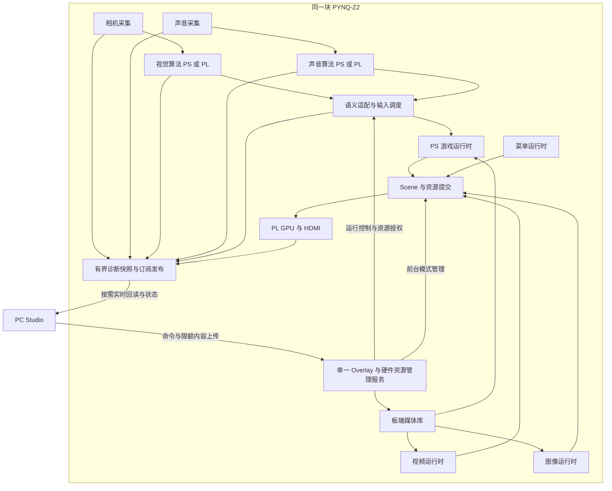

# 同板实时视觉、声音、游戏与 Studio 回读部署架构分析

| 项目 | 内容 |
| --- | --- |
| 文档类型 | 系统架构分析、团队交付与集成验收方案 |
| 当前路径 | `docs/same_board_multimodal_studio_integration_analysis.md` |
| 项目 | Voice View / PYNQ 多模态交互与上位机工作台 |
| 日期 | 2026-10-02 |
| 状态 | 产品目标已明确；算法接口待交付；整合 Overlay 与全链路并发待验收 |
| 目标平台 | PYNQ-Z2，`xc7z020clg400-1`；现有板端系统 PYNQ 3.1 |
| 当前工具与基线 | Vivado/Vitis 2026.1；C6I BUILD_ID `0xC0060700`；Game SDK 1.1；GPU ABI 1.0 |
| 本文执行范围 | 仓库与记录分析、目标设计建议；未构建硬件、访问板卡或改变现有软件 |

## 1. 已确定的产品目标

据此，系统应形成两个相互协作、独立调度的闭环：

1. **板端交互闭环**：真实采集 -> 视觉/声音算法 -> 语义输入 -> 游戏逻辑 -> GPU -> HDMI。Studio 接收速度不决定该闭环的运行速度。
2. **上位机控制与观察闭环**：Studio -> 内容构建、上传、安装、激活和运行控制；板端 -> 图像、波形、算法结果、事件、运行状态和诊断证据。

本方案将“部署视频、游戏、图像”解释为：三类内容可安装到板端媒体库，并按显示模式激活。GAME、VIDEO、IMAGE 共用 HDMI，首版采用单一前台显示模式；后台视觉和声音处理可以持续运行。游戏叠加视频、多窗口 HDMI、高清真彩显示和视频伴音是需要单独评审的扩展需求。

“游戏前台 + 视觉与声音后台 + Studio 同时观察并上传新内容”属于目标场景。媒体上传采用限额后台任务；新内容安装成功后，由显式切换命令决定是否替换当前前台内容。

建议增加“关闭 Studio、断开网线后，已启动的板端游戏继续运行”验收项，用来证明板端闭环独立。是否要求开机自动进入指定内容、自动恢复上次运行，另由产品策略确认。

## 2. 结论与架构方向

**推荐方案：下一代单一整合 Overlay + 单一硬件所有者 + 板端语义输入调度 + 分层订阅回传 + 统一媒体库。**

- 保留已验证的 C6I、游戏与相机实验产物，作为回归和恢复参照。
- 下一代 Overlay 合并必要采集与处理能力，采用新的 BUILD_ID；当前基线身份保持原样。
- 视觉与声音算法可分别部署在 PS、PL 或两者协同，具体位置依据队友实现和实测预算确定。
- 游戏继续在 PS 运行，消费语义输入并生成 Scene；PL GPU 负责正式 HDMI 游戏输出。
- Studio 获取真实算法后台数据，主要通过按需、限频的诊断副本；原始采集与算法主链路不依赖图形界面。
- 内容部署复用现有 staging、校验与安装机制，图像补齐编码、安装和显示链路。
- 网络 framing、算法 payload、GPU ABI、Game SDK、硬件身份分层管理，允许局部替换。

目前最值得投入的是交付接口、现场运行入口、真实输入录制回放、后台数据合同和资源预算。最终 BD 拓扑、DMA 数量、地址分配、时钟划分和算法寄存器应在实际交付后确定。

## 3. 仓库现状与证据边界

| 能力 | 2026-10-02 可依据的现状 | 对目标系统的影响 |
| --- | --- | --- |
| 游戏框架 | GamePlugin、Scene、VVG、headless 回归、部署前验证与逐 tick 报告已经接入 | 保留内容与测试层，在采集和运行模式处补真实输入 |
| 游戏运行 | PackagedGameRuntime 支持无测试用例的 live 路径；存在测试用例时忽略实时 `update` | Studio 需要显式区分现场游玩与确定性回放 |
| 声音游戏输入 | GameInput 接受 ToneSignal；旧 ControlState 中高低声字段没有自动转换为 ToneSignal | 对齐真实算法输出与玩法语义，补声音桥接 |
| C6I 回传 | PL 返回源生成 seed/byte-index 测试图样，已有 DMA 与网络回传记录 | 真实算法 producer、业务包边界和 decoder 仍需接入 |
| Studio DATA | 默认订阅 source 1/2，按 fixture source 路由；画布识别 fixture 图像、波形、频谱 | 增加真实能力发现、订阅与业务 decoder，避免固定来源假设 |
| 队列 | Agent 与 Studio 都采用按 source/channel 的有界 latest-wins 队列 | 保留预览策略；语义事件和可靠报告采用独立策略 |
| 视频 | S2V1 编码、上传、控制与 C6I 播放已有软件及板端记录 | 继续复用；和后台采集、算法、回传的并发另行验收 |
| 图像 | LibraryKind 已包含 IMAGE，底层库可保存图像类条目；Shell 显示入口为占位 | 文件入库基础可复用，专用内容验证、Studio 部署和 Image runtime 尚需补齐 |
| 相机 | 独立 OV5640 原型提供 1280x720 镜头 RGB/MJPEG，约十分钟受监护 PC 接收记录 | 与 C6I Overlay 互斥，需整合采集能力与帧分发 |
| 相机交付指标 | 7.93..7.98 fps 是单客户端 PC JPEG 解码到达率；HDMI 目视与长期电气适配待验收 | 单独测量传感器新帧率、算法结果率及最终交互延迟 |

最近全仓 `378 passed, 4 subtests passed` 与 Game2 的 76 tick asserted 报告属于上一轮软件框架验收；本次分析未重新运行该测试集。该证据覆盖已有软件合同，最终同板并发需要新板端记录。

当前 C6I source 3 的持续测试证明特定测试负载下的返回通路与清理能力；它既不是实时算法接入验收，也不是摄像头、声音、GPU 同时运行的总带宽测量。

历史架构文档中的阶段规划要结合最新代码与 bring-up 阅读，尤其是早期“尚待游戏上传”等条目。以具体版本、代码控制路径和最新事实记录为准。

## 4. 目标架构与模块所有权

### 4.1 总体数据流

图中模块是目标责任边界，箭头代表数据或控制关系，不是当前 BD、进程布局或最终 AXI 连接承诺。PL 算法可能直接消费流；PS 算法可能消费 DDR 帧，均通过适配器向同一语义层交付结果。

### 4.2 所有权合同

| 资源 | 推荐唯一所有者 | 消费者与约束 |
| --- | --- | --- |
| Overlay 下载、BUILD_ID 与生命周期 | 板端硬件资源管理服务 | Studio 和算法 worker 通过受控接口请求能力 |
| MMIO、DMA、时钟、复位配置 | 对应硬件驱动，由管理服务协调 | 队友独立脚本迁移为插件/worker，避免自行下载第二个 Overlay |
| 相机采集帧 | 采集模块与明确的缓冲管理器 | 算法、预览、录制取得有效快照或受控引用 |
| 音频采样块 | 声音采集模块 | 算法、波形显示、诊断录音独立消费，明确是否允许丢块 |
| 算法结果 | 算法模块 | 同时供语义适配与诊断发布使用 |
| 语义输入与事件序列 | 输入调度器 | 游戏 tick 消费；Studio 获得观察副本 |
| GPU Scene 提交 | 前台模式管理器授权的单一 runtime | MENU、GAME、VIDEO、IMAGE 之间交接，禁止多个提交者竞争 |
| 媒体安装事务 | 媒体库服务 | 上传过程不改变当前前台内容，激活单独执行 |

Python 对象、PYNQ buffer 和 MMIO 句柄的共享方式属于实现决策。跨进程传递必须明确有效期和释放责任；不能把一个 PYNQ 对象的裸引用视为通用 IPC 合同。

### 4.3 为什么需要整合 Overlay

当前相机与 C6I 使用不同完整 bitstream，加载另一套会替换现有 PL 设计。两套独立实验成功不能通过交替加载实现“同时运行”。

推荐复用 GPU、相机采集和声音采集中的必要模块，按实际算法接口形成单一整合设计。相机原型为观察而加入的 HDMI 显示链路不宜直接整套叠加；正式显示应优先由共享 GPU/显示后端统一管理。

如果声音队友的代码使用官方 Base Overlay 的 audio 对象，需要核对其依赖的音频接口、codec 配置和时钟是否进入整合设计。PS 算法运行位置与底层采集硬件依赖是两个问题。

## 5. 游戏输入与真实运行模式

### 5.1 三种模式显式分开

| 模式 | 输入来源 | 用途与报告 |
| --- | --- | --- |
| 现场游玩 | 当前真实视觉、声音结果 | 实时玩法，记录运行与输入质量；不产生确定性用例 PASS |
| 确定性回归 | GameTestCase 或已规范化的录制输入 | 固定 seed、逻辑时间与顺序，用于断言和逐 tick 对照 |
| 交互调试 | 人工注入、按键、临时参数 | 保留注入身份和来源；报告明确为 interactive |

当前测试模式隔离真实 `update` 是合理的测试规则。需要修改的是 Studio 对运行模式的选择和现场输入桥，而非简单删除隔离判断。

### 5.2 待确认的语义

- 视觉位置：相机坐标、ROI 坐标、镜像方向、纵横比例和无目标行为；映射到现有 GameInput 的 `[-1, 1]` 范围。
- 动作：算法输出持续握拳状态、动作概率还是单次事件；由明确规则产生事件，避免每帧重复触发。
- 声音：连续音高、能量状态、离散音调类别或其他事件；根据真实输出选择适配，避免把分类标签伪造为测得频率。
- 有效性：输入质量、置信度和最大允许年龄；失效时释放持续动作，防止断流后卡住。
- 会话：source 重启或算法重置产生新 epoch，序号在新会话重新建立基线，避免误拒绝新数据或触发旧事件。

若实际声音语义超出现有 ToneSignal 的表达范围，先评审输入扩展和 SDK 兼容方式，再更新玩法；硬件传输格式无需直接暴露到游戏 API。

### 5.3 多速率调度

游戏逻辑 tick、HDMI 刷新、相机新帧、算法结果与 Studio 绘图可以采用不同频率。游戏在每个 tick 消费最新且有效的状态，以及尚未消费的离散事件。

- 持续状态采用 latest-valid；视觉低频时可持有最近状态至有效期，任何预测/平滑都需明确标注。
- 离散事件采用有界队列、唯一 ID、去重和消费记录，定义同 tick 多事件的顺序及数量上限。
- 队列满时显式报告溢出并执行约定的安全策略，不能静默覆盖动作事件；有界策略也不承诺无限流量下零丢失。
- 对每个事件关联产生、接受、消费 tick，区别算法抖动、传输延迟和游戏消费问题。
- 逻辑超时记录 missed deadline；避免无限追赶历史 tick 挤占采集与控制线程。

现有通用显示缓冲的默认两秒 stale 阈值不能直接作为游戏输入有效期；游戏有效期由交互要求单独确定。

### 5.4 时间基准与录制

同一板端的过程延迟优先使用单调时钟，记录 capture、process-complete、publish、consume 和 render/present 关联信息。音频结果包含窗口起止及时间锚点，视觉结果包含对应输入帧身份。

PC 与 PYNQ 的单调时钟不能直接相减。跨机时标差需要明确同步误差；没有可信同步时，报告板端延迟、PC 本地绘图延迟和网络往返时间，不合并为精确的采集到显示延迟。

录制应保存两层数据：算法原始结果，以及语义适配后的游戏输入。可选保存有限的原始图像/音频片段，并关联 frame ID、sample range、event ID、算法配置与版本。规范化输入可用于 PC/PYNQ 回放；重新执行算法涉及浮点或并行差异时，按算法方确认的容差比较。

## 6. Studio 实时后台数据合同

### 6.1 应显示的数据

| 类别 | 首版建议视图 | 元数据与限制 |
| --- | --- | --- |
| 相机/视觉原始观察 | 限频镜头预览、ROI、输入质量 | 尺寸、像素格式、帧身份、采集时间；有损预览明确标注 |
| 图像处理过程 | 算法实际提供的灰度图、掩码、特征图或其他中间结果 | stage 名称、算法配置、输入帧关联；具体 stage 由视觉队友提供 |
| 视觉输出 | 位置、检测区域、动作、置信度、有效性 | 坐标系、来源、年龄、输出序号 |
| 声音波形 | 处理前/后波形，必要时 min/max 包络 | 采样率、通道、单位、样本范围；包络与原 PCM 区别显示 |
| 声音处理过程 | 算法实际提供的频谱、滤波结果、能量或其他特征 | 窗口、hop、频率轴、幅值尺度、版本 |
| 声音输出 | 音高或实际分类结果、置信度、活动状态与事件 | 输入窗口关联、事件序号、结果有效期 |
| 游戏消费 | 最新语义输入、动作接受/消费记录、游戏快照 | 游戏 tick、输入身份、包身份和运行模式 |
| 系统健康 | 算法率、丢帧/丢块、队列深度、CPU/RSS、DMA 错误、运行状态 | 当前会话与统计周期；历史数据和当前状态分开 |

“实时获取后台数据”要求数据来源真实且可关联，但不等于持续无损传回所有原始帧和完整采样。完整原始录制作为限时、限容量的诊断模式，事先检查资源。

### 6.2 控制、事件、预览与文件分别调度

| 数据面 | 建议处理方式 |
| --- | --- |
| 命令、错误与报告 | request ID、幂等结果、明确确认；失败可查询，避免被可丢队列覆盖 |
| 板端游戏语义事件 | 本地消费独立于网络；有界事件队列、去重、消费记录与显式溢出策略 |
| Studio 事件观察 | 有界序列日志、可见缺口与按范围查询；若要求完整记录，使用专门记录通路 |
| 图像、波形、频谱与持续状态 | 按 topic/source/channel 限额，latest-wins，累计 dropped/stale/out-of-order |
| 内容上传与诊断文件 | 分块、校验、断线恢复和字节/CPU/磁盘限额；不占用采集热路径 |

当前 Agent 的 DATA writer 与控制响应在同一连接上共享 send lock，大帧可能延后命令响应。建议先用现有协议建立独立控制/上传/预览连接或有公平性与分块约束的调度，并验证效果；无需为了并发目标立即更换 RPC 协议。多连接仍共享 CPU、网络与存储资源，因此也需要整体限额。

### 6.3 能力发现与订阅

握手后建议返回可用 source/topic、payload schema、数据类型、最大速率、可选阶段、当前版本及运行状态。source ID 数值和算法 payload 由交付评审确定，避免继续把 1/2 fixture 或 3 opaque 当作最终业务语义。

Studio 按实际能力订阅可见视图；切页或隐藏视图可降低频率、暂停昂贵诊断输出。诊断编码只在有订阅或录制需求时执行，游戏语义结果照常产生。

平台元数据建议包含 schema、epoch、sequence、来源身份、输入帧/样本范围、时间基准、配置版本和有效性。它们是交付讨论项，不是预先规定队友的 MMIO 寄存器或 AXIS payload 布局。

Qt 主线程只更新界面；网络接收、图像解码、文件校验和长任务在 worker 中完成。保留已有旧 worker 信号防护、会话重置与安全关闭机制，限制跨线程积压。

## 7. 视频、游戏、图像部署闭环

### 7.1 通用事务

目标路径：PC 准备内容 -> 本地验证 -> 分块上传至 staging -> 板端校验 -> 原子安装 -> 库目录回读 -> 显式激活/显示 -> 状态与运行证据回读。

内容身份由 item ID、长度、SHA-256、格式版本和兼容信息组成。安装成功不等于内容已运行；运行成功也需关联实际呈现与错误状态。

目标支持当前游戏运行时后台上传另一条目，但必须先验证磁盘空间、内存、CPU 与网络预算。安装临界区应短且有界，避免长期占住控制锁；大包解析与摘要计算不放在采集或显示线程。当前实现需逐项审查该并发能力，不能仅据独立部署成功推定。

同 ID 替换采用版本化安装或明确的活动条目保护。正在运行的内容持有稳定身份和有效文件引用；新版本验证失败保留旧版本。回滚需保留实际旧版本或可恢复产物，不能把安装过程的临时原子替换等同于长期历史回滚能力。

### 7.2 游戏

复用 VVG 双构建与 PC 测试门禁，安装后回读包身份。现场运行发送 live 模式，回归运行发送测试用例；两条路径共用内容身份校验，分别保存实时运行与确定性测试报告。

对于新 Overlay，复核游戏、库 manifest 和 Scene/资源提交中的硬件兼容信息；即使 GPU ABI 仍兼容，也需完成明确验证或重新构建元数据，不能绕过 BUILD_ID 检查。

### 7.3 视频

沿用现有 S2V1、PC 编码器和板端 runtime。现有显示合同为 320x180、30 fps 内容，通过 GPU 输出到 HDMI；物理 HDMI 720p60 不代表内容具有 1280x720 原生细节。

现有 S2V1 V1 为图像帧与 GPU 资源容器，不包含音轨。若需要视频伴音，另行设计解码、声音输出与同步；声音输入处理能力不自动提供伴音播放。

视频切换到前台时，视觉与声音后台继续运行。视觉动作此时是否控制菜单、控制视频或仅记录，由模式路由策略确认；不向已停止的游戏积压旧动作。

### 7.4 图像

底层媒体库已有 IMAGE 类型，目标仍需补齐以下链路：

1. PC 导入常用图片，处理尺寸、透明度、缩放和确定性量化，生成适合当前 GPU 的内容。
2. 保存源文件身份、编码参数、显示尺寸、Palette/Asset/Tilemap/Scene 资源以及兼容元数据。
3. 专用校验器检查格式、长度、哈希、资源预算与 generation，安装为 IMAGE 条目。
4. Image runtime 使用共享 sink 上传资源并提交静态 Scene，保持画面，接收显示/停止/切换命令。
5. Studio 回读库身份、当前 image ID、已呈现状态与错误，区分原图预览和硬件等价预览。

优先复用现有 INDEX4、tile、Scene compiler 和视频量化工具，避免为静态图片立即新增显示 RTL。单帧视频可以作为局部显示探针；正式交付仍应保持 IMAGE 语义、专用验证与显示状态。图像包扩展名与 schema 留待评审。

高分辨率/真彩原图 HDMI 显示超出当前 320x180 INDEX4 显示合同，需要单独的显示后端与资源评估；Studio 可以保留高分辨率原图观察。

### 7.5 前台与后台模式矩阵

| 前台模式 | 视觉/声音后台 | Studio 回读 | 内容安装 | 游戏事件去向 |
| --- | --- | --- | --- | --- |
| MENU | 运行或按策略降频 | 可订阅 | 限额允许 | 当前菜单；只处理符合菜单映射的输入 |
| GAME live | 持续真实运行 | 可订阅 | 限额允许，待压力验收 | 当前游戏消费 |
| GAME test | 可运行用于诊断 | 可订阅 | 限额允许，待压力验收 | 测试只消费回放，真实输入不进入断言链路 |
| VIDEO | 持续或按明确策略降频 | 可订阅 | 限额允许，待压力验收 | 视频/菜单或仅记录，按产品映射 |
| IMAGE | 持续或按明确策略降频 | 可订阅 | 限额允许，待压力验收 | 图像/菜单或仅记录，按产品映射 |

以上是目标矩阵。前台切换应等待当前提交/DMA 边界，清理旧模式事件与资源，建立新模式输入基线，再确认首帧。正常内容切换保留后台采集；只有硬件升级或故障恢复才重载 Overlay。

## 8. 并发资源与实时预算

### 8.1 预算对象

| 层面 | 必须收集的量 |
| --- | --- |
| PL | LUT、FF、BRAM、DSP、时钟资源、各域频率、WNS/WHS、DRC、CDC、复位关系 |
| DDR/AXI | 相机写入、算法读取、复制、GPU DMA、调试回传与各通路背压 |
| PS | 算法耗时分布、tick/Scene 开销、图像压缩、波形抽取、网络封包与 CPU 饱和情况 |
| 内存 | 相机池、音频环、worker、视频 reader、上传 staging、每客户端队列与峰值 RSS |
| 网络/存储 | 预览流量、上传限额、诊断录制速率、磁盘空间和持续写入影响 |
| 稳态 | 温度、错误计数、deadline miss、队列峰值、内存增长与恢复时间 |

### 8.2 可计算的示例

下列是格式预算，采用十进制 MB，不是最终板端实测或性能承诺：

$$
B_{\text{RGB}} = W \times H \times 3 \times f
$$

| 工作负载 | 字节预算 |
| --- | ---: |
| 1280x720 RGB24 单帧 | 2,764,800 B，约 2.76 MB |
| 1280x720 RGB24，30 新帧/s，单次全帧流量 | 82.944 MB/s |
| 1280x720 RGB24，60 新帧/s，单次全帧流量 | 165.888 MB/s |
| 假设 30 fps 下写入一次、算法全帧读一次、额外完整复制一次 | 约 331.776 MB/s DDR 字节交通；复制计一次读与一次写 |
| 48 kHz、16 bit、单声道 PCM | 96,000 B/s；实际位宽、通道和采样率由声音交付确定 |
| 现有 S2V1 30 fps Asset+Scene | 约 1,051,710 B/s，另有 Palette 与启动/seek 的 Tilemap |

PS 算法还可能产生更多中间结果；PL 流式处理可能减少 DDR 读取。RGB 示例不能直接套用到 Bayer RAW、RGB565 或其他格式。JPEG/压缩流量取决于内容和质量，CPU 代价需单独实测。

上述 RGB 60 fps 原始流量已超过千兆以太网约 125 MB/s 的理论字节上限，实际可用吞吐更低。优先发送语义结果和按需缩小的诊断视图，而非把全尺寸原始图像常态化推回 PC。

历史 C4M7 的利用率和时序只作为该 GPU 基线证据。新增算法 IP 的独立综合报告也不能证明最终整合设计的余量、时序和总线并发；以整合后的实现与板端压力结果为准。

### 8.3 指标草案与测量定义

| 指标 | 首轮讨论目标 | 测量边界 |
| --- | --- | --- |
| 游戏逻辑 tick | 60 Hz | tick 执行率与 deadline miss；与 HDMI 刷新率分开 |
| HDMI | 沿用当前 720p60 模式 | 同时记录实际新内容 present 率和重复帧情况 |
| 有效视觉结果 | 建议至少 10 Hz | 新输入身份对应的有效算法结果率，不用 PC 预览 fps 代替 |
| 声音结果 | 建议至少 20 Hz | 与 hop/窗口要求共同确认；音频采样连续性另计 |
| 输入到游戏呈现 | 建议 P95 不高于 200 ms | 声音从约定窗口锚点计；present 软件时间与物理屏幕延迟区分 |
| Studio 图像预览 | 建议至少 5 fps | 订阅、解码和界面新画面率，同时记录年龄与丢帧 |
| Studio 波形/频谱绘图 | 建议 10 次/s | 显示刷新率，保持采样率/窗口标签，避免混淆 |
| 带上传压力的普通控制响应 | 建议 P95 不高于 300 ms | 接收确认与长任务完成分开计时 |

这些值是建议，不是已达成指标或当前正式门禁。最终还需明确 P99/最大延迟、连续事件丢失策略与稳定性时长。Linux/Python 路径按软实时系统设计，避免承诺每次 tick 均具有硬实时保证。

## 9. 相机、声音与硬件接口的优先风险

1. **相机电气条件**：当前实验记录保留 XCLK/SCCB 推荐电压适配待验收。先完成安全的长期接口方案，再安排长稳态；沿用最新实物映射，不复用已撤销的历史针表。
2. **相机帧寿命**：独立原型曾出现原生崩溃；已验证路径采用隔离显示帧、CPU 快照与受控采集引用。整合后重新定义 lease/归还边界，任何诊断消费者都不能读取已回收的帧。
3. **多消费者**：目前相机 HTTP 服务单客户端。最终相机只采集一份数据，由帧分发器供算法、预览和录制；增加并发 HTTP handler 本身不能解决缓冲所有权。
4. **声音采集质量**：此前麦克风仅读到底噪缺少现场代码与 raw 数据。声音队友先交有效 PCM/WAV、输入选择和信号变化证据，再验算法；采集接口与 codec 时钟纳入整合。
5. **AXIS/MMIO 合同**：交付位宽、字节顺序、TLAST/TKEEP、背压、包最大长度、复位语义；寄存器结果需一致快照机制。最终控制地址由集成工程分配。
6. **整合复位与时钟**：列出 camera PCLK、音频时钟、算法/GPU/AXI 时钟域，检查 CDC、跨域缓冲与复位释放顺序。普通内容切换不随意复位采集域。

## 10. 两位队友的分阶段交付

### 10.1 共同交付内容

| 项目 | 最小交付 |
| --- | --- |
| 身份 | 版本/提交、运行命令、依赖、配置、输入与产物哈希 |
| reference | 可运行离线实现、真实样例输入、expected 输出及比较容差 |
| 输入 | 格式、分辨率/采样率、时间基准、采集依赖与输入有效性 |
| 输出 | 实际字段样例、单位、坐标/类别含义、输出频率、失效行为 |
| 事件 | 持续状态或边沿、序列身份、开始/结束、重启与取消行为 |
| 性能 | 耗时分布、内存/CPU；PL 路径附资源、时钟、综合与实现报告 |
| 硬件 | IP/驱动、时钟、复位、寄存器或流协议、DMA/缓存需求 |
| 诊断 | 可提供的处理阶段、波形/图像类型、诊断开启时的额外开销 |
| 验收 | 成功与失败样例、噪声/无目标样例、边界条件和可复现脚本 |

先约定语义与示例，再冻结传输与寄存器。建议提供正常、无信号/无目标、短时突发三类样例，让集成方提前验证状态与事件规则。

### 10.2 视觉专项

确认 RGB/RAW、RGB/BGR、stride、分辨率、ROI、镜像与坐标映射；新帧身份与结果关联；置信度、目标丢失和多目标规则；算法部署位置；实际可提供的中间图；采集缓冲生命周期。

当前 MJPEG RGB 可以支持合适的离线原型，但算法若需要无损像素、RAW 或更高新帧率，应明确独立输入接口，避免把预览协议当作最终算法采集 ABI。

### 10.3 声音专项

确认实际输入端口与 codec 设置、通道、PCM 符号/有效位/封装、采样连续性、窗口与 hop；输出是音高、能量、类别还是事件；时间锚点、噪声处理和无信号行为；诊断波形单位与频谱归一化方式。

先使用已知输入取得可听或可分析的 raw WAV，并提交峰值/RMS、样本变化与溢出情况。所用采集代码若加载 Base Overlay，列出迁移到整合 Overlay 所需的硬件与软件依赖。

### 10.4 里程碑

| 交付阶段 | 队友交付 | 集成方可开展的工作 |
| --- | --- | --- |
| D0 接口草案 | 输入/输出样例、部署位置、采集依赖 | 语义评审、诊断 topic 设计、资源表 |
| D1 离线 reference | 可运行代码、样例、golden/容差 | 真实输出回放、适配器测试 |
| D2 独立板端 | 采集与算法运行、状态与诊断证据 | 单路 live 接入、缓冲/时间基准验证 |
| D3 硬件可集成 | IP/驱动、完整协议、时钟/资源报告 | 整合 BD、后端与 capability manifest |
| D4 联合验收 | 两路同时工作、压力与恢复记录 | 完整游戏、Studio 与媒体部署验收 |

D0/D1 应早于“算法全部优化完成”。PS 实现没有自定义算法 IP 时，D3 仍需交采集硬件、驱动和实际 CPU/内存预算。

## 11. 版本、启动、故障与恢复

### 11.1 兼容性与可恢复基线

分别记录硬件 BUILD_ID、bit/HWH 哈希、GPU/Scene ABI、Game SDK、网络 envelope、算法 payload schema、算法版本/配置和内容身份。

下一代整合 Overlay 使用新身份，保留当前已验证产物与匹配软件。兼容矩阵说明每类内容在哪个后端可运行，迁移由明确验证支持；能力发现允许不同后端暴露不同的 source 和 stage。

### 11.2 生命周期

启动顺序建议为：PYNQ 启动清理完成 -> 取得唯一所有权 -> 加载并核对硬件 -> 配置外设/采集与算法 -> 初始化显示 -> 发布 READY 和能力 -> 接受内容运行与订阅。

沿用已有经验，服务排序须考虑 `bootpy.service` 和 `clear_pl_statefile.service`。网络端口可监听与全部能力 READY 应有独立状态；初始化失败返回明确原因，不向 Studio 暴露“可运行”假象。

停止按生产者、算法/调度、前台提交、网络发布与驱动资源的依赖顺序收敛，明确每步 deadline、join 与 DMA Halted/错误检查，最后释放 session 和锁。

### 11.3 故障隔离

| 故障 | 目标响应 |
| --- | --- |
| Studio 断线或预览慢 | 结束/降级订阅，板端交互继续，记录丢弃与会话变化 |
| 单路算法超龄 | 释放对应持续动作，游戏按约定缺输入策略运行，报告来源失效 |
| CPU 算法 worker 异常 | 若硬件状态安全，隔离并重启该 worker，重建 epoch 与输入基线 |
| 事件队列溢出 | 显式记录缺口/故障，执行约定安全策略，不伪装完整输入 |
| DMA/共享硬件错误 | 停止受影响生产者与提交，进入故障态；依据状态决定局部或整体恢复 |
| 原生崩溃 | 外部监督器处理进程退出与 DMA 清理；不依赖崩溃进程的 finally |
| 上传/安装失败 | 保持当前有效内容，回读失败原因与事务状态 |
| 新前台启动失败 | 回到已验证安全显示状态或保留可恢复前台，避免残留两个提交者 |

监督器清理必须核对当前 Overlay 身份和匹配的资源描述，避免按旧 bitstream 的地址写入新硬件。恢复与重载只能由所有权管理服务执行。

## 12. 实施顺序与现在应做的工作

| 优先级 | 工作 | 完成条件 | 依赖 |
| --- | --- | --- | --- |
| P0 | 三方接口评审与交付清单 | D0 输出样例、部署位置、采集依赖和责任人明确 | 两位队友提供最小信息 |
| P0 | 现场/测试/调试模式分离 | 同包三种输入模式明确，测试隔离保持 | 可先实现软件边界 |
| P0 | 输入与真实结果录制方案 | 两层记录、epoch/序列、有效期、消费规则可回放 | 样例决定实际字段 |
| P0 | 声音 raw 与相机长期接口门禁 | 有有效采集证据，安全条件明确 | 队友与现场确认 |
| P1 | 实际语义适配器 | 两路 reference 输出分别驱动游戏 | D1 与确认后的语义 |
| P1 | Studio topic/decoder 与按需订阅 | 图像处理阶段、波形/频谱来源真实可关联 | 真实输出与诊断列表 |
| P1 | IMAGE 部署与显示 | 编码/验证/安装/回读/首帧闭合 | 可复用现有 GPU，先软件与 fake sink |
| P1 | 资源与并发预算 | PS/PL、内存、DDR、网络和显示所有权有表 | D1/D2，PL 路径需要 D3 |
| P2 | 下一代单一 Overlay | 实现与硬件门禁通过，匹配驱动和新身份 | 稳定的采集与算法接口 |
| P2 | 全链路与后台上传压力验收 | 两路算法、游戏、Studio 和内容安装同时通过 | 整合系统 |
| P3 | 发布、运维与恢复 | 冷启动、诊断包、兼容矩阵、回滚和长期验收 | 联合门禁通过 |

等待期间优先推进 P0 和可独立验证的 P1。暂停大量新游戏模板、纯视觉装修、猜测式 MMIO/AXIS 适配和没有预算的最终 BD 构建。上述安排保留现有成果，并让后续变动集中在明确边界内。

## 13. 验收矩阵与证据要求

| 阶段 | 实施场景 | 必须保存的证据 |
| --- | --- | --- |
| A 基线 | 当前 GPU、游戏、视频和返回测试分别回归 | 匹配版本、哈希、命令、报告与恢复路径 |
| B 离线语义 | 两路真实 reference/结果文件驱动游戏 | 输入输出身份、映射结果、断言与首次分歧 |
| C 单路 live | 真视觉+模拟声音；真声音+模拟视觉 | 新鲜度、消费记录、失效释放、恢复与采集质量 |
| D 同板核心 | 真视觉+真声音+游戏，同一整合 Overlay | BUILD_ID、资源/时序、CPU/内存、输入率、呈现率与延迟 |
| E Studio 回读 | D 场景下同时看图像处理阶段、波形、频谱与事件 | topic/schema、源关联、显示率、队列峰值、丢弃与控制延迟 |
| F 内容并发 | E 场景下上传并安装视频、游戏、图像 | 当前游戏继续、内容身份正确、失败保持旧内容、资源与 deadline |
| G 模式切换 | GAME/MENU/VIDEO/IMAGE 来回切换，后台采集持续 | 单一提交者、资源 generation、首帧、旧事件清理与后台连续性 |
| H 恢复与稳态 | 断网重连、算法停流/重启、上传中断、服务重启、正式冷启动与持续运行 | 明确故障/恢复时序、无失控动作、端口/锁/缓冲收敛、温度与错误统计 |

首轮建议在安全条件满足后开展 30 分钟受监护并发测试，并把多次重启、模式切换和部署次数写入正式验收配置。此前相机十分钟记录不代替该整合测试；更长时长依据温度、资源和产品要求逐步增加。

每次真实硬件构建或上板结果写入对应 bring-up，保留完整命令、退出码、原始日志、bit/HWH/软件/内容哈希、测试时长和限制。失败先记录再修改，恢复后重跑相同门禁。

PC/fake sink 证明软件合同；DMA/renderer/present 状态证明板端部分链路；现场 HDMI 观察证明实际显示。自动软件 PASS 和硬件验收状态分别记录。

## 14. 需要评审后冻结的决策

| 决策 | 推荐方向 | 冻结所需输入 |
| --- | --- | --- |
| 算法运行位置 | 单板 PS/PL 按预算组合，PC 作为开发与观察端 | 实际算法、采集依赖和耗时/资源 |
| 声音控制语义 | 按真实输出桥接，必要时版本化扩展 GameInput | 声音样例与玩法映射 |
| 输入最大年龄与事件顺序 | 按来源与模式分别定义，失效安全释放 | 交互体验与算法节拍 |
| Studio 诊断范围 | 必需视图优先，昂贵中间结果按需开启 | 两位队友的真实 stage 列表 |
| 图像显示质量 | 首版复用 320x180 GPU，提供硬件等价预览 | 用户对静态图像清晰度的要求 |
| 回传连接与限额 | 保留协议、隔离优先级、限制大流量 | 延迟测试、CPU/网络预算 |
| DMA/地址/时钟拓扑 | 集成后统一分配并验收 | D3 协议、资源、CDC 与并发需求 |
| 显示模式输入路由 | GAME 消费游戏事件，其他模式明确映射 | 菜单、视频、图像的操作要求 |
| 自动启动与恢复 | 独立定义策略与服务排序 | 产品使用流程与安全状态 |

本文不冻结尚未交付的算法寄存器、source ID、payload 格式、最终 BD 或性能阈值。评审后的决定应写入版本化接口文档，并由测试与 capability manifest 共同落实。

## 15. 代码与记录索引

| 证据入口 | 用途 |
| --- | --- |
| [Studio 阶段与验收](voice_view_studio_stage_plan.md) | 最新游戏框架、UI、通信和视频阶段证据 |
| [OV5640 接入记录入口](ov5640_pynq_z2_integration.md) | 页首当前相机状态、帧所有权、电气与 Overlay 边界 |
| [相机完整 bring-up](bringup/2026-10-01_pynq-z2_camera_direct_plug.md) | 镜头原型、失败尝试、最新布局与受监护验证 |
| [C6I Agent bring-up](bringup/2026-09-29_pynq-z2_studio-s3.md) | 返回流、身份与持续测试的板端事实 |
| [C5 范围调整](bringup/2026-09-27_pynq-z2_c5.md) | 真实输入接口由队友交付后适配的已有边界 |
| [S2V1 格式](s2v1_video_format.md) | 视频内容、资源预算、量化与显示合同 |
| [Game SDK](../python/pynq_multimodal_game/game_sdk.py) | GameInput、ToneSignal、插件合同 |
| [共享游戏验证](../python/pynq_multimodal_game/game_validation.py) | 回放、报告、对照和构建门禁 |
| [板端游戏运行时](../python/pynq_multimodal_game/agent/game_runtime.py) | live/test 输入与运行路径 |
| [Shell 运行时](../python/pynq_multimodal_game/agent/c6i_shell.py) | 模式、共享 sink、游戏/视频和图像占位 |
| [媒体库](../python/pynq_multimodal_game/library.py) | GAME/VIDEO/IMAGE 分类、身份与 staging 安装 |
| [Agent transport](../python/pynq_multimodal_game/agent/transport.py) | DATA 队列、订阅、控制响应与发送锁 |
| [Studio 缓冲](../python/pynq_multimodal_game/streaming.py) | latest-wins、过期、乱序与 fixture 解码 |
| [Studio 游戏部署](../python/pynq_multimodal_game/studio/game_workspace.py) | PC 门禁、测试启动和运行报告 |
| [Studio 接收路由](../python/pynq_multimodal_game/studio/main_window.py) | fixture source 路由与会话处理 |
| [Studio 数据画布](../python/pynq_multimodal_game/studio/workspaces.py) | 图像/声音 fixture、相机 worker 与显示边界 |
| [C6I 返回 backend](../python/pynq_multimodal_game/agent/c6i_backend.py) | 唯一 session、DMA 缓冲与返回测试控制 |
| [PL 返回测试源](../rtl/scene2d_gpu/scene2d_return_source.sv) | seed/byte-index 图样与 AXIS 测试 |
| [Render Agent 专项参考](../xilinx-skill/plugins/xilinx-suite/references/pynq_render_agent.md) | 已验证的所有权、协议、队列与生命周期经验 |

**执行结论**：先取得两位队友的 D0/D1 交付，补现场模式、语义适配与真实录制回放，建立真实后台视图和图像部署闭环；再依据实际采集、算法和资源需求构建单一整合 Overlay。最终以“两路算法 + 游戏 + Studio 回读 + 限额后台内容安装”的同时运行证据闭合产品目标。
