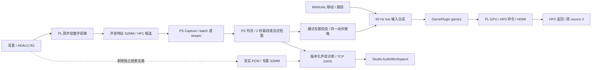

# 声音先行融合方案：PL 预处理、PS 游戏输入与 Studio 分析

2026-10-05优先级更新：当前主工程先完成[视觉Studio–PS–PL闭环](vision_first_studio_ps_pl_plan.md)，声音暂缓接入。本文保留原声音改进与阶段门禁，待视觉闭环及初步稳定性验收后继续评审。

## 1. 文档身份与范围

- 日期：2026-10-05。
- 状态：实施中；P0 PARTIAL、P1 ACTIVE。2026.1原生迁移已开展，合并Overlay与真实游戏联调留在后续阶段。
- 主工程：`E:/projects/fpga/voice-view-game`。
- 声音基线：并列 `E:/projects/fpga/voice_2s_20261005`，来自提交 `351caf8a31eec072275d18022f28aae6c7b35596` 的交接目录。
- 界面参考：并列 `E:/projects/fpga/Audio Analyzer`，只读研究。
- 目标：视觉算法尚未接入时，用手动移动/跳跃和真实声音完成 game1 闭环；声音触发以实时性为第一优先，先验收 1 秒内，再争取 0.5 秒内，资源配置以给未来视觉处理留下足够余量为约束；同时在上位机展示有来源、有时间戳的声音分析。
- 修改边界：只读保留队友交接、冻结模型/bit/HWH；在隔离声音副本迁移2026.1工具入口与构建调用，现有算法RTL、Agent、Studio和游戏规则保持原样。

## 2. 结论与接入顺序

建议采用“独立声音复验 -> 2026.1 数值迁移 -> 实时优先的流式短窗验证 -> 单 Overlay 合并 -> game1 live 接入 -> PCM 可视化扩展”的路线。分类摘要界面可与硬件迁移并行准备。队友已验证的 2 秒 attack/shield/none 分类器、模型和制品保留为复验及回退基线；game1 的主目标调整为复用同一 PL 前端、由 PS 短窗识别驱动的快速命令模式。游戏使用 MANUAL 移动/跳跃和 REAL 声音，视觉缺席保持明确可见。

三种能力分别验收：

| 能力 | 当前交接支持 | 首次接入安排 |
| --- | --- | --- |
| 声音类别控制 | 485 条 PL 特征完成后 PS 分类；attack 单 tick，shield 接收后最多保持 5 秒 | 2 秒模式复验/回退；流式短窗模式独立验收 1 秒及 0.5 秒目标 |
| 声音分析 | 功率、过零率、频带幅度摘要、质心相关量、聚合特征及判决理由 | 基线显示批次诊断；流式模式增量显示真实特征趋势 |
| 原始波形、逐 bin 频谱、连续声活动 | 交接数据出口只提供特征摘要 | 增加真实 PCM 观察支路后逐项验收 |

融合可行性判断：现有每 4 ms 形成的特征记录足以作为短窗识别输入候选，复用 FIR/FFT/CORDIC 并改采集末端及 PS 判决，是亚秒触发的初始实现路径。1 秒为基本验收档，0.5 秒为短前缀可分辨且识别质量达标后的增强档；在识别质量、故障安全、GPU 合同和视觉资源预留满足的候选中，优先选择端到端延迟更低、更稳定的配置，再优化资源占用。缓存深度、并行逻辑和调度隔离可为实时性调整，不以固定 BRAM 数量限定声音方案。当前材料足以制定实施方案，尚无合并资源、整机延迟和真人 HDMI 闭环的实测数据。资源比较口径及快速路径见 6.4、7.4 和 12.4。

## 3. 已核实的软件与硬件事实

| 代码位置 | 直接观察 | 接入含义 |
| --- | --- | --- |
| 声音 `integration/voice_bridge.py` | 识别结果转换为 attack 单 tick 脉冲和从接收时刻计时的 5 秒 shield；220/1200 为兼容语义值 | 首个正式目标为 game1/C1 控制；显示声音类别和策略状态，频率读数取实际测量来源 |
| 声音 `integration/safe_voice_capture.py` | 外部传入唯一 Overlay；每批分配 `485 * 8` 个 uint64；轮询专属 S2MM 状态并交给分类器 | 已有 31040 字节特征批次的采集边界；原始波形需要独立、明确的数据出口 |
| 主工程 `agent/game_runtime.py` | `update()` 仅在 `_test_case is None` 时更新常规控制；启动有用例时优先消费共享回放 | REAL 声音接入需要明确 live 启动、tick 输入合成和与回归隔离的来源合同 |

### 3.1 PL 数字前端

实际声音链为 Codec 左声道 I2S -> 异步 FIFO -> PCM FIFO -> DC blocker -> 1201 tap Q17 FIR / 六倍抽取 -> 8 kHz 分帧 -> 每帧去均值 -> Hamming -> 512 点定点 FFT -> CORDIC 幅度 -> 时间/频谱特征合并 -> 64 bit AXIS -> 批次捕获 -> S2MM。

| 参数 | 源码值/约束 | 含义 |
| --- | --- | --- |
| 输入 | 48 kHz 设计合同，24 bit I2S 取高 16 bit，32 bit slot，左声道 | 实际 LRCLK 和 Codec 配置仍需板端核验 |
| FIR | 1201 tap，Q17 系数，抽取相位 0，输出为 18 bit Q15 | 系数、饱和、舍入、初始零历史属于数值合同 |
| 算法 / AXI 时钟 | FCLK1 40 MHz / FCLK0 100 MHz | 原工程已有 AXIS clock converter 和分域复位 |
| 帧长 / 步进 | 512 / 32 个 8 kHz 样本 | 64 ms 窗、4 ms 帧间隔，重叠率 93.75% |
| 特征记录 | 8 个 uint64，64 字节，小端 | RECORD_VERSION=1，frame_start_8k、phase/status 和各特征 |
| 2 秒批次 | 485 条，3880 个 uint64，31040 字节 | 构建脚本显式传入 485；wrapper 默认 985 |
| DMA | AXI DMA 7.1，simple S2MM，SG=0、MM2S=0、64 bit AXIS、23 bit 长度 | 31040 字节接收容量、实际长度、最终 TLAST 均需一致 |
| Codec | ADAU1761，IIC1 EMIO，10 MHz MCLK | 独立声音工程负责时钟主控；合并后保留唯一配置者 |

记录包含帧功率、过零率、80-300 / 300-800 / 800-2000 / 2000-4000 Hz 四段幅度和、总幅度及加权 bin 幅度和。加权和可计算频谱质心；它不提供峰值 bin、原始 PCM 或完整频谱。频带量是幅度和，界面应标为“频带幅度/比例”，功率曲线使用对应均方量。

FIR 串行 MAC 约 1201 拍，40 MHz 下约 30.03 us，小于 8 kHz 输出周期 125 us；它超过原始 48 kHz 输入周期约 20.83 us，因此 PCM FIFO 是必要结构。该计算说明设计吞吐有依据，FFT/CORDIC 的实际阻塞、FIFO 高水位和帧调度仍需联合验证。帧调度只保留有限 pending 状态，长时间反压会消耗其余量。

当前 capture_enable 同时控制算法复位，每批重新建立 FIR/帧状态；批末刻意反压并等待 PS 清 enable。原链适合独立批次，连续无缝录音需另外建立合同，批间空隙和起始瞬态应在记录中可见。

快速候选保留上述数字前端和 64 字节记录布局，另定义持续运行、短包 TLAST、跨包序号及健康状态。原解析器可以解析任意非空整记录数量，但只检查包内连续性；流式接收器还须校验前包末帧到后包首帧的步进、会话复位和计数回绕。旧 485 条整批健康条件仍属于原基线合同。

### 3.2 PS 分类与策略

模型版本为 `pynq-pl-feature-ps-v2.1`。PS 将整批帧记录聚合成 13 个基础特征和 2 个稳定性特征，进行尺度归一化的类中心距离比较，再应用 attack/shield 门限及 shield 持续性、频带/质心稳定性门限。整批 RMS 归一化、片段数和最长活动段等依赖整个录音窗口，直接减少批次长度会改变模型输入分布。

分类结果中的 ratio 是“命令类距离 / none 类距离”，gate_ratio 是门限，两者均为判决诊断值。界面显示距离、门限、拒绝理由；百分比置信度需要另行校准。1200 / 220 Hz 是 SDK attack/shield 的兼容语义值，实测音高字段应从独立频谱或音高估计器产生。

桥接默认值：shield_hold_ms=5000、stale_ms=3000、event_max_age_ms=500、队列容量 16。健康批次需 485 条、batch_done=True、PL 无错误。healthy none 保持已有 shield 但不续时；新 shield 从结果接收时刻重计 5 秒；举盾期间 attack 丢弃；过期事件丢弃；溢出或失效清除动作。5 秒策略成立需要后续健康批次持续到达，否则 3 秒 stale 会提前收盾。

`VoiceInputService` 将有界 capture/classify 放入后台线程，REAL 必须携带模型 SHA；失败提交失效状态并停服务。诊断队列容量 32，有丢弃计数。`game_dispatched=False` 表示服务没有直接操作游戏，实际游戏消费需要独立 ACK。

## 4. 总体结构与唯一硬件所有者



合并部署使用单 PS、单 bit/HWH、单 Agent Overlay 所有者。声音 capture 只接收受限 Overlay/DMA/control 句柄，Codec 配置也由所有者编排；游戏线程、Studio、声音 worker 和独立交接脚本均不另行重配置 PL。

网络和 Studio 仅负责命令、订阅和呈现。声音分类到游戏的主路径留在 PYNQ PS，PC 断线不引入分类经网络往返的依赖。PC 手动移动失联后执行有界 TTL -> 中立输入；声音是否继续由启动时的 headless policy 决定，并在状态中公开。明确 stop 始终停止动作与采集；分析窗口暂停只冻结视图。

## 5. Vivado 2024.1 -> 2026.1 迁移

### 5.1 两条基线与升级依据

原 2024.1 bit/HWH/模型为只读 golden，当前游戏冻结 C6I 为 BUILD_ID `0xC0060700`；P4 `0xC0060760` 是另一个优化实验身份。首轮合并以冻结 C6I 为对象，避免同时引入声音迁移与 GPU 优化的两组变量。新合并产物另分配 BUILD_ID 和 voice capability，Scene ABI/GameSDK 的兼容性单独验证。

板端镜像版本目前只有用户报告的 PYNQ 3.1 信息；SafeVoiceCapture 的设计说明引用 PYNQ 3.0.1 simple-S2MM 驱动行为，并使用驱动内部通道/状态细节。实施时须记录实际镜像、PYNQ、Python、音频及 DMA 驱动版本，验证 HWH 绑定、通道状态、缓存一致性与异常停止，保留 PC 项目 Python 3.10 底线和实际板端解释器兼容门禁。

AMD UG896 明确：升级 IP 会删除原输出产物/DCP，升级前须归档并检查 IP 状态；旧 IP 若已有完整输出产物存在保留使用的条件。该条件不等于本包已具备跨版可用 DCP，本包的 FFT/CORDIC 由源码 Tcl 重新生成。UG994 建议另存工程、查看变更并选择升级；UG1118 提醒自定义 IP 的 AMD 子核也可能锁定。采用源码重建和数值门禁，比直接覆盖交接工程更便于回退。

交接重建入口默认只接受 2024.1，`VOICE_ALLOW_UNVALIDATED_TOOL=1` 仅许可显式迁移试验。2026.1 创建新工程成功只说明结构可生成，随后仍需功能、定点数值、时序、驱动和板端验收。迁移失败时保留失败日志及 golden，在独立声音诊断模式继续排查；将 GPU 降回 2024.1 属于额外兼容性工作，需另行批准。

当前迁移使用明确要求2026.1的[生成入口](../board/pynq_z2/scripts/voice_p1_prepare.tcl)、[仿真入口](../board/pynq_z2/scripts/voice_p1_simulate.tcl)与[受控构建入口](../board/pynq_z2/scripts/voice_p1_build.tcl)，无需旧版本绕过变量。新副本位于E:/vvgvoice/p1_native26；原交接76项身份已复核不变。创建副本仅移除2026.1只读的GP0/HP0频率提示参数写入，保留100/40/10MHz及原HP0/地址合同。实际执行与警告记录见[P1事实记录](bringup/2026-10-05_pynq-z2_voice_p1.md)，构建通过与完整数值/实板通过分别登记。

### 5.2 必查项目与数值门禁

| 对象 | 比较项目 | 通过证据 |
| --- | --- | --- |
| FFT 9.1 | 512 点、18 bit 输入/相位、natural order、scaled、convergent rounding、动态 config/scaling schedule、握手/TLAST | 同固定 PCM 的输出顺序、尺度、舍入与状态逐项对照 |
| CORDIC 6.0 | Translate、Parallel、18 -> 24 bit、Nearest_Even、TLAST 传播及有效布局 | magnitude 和其特征累计与 golden 对照 |
| FIR / Hamming | .mem SHA、相对路径、ROM/BRAM 推断、抽取相位、复位初态 | 首帧及所有后续帧索引、整数功率/频带量对照 |
| BD / CDC | 40/100 MHz、I2S 异步入口、状态同步、复位释放、clock converter | 综合/实现时序、CDC、DRC、methodology 和恢复测试 |
| DMA / 驱动 | simple mode、23 bit BTT、64 bit、缓存 invalidate、实际长度、HWH 字段 | 485 条、31040 字节、TLAST 和重复采集一致 |
| Codec / 板端 | 实际采样率、左声道、MIC 选择、增益、MCLK/PLL、PYNQ/驱动版本 | 版本清单、采样计数/时钟测量、输入状态和真实声音记录 |
| 模型 | 同 SHA、同聚合特征、同 ratio/gates/label/rejected_by | 测试向量对照与真人独立复验 |

优先整数特征逐记录一致；若工具产生数值差异，先定位尺度/舍入/IP 配置，再由双方明确误差预算及判决边界用例。训练音频未随包交付，需队友提供可授权固定向量或整数 golden；当前 47 项策略/SDK 测试覆盖不到前端数值迁移。历史零频谱问题的根因仍需专项闭合，以全零记录、错误状态、FIFO/FFT 握手与复位时序作为排障证据。

FFT 创建脚本的 target_clock_frequency/target_data_throughput 为 100，而实际 BD 算法域为 40 MHz；生成提示与实际工作时钟分别记录，吞吐/阻塞验证按 40 MHz 的真实时钟合同执行。

## 6. PL 合并规划

### 6.1 地址、HP 与控制互联

声音 HWH 实际地址与候选新地址如下；候选须由完整 BD address map 校验后冻结。

| IP | 独立声音地址 | 合并候选 | 合并约束 |
| --- | --- | --- | --- |
| voice_feature_dma | 0x40400000-0x4040FFFF | 0x40420000，64 KiB | 旧地址与 GPU 命令 DMA 冲突 |
| voice_control | 0x41200000-0x4120FFFF | 0x41400000，64 KiB | 旧地址与 GPU BUILD_ID GPIO 冲突 |
| audio_codec_ctrl_0 | 0x43C00000-0x43C0FFFF | 0x41410000，64 KiB | 用合并 HWH 名称/地址注册驱动 |
| 后续 PCM DMA | 新模块 | 0x40430000，64 KiB 预留 | 仅 PCM 阶段使用，仍需冲突审计 |

GPU HP0/MM2S、HP2/S2MM 和原 source 3 保持。声音 feature DMA 从原 HP0 改走 HP1，独立内存互联；未来 PCM DMA 可作为 HP1 的另一个受限 master。HP1 的独立入口减少端口竞争，DDR 控制器和总线资源仍由各业务共享。

GP0 建议新增一个声音子互联入口，子互联接 codec、feature DMA、GPIO，后续扩 PCM 控制面；检查当前主互联 NUM_MI 和当前版本支持范围，避免无规划堆叠出口。HWH、驱动绑定、能力表、地址清单和 bit 必须作为一组版本化产物。

### 6.2 时钟、复位与管脚

当前 GPU 构建显式关闭 FCLK1、IIC1/EMIO；合并需重新启用声音 40 MHz 和 Codec IIC1，同时保持 GPU 100 MHz 与 74.25 MHz 像素时钟。10 MHz MCLK 使用独立 Clocking Wizard 或经过时钟报告验证的共享资源方案；保留音频与 GPU 各自的域内复位。

声音现有 XDC 管脚为 U9/T9（IIC）、U5（MCLK）、R18/T17（BCLK/LRCLK）、G18/F17（输出/输入数据）、M17/M18（Codec 地址）。当前 HDMI 的 L17/L16/K18/K17/J19/K19/H18/J18 和按钮开关 D19/D20/L20/L19/M20/M19 与这九个管脚无重复。该静态比较只覆盖当前声音、HDMI、按钮开关约束；最终 top 的 Bank、电气、时钟和摄像头配置以全量 DRC 为准。

音频 XDC 已将 FCLK0/FCLK1 声明异步，GPU XDC 已将渲染/像素域声明异步。合并保留真实跨域结构并检查 clock 名称匹配、遗漏同步器和过宽例外；时序例外必须对应实际 CDC，不能以例外覆盖未同步数据。

### 6.3 资源可行性与预算边界

采用当前整机 P0 数据，避免用旧“GPU 核心”数字代替含返回通路的 C6I。

| 资源 | C6I P0 | Z020 总量 | 算术剩余 |
| --- | ---: | ---: | ---: |
| LUT | 14025 | 53200 | 39175 |
| FF | 22845 | 106400 | 83555 |
| Slice | 7262 | 13300 | 6038 |
| BRAM Tile | 62 | 140 | 78 |
| DSP | 2 | 220 | 218 |
| MMCM | 2 | 4 | 2 |

依据为 [GPU 优化总结](gpu_ai_optimization_p0_p4_summary.md)。算术剩余说明有集成空间；新增 FIR/FFT/CORDIC、Codec、DMA、互联及 CDC 的实际占用需 standalone 与合并报告确认，Slice/布线局部拥塞和 MMCM 放置可能先成为限制。现有 GPU 优化阶段的 LUT/BRAM 门限仅适用于原实验，应另立声音合并预算并保留未来视觉余量。

资源分配按整机约束确定：对 LUT、FF、BRAM、DSP、MMCM 等逐项检查“C6I + 完整声音子系统 + 共享集成增量 + 视觉预留 + 实现余量 <= 器件容量”，集成报告中各项避免重复计数。视觉预留需结合队友的分辨率/帧率、行或帧缓存、计算 IP、时钟/IO 和 AXI/DDR 吞吐估计，再以其候选实现校准；PS 同时预留视觉的 CPU 峰值、RAM 和调度空间。现有算术剩余不等于全部可分配给声音。视觉需求尚未量化时列为待确认项，报告声音候选运行后各项实际剩余，足够视觉资源的结论保持待验证，不虚设一个统一百分比或 BRAM 数量。

P0 当前 WNS/WHS 为 0.057/0.050 ns，虽然通过原门禁，正时序余量较小。新互联扇出、时钟放置和音频逻辑布局会改变路径，合并资源利用率与实际时序收敛应共同评估。

首次硬件候选只增加分类链，PCM 支路另阶段加入。通过门禁至少包含 WNS/WHS >= 0、TNS/THS=0、有效时钟定义、无未处理 critical DRC/CDC/methodology 问题、GPU 帧/资源合同回归、声音重复采集和 HP0/HP1/HP2 并发。PS/网络低带宽不能替代这些门禁。

### 6.4 实时优先的流式快路径

资源比较采用同工具、同器件、同 GPU/Codec/声音前端及相同观察能力的两个候选：batch-2s 与 stream-fast。比较增量为 stream-fast 减 batch-2s；从纯 C6I 增加整个声音子系统的资源另计。增量用于解释加速代价，准入条件为整机实时性、时序和视觉预留，而非固定的小增量上限。原 2024.1 golden 与两个候选分别保留；涉及前端并行度或时钟调整的候选单独注明差异并重新做数值/时序回归。

主方案复用同一套 I2S/DC/FIR/分帧/FFT/CORDIC/特征累计、同一个声音 S2MM 和 HP1。替换旧的“485 条后停止、每批重置算法”采集末端，使用持续 RUN、短包分包器和有界 FIFO。两种模式通过独立 profile 或安全停机后切换，运行时不同时实例化两套识别前端。

初始候选每包 8 条记录：512 字节、稳定流期间每 32 ms 一包，TLAST 只置于第 8 条记录的最后一拍；记录内部布局保持。RUN 在 DMA 重新 arm 期间保持，FIR 历史/FFT 帧索引连续；STOP/故障才受控停止和重建会话。会话启动首次填窗约 64 ms，第一包名义最早约 64+7x4=92 ms，另计前端处理；首次 READY/暖机单独验收。

为吸收 simple DMA 再 arm 间隙，初始候选使用 512x64 bit 数据 FIFO：有效数据 4096 字节、64 条记录，稳定流对应约 256 ms 缓冲。数据位容量可由一个 36 Kb BRAM Tile 容纳，实际映射随 valid/边界标记与实现报告确定；这是起始配置，不是 BRAM 上限。按并发负载下的再 arm 间隙、调度停顿和 FIFO 水位决定深度；给视觉留足资源的前提下，可增加 BRAM、双缓冲或调整分包以降低溢出风险和延迟抖动。缓冲容量是耐受停顿的空间，正常路径读到即处理，不等待填满；记录年龄与动作截止时间单独约束，避免深缓冲变成长时间旧动作。

FIFO 前后记录边界、完整记录计数、溢出/高水位和跨时钟状态均需验证。buffer 满或输入帧缺口使当前活动事件失效并显式报错，停止继续派发；有限缓冲无法消除任意长 PS 停顿。新状态机持续检查 overflow/error，旧 batch_done 后忽略收尾溢出的策略不直接沿用。

以下为资源评估口径与选择原则，非综合结果；声音方案不设置独立的固定资源增量上限：

| 资源 | 初始实现 | 选择依据 |
| --- | --- | --- |
| DSP / MMCM | 复用单前端与现有时钟 | 若并行化或时钟调整明显改善延迟/时序且满足视觉预留，可增配并重新验证 |
| BRAM Tile | 从 4 KiB PL 数据 FIFO 起步 | 按停顿分布、水位、缺口与记录年龄选深度，允许多个 BRAM |
| LUT / FF | 分包、状态及采集控制逻辑 | 包含新增互联/CDC，按 routed 报告核对整机容量与视觉预留 |
| PS RAM / DDR | 有界 ring、PS DDR 中的持久双 DMA buffer、缓存模型 | 统计 Python/NumPy/模型与峰值内存，预留游戏及视觉所需空间 |
| PS CPU / DDR | 短包、增量统计和有界 worker | 测平均/峰值、调度停顿、tick/frame jitter 与三路并发吞吐，优先保障声音和游戏截止时间 |

选型顺序：先满足识别质量、故障安全、GPU 合同及视觉预留，在可行候选中优先改善声起点至 HDMI 的延迟和尾部抖动，再在实时性相当的配置中减少资源。若增加缓存或逻辑能显著提高实时稳定性且保留足够视觉空间，应采用该配置；FIFO 深度、包大小与 PS 执行方式通过并发测量定型。视觉方案未定时只能报告预留假设和余量，最终合并可行性需随视觉资源估计更新。

game1 快速触发不依赖新增 PCM DMA、逐 bin FFT 输出、PL 神经网络、更高 FFT 点数、更短帧步进或更高时钟。后续波形功能独立增加/比较资源，避免将观察支路的代价计入快路径又归因于触发加速。

## 7. PS live 输入与游戏控制

### 7.1 复用当前拥有行为的路径

Agent shell 的 start_game 已允许省略 test_case_json；PackagedGameRuntime 在无用例时从常规 control/gesture/tone 构造输入。Studio 的部署运行路径当前始终传入测试用例，需要新增明确的 live 启动编排。包的 PC 预验收可继续使用固定用例，实际 live 启动省略用例，并显式提交输入模式及 voice capability 请求。

拟议 tick 路径：

```text
一次且仅一次：manual_adapter.sample(tick_id)
一次且仅一次：voice_service.poll(tick_id, monotonic_now)
合成：apply_to_game_input(manual_game_input, voice_tick)
运行：GamePlugin.step -> Scene -> GPU submit
消费记录：voice session/sequence + game run/tick + started/ended/active
```

poll、合成和消费顺序由游戏 tick 单一消费者确定；后台 capture/classify 不持有 tick/GPU submission 锁。控制输入只改变 tone，手势/移动/跳跃及本 tick 身份保持，起止脉冲各消费一次。构造启动首 tick 时也遵守此顺序，避免首帧遗漏或重复 poll。

GameInput/ToneSignal 本身没有 source/model 字段。首版使用 run 配置和诊断旁路记录 hand_source=MANUAL、voice_source=REAL、model_sha256、session_id、batch_index、voice_sequence、consumed_tick；保持 SDK 1.1 字段和游戏规则。真实视觉到来后替换 hand adapter，声音路径和来源记录独立保持。

### 7.2 来源、模式与游戏差异

| 模式/游戏 | 输入安排 | 验收范围 |
| --- | --- | --- |
| game1 live | MANUAL 左右/跳跃；REAL 分类 attack/shield；启动时明确 batch-2s 或 stream-fast | 先复验基线策略，再独立通过快速档的 HDMI 延迟/准确率/视觉资源预留门禁 |
| game1 regression | 原固定 replay，无 REAL 混入 | 确定性指纹和 PC/PYNQ 同 tick 对照 |
| game2 猜拳 | 手动三态手势；声音只做分析 | 保持猜拳规则和公平性 |
| game3 共鸣王国 | 首轮仍使用既有测试/手动声音；真实声音仅诊断 | 快速连续声活动独立验收后启用 |

game3 短音规则为 3-24 active tick（50-400 ms）并在释放时开门；升降台需 18 tick（300 ms）起升、连续声维持、停声后 120 tick 保持。当前 attack 只有 1 active tick；shield 是接收后的 5 秒策略保持。两者表达的是命令政策，而 game3 需要真实声活动的持续时间与释放。直接套用会导致短音失效或升降台在停声后仍上升。

### 7.3 暂停、故障与消费确认

建议 live 游戏暂停立即禁用声音 dispatch、清除待消费命令；采集可继续作为分析 heartbeat，shield 按真实单调时钟到期。恢复先建新的输入会话/清桥状态，等待新健康批次，防止暂停期间积累旧攻击。live 单步只消费当前有效输入；确定性单步使用 replay。reset/restart/换游戏同样切断旧 session 的动作。

stop 顺序为禁用 dispatch -> 清状态 -> 请求 service 停止 -> 等有界 capture/classify drain -> 专属 DMA 停止确认 -> 释放 buffer/Overlay。service.stop 默认 3 秒可能短于 capture 的 8 秒超时；返回 False 必须保持所有者和缓冲并呈现 draining，不能据此立即关闭共享硬件。超时停 DMA 按 SafeVoiceCapture 的专属 S2MM 路径处理，Halted 未证实时保留缓冲，避免 use-after-free 和全 DMA reset。

区分“分类 accepted”“桥策略 dispatched”“游戏 tick consumed”“渲染提交/显示确认”。消费 ACK 包含 session、sequence、run_id、tick 和动作起止；GPU/vblank 有证据时再显示 presented。游戏本地事件队列使用有界、顺序、去重、超时和失败关闭规则；图表 latest-wins 不参与动作派发。原 inject_test_input 继续承担测试功能，正式 REAL 入口由新 live adapter 接入。

### 7.4 PS 短窗识别与事件去重

新 streaming capture 使用持久双接收 buffer，接收完成及 invalidate 后将完整记录交给有界 ring，再重新 arm 空闲 buffer。处理者释放前不复用 DMA 正在写入或分类仍持有的内存；buffer 实际分配还计入页对齐。结束/错误仍遵守专属 S2MM Halted 确认和安全释放，原 SafeVoiceCapture 的逐批 clear-enable 行为保留给原 profile。

PS 在每个 32 ms 新包到达后更新因果统计：功率、过零率、频带比例、质心及短段稳定性；窗由真实 sample counter 定义，不按收包时间假定连续。采用小型类中心/距离门控或经验证的轻量判别器，不新增大型深度网络。候选时间如下，指发声起点至识别证据满足的目标，含 64 ms 帧支撑：

| 档位 | attack 证据期 | shield 证据期 | 动作语义 |
| --- | --- | --- | --- |
| 1 秒基本档 | 200-300 ms | 300-600 ms | 确认后触发；普通说话/噪声仍进入 none |
| 0.5 秒增强档 | 160-240 ms | 240-300 ms | 使用可分辨的命令前缀，确认后即举盾，随后保持原 5 秒策略 |

证据期和短窗参数是待校准候选，不能沿用原 2 秒聚合特征的 scale/centers/temporal guards 后直接声称分类等价。现有整体 RMS 归一化及稳定性分块在短窗下会改变分布或产生证据不足；新模型/门限有自己的版本、SHA、训练/验证划分和 none 拒识测试，模型在会话内只加载一次。短窗校准与 Vivado 数值迁移分别进行，避免用重训练吸收前端迁移错误。

0.5 秒档前提是 attack/shield 在前 300 ms 内具有可分辨特征，并将盾声定义为“稳定哦声达到短确认期即可触发”。若命令定义本身要求观察完整 1-2 秒长音，该时间会成为触发下界；方案默认采用短确认期，后续游戏举盾时长仍为 5 秒。220/1200 继续只是 SDK 动作语义值，分类不以这两个数字作为实测音高阈值。

每次独立发声有一个 utterance_id 和一个被接受的动作 sequence，滚动重叠窗口仅更新候选证据，不重复发攻击或逐窗刷新盾。已接受类别在本次发声内锁定，静音/结束经短 release debounce 后允许新事件；候选 debounce 64-96 ms，属于重新起手而非首次触发的额外等待。再次独立 shield 事件刷新 5 秒，盾内 attack 丢弃且不补发；事件与健康 heartbeat 分开，以有效持续采样维持健康而不是用重复命令维持健康。

新 fast event 校验器审核模型/profile/session、跨包连续性、窗覆盖、候选类别/门限、PL 状态、声源年龄和事件去重，随后进入同一游戏动作策略。原 bridge 的 485 条健康条件、原 47 项测试和原制品保持；短包不能伪填 record_count=485 通过旧检查。capture/profile、事件 schema 和健康 TTL 单独协商，GameInput/GameSDK 1.1 字段及 game1 规则保持。

间隙、重连、STOP、暂停/恢复、换游戏或新模型均清当前候选/utterance 状态，等待新连续有效证据。过旧的特征窗/判决拒绝派发；FIFO 可保存记录用于诊断，但不能将 backlog 消费后视为刚发出的命令。共享 ring 或统计快照必须短锁保护，capture/classify 不持有游戏提交锁。

## 8. Studio 声音分析的两级数据面

### 8.1 首级：现有特征即可实现

利用 completed batch 中实际记录/分类结果提供：64 ms 帧功率/RMS、过零率、四段幅度比例、频谱质心、整批活动段/稳定性、类距离、门限和拒绝原因。历史记录相对时间以 frame_start_8k / 8000 解释；485 个重叠窗覆盖 2 秒样本，曲线可在收到整批后展开。

界面明确“批次更新 / 2 秒窗口”，显示 batch 完成时间和窗口跨度。功率图是声强趋势，四段热力图是频带趋势；PCM 波形和完整频谱面板保持等待相应数据。波形不能由 RMS 合成，峰值频率不能由质心冒充。

stream-fast profile 下，真实特征到 PS 的稳定名义间隔为 32 ms，趋势按现有 50 ms UI 刷新增量显示；检查器标明 profile、短窗长度、模型和实际窗龄。该改进无需原始 PCM，提升的是功率/频带趋势的新鲜度，而非新增时域波形或逐 bin 频谱。

### 8.2 第二级：真实 PCM 观察支路

优先新增同 Codec/I2S 信号的独立、常开观察接收器 -> 异步 FIFO -> 分包器 -> 专属 PCM S2MM -> PS bounded ring -> TCP -> PC。使用全局复位而非分类 capture_enable，维持原分类链数值/复位行为；观察支路 FIFO 满时只丢观察数据并记录 gap，避免反压原特征链。

首选导出 Codec 原始 48 kHz 左声道高 16 bit，数据率较低，且无需再复制 1201 tap FIR。PC 用成熟 NumPy FFT 构建显示频谱；该模式标为“PC FFT / 实际 PCM”，PL 仍承担声音分类前端。按需显示 8 kHz 信号可从另行定义的抽取链获得；原 FIR 输出是 18 bit Q15，导出 int32 容器或明确定义饱和/量化后的 int16，不能无说明截断。

若复用现有 FIR/FFT 的中间输出，显示自然继承每批复位和批间空隙；若要求连续 8 kHz 与分类端完全同源，需另行设计流式状态和 batching，属于新硬件/数值合同。优先独立观察支路可以先获得稳定连续波形，而不改变已验收分类器。

完整 PL FFT 逐 bin 观察作为可选升级：输出需包含 bin index、frame index、缩放/格式、采样率、窗函数和错误状态；分支丢包不影响原流水线。完成端到端频谱尺度对照前，PC 计算图与 PL 定点输出分别标识。

## 9. 遥测、协议和时间语义

Voice View TCP 1.0 的 48 字节大端 envelope、CRC32、长度和拆包逻辑保持。现有 source 1/2 为 fixture，source 3 为 C6I opaque 返回。申请独立 REAL voice source（具体 ID 由能力表注册），fixture 的 topic/来源仍保留。

| 候选 topic | 内容 | 交付/队列策略 |
| --- | --- | --- |
| voice.status.v1 | source/model/build/capture/health/draining/计数 | 状态 latest-wins；心跳不替代健康批次 |
| voice.batch.v1 | 判决、ratio/gates、拒绝原因、聚合特征、窗口范围 | 完成一次发布一次；分类历史独立有界保存 |
| voice.features.v1 | batch-2s 的 64 字节原记录及 schema/整数单位说明 | 批次完整发布，保持基线合同 |
| voice.stream_features.v1 | stream-fast 连续记录、chunk/sample range、跨包连续性/缺口 | 有界有序 ring，图表快照可降频；独立新合同 |
| voice.fast_event.v1 | 短窗候选/命令、utterance_id、声起点/证据终点、模型及年龄 | 去重、门控、有序事件审计；PS 本地直接派发 |
| audio.pcm.v1 | 采样块或明确定义的 min/max 包络 | 有界 ring、可丢帧、sample-counter gap 可见 |
| audio.spectrum.v1 | 实际逐 bin 频谱及分析元数据 | 10-20 Hz 候选；明确 PC/PL 计算来源 |
| voice.consumed.v1 | 游戏 run/tick、voice sequence、动作起止/丢弃原因 | 有序事件记录与完整性统计 |

source topic/version 在能力协商时发布；未知 version 明确 unsupported。状态/分类先使用有限 JSON；PCM/特征采用版本化二进制 body，显式小端数据、样本类型/长度，外层仍大端 envelope。该 body 是待定义新合同，当前 fixture JSON decoder 不能直接解码二进制；需 decoder registry 与长度/范围/finite 校验，保留 opaque fallback。Inf/NaN 用 null 加错误理由表达，禁止进入正常图表和命令验证。

共同元数据至少为 session_id、sequence、capture batch/index、source、model_sha256、build_id、channel、fs_hz、sample_format、signal_stage、first_sample_counter、sample_count、gap/drop_count、capture-valid。频谱附 NFFT/window/hop/scale/单位/analysis_origin，分类附 decision 与策略，包络附每桶样本数和 min/max 单位。新会话重置序号状态；断线重连旧会话数据转历史。

时标分三层：PL sample counter 表达同域相对录音时间；PS monotonic 表达采集完成、判决、接收策略和消费间隔；PC monotonic 表达收包到绘制时间。外层 timestamp_ns 使用发布完成后的 Unix 时间以兼容现有 buffer，窗口开始/结束与 mono 时标留在 payload。采集墙钟映射和跨机 clock offset 未校准时，只显示源时间和本地到达年龄，不把 PC-PS 墙钟差称为端到端延迟。

当前通用 buffer stale 阈值 2 秒；若填入窗口开始时间，整批到达时已接近/超过阈值。改用发布时标并定义每 topic freshness，分类 freshness 与桥的 3 秒健康约束协调，历史窗口不因跨度误判网络过期。现有 UI 的 max(0, time.time_ns()-timestamp) 只能给墙钟差，新的延迟视图需分列已校准和本机测量指标。

图表状态可 latest-wins；连续 PCM、瀑布历史和事件需要先入有界有序 ring。若包被覆盖或序号跳变，以缺口标识真实历史，不能把非连续样本直接拼成连续波形。事件主控在 PS，本地消费不依赖 UI 队列；PC 事件审计出现丢失时保留丢失计数。

## 10. Audio Analyzer 的实际借鉴与边界

参考提交为 `67cded7e681bc2e6ad5d15c962dd8499f004764d`。本轮只读检查 Upper.py、main.ipynb、Pro Mode 截图和 LICENSE，未启动参考 GUI、测量该项目或修改其文件。

| 实际观察 | 借鉴方式 | 融合时处理 |
| --- | --- | --- |
| Pro 图为 Real-time Spectrum；有 peak marker、crosshair、轴范围和联动瀑布图 | 清晰的频谱检查与游标操作 | 增加独立时域 PCM 图；频谱与波形各有单位/横轴 |
| NetworkWorker 后台 UDP 接收 4096 float32，至少 16384 字节 | 接收/绘图线程分离 | 复用现有 TCP framing；加入版本、session、fs、序号和采样时标 |
| 本地 AudioWorker 为 48 kHz、8192 样本 callback、Hann FFT | 可做明确标识的本地声音测试源 | 输入来源与队友 PL REAL 分开；不混入冻结模型结果 |
| main.ipynb 当前 UDP 实时循环用 NumPy rFFT、8192 Blackman 窗、缩放/clip 后 float32 发送 | 已有完整 PCM -> 频谱 -> 网络 -> 图表思路 | 当前循环是 PS 软件 FFT；其硬件 benchmark 另计 |
| np.roll 推动 300x4096 float64 历史，输入包到达即绘制 | 有界瀑布历史 | float32 环形缓存、固定刷新率与缺口显示 |
| REC/LOAD 保存频谱 .npy/.csv；回放 timer=16 ms | 录制/回看操作 | 按真实时间戳回放，保存完整 metadata；有 PCM 时才导出 WAV |
| 25 帧分析与 EMA；分段幅度和启发式判 voice/music | 稳定显示和检查历史区间 | 平滑只影响显示；attack/shield 来自队友冻结分类器 |

参考端 48 kHz / 8192 样本块的名义间隔约 170.67 ms，即约 5.86 Hz；25 块对应约 4.27 秒而非固定 1 秒。16 ms timer 只用于回放，不能据此推导实时输入更新率。8192 点 FFT 的 bin 间隔为 48000/8192；当前 linspace 到 24 kHz 的显示轴并非严格 rfftfreq，并且网络包缺采样率。融合应按实际 fs/NFFT 生成频率轴。

16 KiB UDP 包在常见 1500 字节 MTU 下需要 IP 分片；参考接收方式缺少来源/序号/采样时标且可接受超长包前段。优先使用现有 TCP；若另建 UDP，须设计 MTU 内分片、重组超时、会话序号、丢包和队列合同。零拷贝、小包和队列优先级比照搬无头 UDP 更适合现有 Agent。

参考仓库为 GPLv3，声音交接 third_party 也保留了来自 FPGA_SocChina 的 GPLv3 来源声明；实际复制/修改/分发相关代码和 IP 前需审核许可兼容与义务。本方案仅借鉴操作方式，Studio 独立实现。pyqtgraph 0.13.7 为 MIT、Requires-Python>=3.9，可作为保留项目 Python 3.10 底线的候选；当前最新版文档已要求 Python 3.12+，不建议无约束升级。具体 PySide6/NumPy/Python 组合需安装与 UI 回归后锁定，本轮不安装依赖。

## 11. Studio 原生工作区设计

沿用 [DESIGN.md](../DESIGN.md) 的原生 PySide6、石墨中性色、青色状态色、字号和 splitters。声音工作区替换当前通用 fixture canvas 的业务视图，整体不移植独立 PyQt5 应用或沉浸装饰。

建议主图区按垂直 QSplitter 组织：时域 PCM（秒/归一幅度）-> 频谱（Hz/明确幅度单位）-> 瀑布（Hz/真实经过秒）；空间较小时通过页签选择图类。频谱和瀑布联动 X 轴，时域保持自己的时间轴。右侧 inspector 显示设备/来源、采样率/数据阶段、捕获状态、模型 SHA 简写、batch 与延迟、候选/实际分类、gate/rejected_by、策略 shield 剩余时间和 consumed tick。

顶部采用来源下拉、视图页签、图标+tooltip 的冻结/复位范围/录制/导出，数值输入控制时窗/频率范围，checkbox 控制峰值标记与显示平滑。MANUAL/REAL/REPLAY/FIXTURE 分开显示；分析录制、游戏暂停、采集停止是三个不同控制。1080x700 与 1440x900 下保留图表最小尺寸、可滚动 inspector 和完整标签。

频谱以实际 rfftfreq 生成 X；PCM s16 以满量程归一后给出明确幅度单位。dBFS 需要定义窗 coherent gain、FFT 归一化、单边补偿和参考幅度；Q31 功率或定点幅度未经该标定时显示自身单位。声压 dB SPL/电压读数需要硬件标定。峰值 bin/频率与语音音高分开，质心独立标识。

先以现有 50 ms 刷新周期，即最高约 20 Hz 绘图。QThread/worker 做收包、校验、分析和有界 ring 更新；GUI 定时取快照并批量 setData/setImage，不随每个采样点发 Signal。波形按可见像素宽度做 min/max 包络，瀑布使用 float32、row-major/C-contiguous 与固定显示 levels；每次最多更新需要的历史区域。pyqtgraph 官方 ImageItem 性能建议支持这些选择，最终以 native UI 测量为准。

断线保留最后历史但清“实时”状态；异常、零数据、clip、gap、stale 和 draining 都有专属状态，停止/重连不展示旧样本为新会话。冻结视图不暂停 capture/game；长期录制采用后台分块文件、容量/时长上限和显式用户启停，默认仅记录分类/事件诊断，原始声音保存需明确选择。

## 12. 实时性预算：四个独立目标

### 12.1 2 秒分类命令延迟

下面是参数推导，非板端实测：

$$N=1+\frac{8000\times2-512}{32}=485,\qquad B=N\times64=31040\ \text{bytes}.$$

第 0 帧需要约 64 ms 输入，第 484 帧在名义 2 秒采样跨度末完成。后续结果周期为采样窗口 + DMA 检出/收尾 + 分类 + 再 arm；4 ms 仅为 PL 帧步进。

$$L_{onset\to HDMI}=T_{onset\to batch\ end}+T_{frontend/DMA}+T_{detect}+T_{classify}+T_{bridge/tick}+T_{render/present}.$$

若可识别声音完整落入当前有效批次且通过门限，第一项约为 0-2 秒（取决于相位及发声长度）；跨批拆分、none/失效、批间空隙可能要求用户重发，当前合同没有固定最坏识别上界。DMA 状态轮询 sleep=10 ms 带来约 0-10 ms 名义检出等待；60 Hz 下一个 tick 约 0-16.67 ms；Linux 调度、分类和显示额外时间待测，以上区间不是硬实时保证。

FIR 对称 1201 tap 在 48 kHz 下的理论群延迟为 12.5 ms，可用于信号特征时间对齐；当前因果零历史的批次并未显式先丢弃该段，不能把理论群延迟机械加成实际 batch 测量值。记录原始样本/帧索引和实际 pipeline 完成时刻再建立对应。

5 秒 shield 从结果接收计时，500 ms 事件过期从结果到 bridge 消费计时，两者都不代表物理声源年龄。GUI 展示这两类时间及当前 stale 状态。

### 12.2 波形/频谱呈现

PCM 候选分块为 20-50 ms，频谱分析/绘图 10-20 Hz。512 点 8 kHz 频谱窗 64 ms、bin 间隔 15.625 Hz、正频谱含 DC/Nyquist 共 257 bin；4096 点 48 kHz 窗约 85.33 ms、bin 间隔 11.72 Hz。选择由实际采样阶段与观察需求决定，显示 FFT 与分类 FFT 可各自运行。

建议验收目标为 PCM 块在采集完成后到 PC 可见的 p95 <= 200 ms、GUI 绘制 p95 <= 20 ms，并持续报告 p99、最大值和丢样；这是待测目标。分析窗口跨度与采集完成后延迟分列统计。现有 2 秒特征出口只能提供批次级趋势，平滑动画不会改变物理更新周期。

### 12.3 game3 / 快速活动新路径

从连续 PCM 或明确的新 PL activity packet 计算因果 RMS/活动起止，候选为 10-20 ms 窗、5-10 ms hop、可配置滞回、release debounce、噪声底及 clip 检查；快速事件携带真实 sample counter，不复用 5 秒 shield 状态。门限先在独立固定声样与环境噪声上调试，规则与准确率作为新模块记录。

拟定 onset/release 到游戏消费 p95 <= 100 ms 的目标，并测量对 50-400 ms 短音和 300 ms 长音资格的边界影响。最短 50 ms 用例尤其需要采样时标与 tick 量化检查：检测延迟、debounce、漏样或两端不等延迟都可能改变长度。首版保持 game3 既有规则，PC/PYNQ 按相同捕获时间轴重放验证后再宣布真实声活动接入。物理声时长精确判定若需新增 SDK 元数据，另立版本合同与门禁。

快速 activity 不天然解决 attack/shield 语义分类；快速高低音/音高路径若提出，应单独建立数据、门限和噪声鲁棒性验证。当前冻结模型保持独立 2 秒分类器，缩短窗口与重训练属于后续算法工作。

### 12.4 game1 实时优先的亚秒触发预算

延迟从真实声起点算到 HDMI 首个攻击/护盾显示帧；判决收到时刻、game tick 消费和 GPU presented 分列记录。服务启动到 READY/暖机另列测试，正常档位预算针对已 READY 且连续健康采样的会话。声起点需用同步声音/显示记录或校准的采样时间基准确定，不能把 PS 收包时刻代替声起点。

0.5 秒档的拟议分项预算如下，非各项已测上界：

| 分项 | 预算 |
| --- | ---: |
| 起点至证据满足，含 64 ms 特征窗 | <= 300 ms |
| 前端处理/时间对齐余量 | <= 20 ms |
| 8 条记录分包等待 | <= 32 ms |
| DMA 检出、调度及 PS 短窗判决 | <= 40 ms |
| 下一 60 Hz 游戏 tick | <= 17 ms |
| GPU 提交至 HDMI 显示 | <= 50 ms |
| 合计 / 剩余预算 | 459 ms / 41 ms |

前端项预留 FIR 与实际管线处理/时间对齐影响，证据项按真实输入跨度定义；实测后核对时段边界，避免重复计算群延迟。原 10 ms sleep 的轮询在 32 ms 包期间占用更大比例，需以检出延迟和游戏/视觉的调度余量决定等待方式，不采用无休止 busy polling。8 条/32 ms 是初始候选；缩小分包、加深缓冲、调度隔离或局部硬件并行化有利于截止时间时，可在整机/视觉预算内采用，并重新核算本表。游戏 tick/HDMI 的预算也以并发测量确认，CPU 与显示调度尖峰可能超限。

1 秒档采用较长证据期，按 shield 600 ms 替代 300 ms 时相同算术预算为 759 ms，余量 241 ms。工程推进先通过基本档，再验证增强档的短前缀质量。单纯把固定批次减至 1 秒会保留窗口边界与分类分布变化，且附加处理/显示时间使“1 秒批次”不等于“1 秒内触发”。

初步延迟门禁：基本档 p95 <= 800 ms、p99 <= 1000 ms；增强档 p95 <= 500 ms、p99 <= 1000 ms，同时报告最大值及超过 500/1000 ms 的次数。这是统计服务目标，不等于每次均低于截止时间；若验收要求每个有效触发都 <1 秒或 <0.5 秒，则额外将对应最大延迟列为硬性测试门禁，普通 Linux 下的普遍硬实时保证另需专门调度设计和证据。

延迟分布仅对成功动作统计，同时公开漏检率和截止时间内成功触发率，禁止将超时/未触发样本剔除后宣称达标。短窗识别质量建议相对原 2 秒参照设置触发成功率下降 <=2 个百分点的非劣效界限，普通说话/环境噪声按单位时长误触发率预设上限，并报告置信区间；具体门限与正式样本数在数据到位后冻结。前缀可分辨性或拒识质量未达标时，保留 1 秒档或 2 秒回退，避免仅为压低延迟而放宽噪声门控。

## 13. 带宽、内存与调度预算

按十进制 kB、只含数据体估算：

| 数据 | 参数 | 名义吞吐 |
| --- | --- | ---: |
| 现有特征批次 | 31040 B / 2 s | 15.52 kB/s，周期突发 |
| 快路径连续特征 | 250 条/s，每条 64 B；8 条/包 | 16 kB/s，512 B/32 ms |
| 48 kHz 原始 PCM | 单声道 int16 | 96 kB/s |
| 8 kHz 显示 PCM | 单声道 int16，需定义量化 | 16 kB/s |
| 8 kHz 原生 FIR 输出 | 18 bit Q15，int32 容器 | 32 kB/s |
| 257 bin 频谱 | float32，10 / 20 Hz | 10.28 / 20.56 kB/s |
| 2049 bin 48 kHz 频谱 | float32，20 Hz | 163.92 kB/s |

PCM 50 ms 块：48 kHz int16 为 4800 B，8 kHz int16 为 800 B；每秒 20 包的 48 B envelope 再加 960 B/s，另计 body 元数据/TCP/IP。选择 PCM 网络上传后在 PC FFT，可免额外频谱上传。声音的数据率较低，带宽不是首个瓶颈；包尺寸、CPU 峰值、GIL、采集停顿和硬件资源更需关注。

快路径 16 kB/s 比原名义 15.52 kB/s 增加约 3.1%，来自消除重复填窗边界，样本率/帧步进保持。32 ms 分包在板内使用，向 Studio 可按 50 ms 合并/降频并携带真实样本范围；若每包直接套 48 B 网络 envelope，其开销为约 1.5 kB/s，再计 body 元数据，不能将数据体增幅当作总网络增幅。500 条原记录 ring 约 32 kB，两个 DMA buffer 的逻辑载荷合计 1024 B，另计页对齐、NumPy/Python 状态及模型；平均 CPU 和 p95/p99 tick jitter 必须与 batch-2s 同负载比较。

10 秒 48 kHz int16 ring 为 960000 B；30 秒/20 Hz/257 bin 的 float32 瀑布为 616800 B；PSD/频谱类型和额外缓冲各单列。参考 300x4096 float64 约 9.83 MB，持续 np.roll 会复制整块历史，新界面以环形缓存和有限快照控制开销。上述均不含 Qt 图像、Python 对象与 DMA 缓冲。

后台线程解耦等待但共享 Python GIL。batch-2s 的 485 条 Python 解码、聚合、模型加载及数组构造可能在批末形成 CPU 突发，需测 tick jitter 与线程争用；该模式保留原分类器，性能优化经数值回归后进行。stream-fast 初始每包 8 条，模型会话内缓存、固定 ring 和增量统计降低批末突发，但判决频率上升，不能据此预先承诺 CPU 更低。初始采用现有进程内的有界 worker；若 GIL/调度争用影响截止时间，可比较独立进程、核心分工或局部 PL 加速，同时计入解释器、模型、IPC 的内存及延迟代价，给视觉保留 CPU/RAM/DDR 余量。两颗 ARM 核的使用、CPU affinity/优先级按并发测量决定，不以固定 CPU 增量百分比代替实时验收。

网络单 writer 串行完整 frame，控制响应优先于分类、分类优先于普通图表；PCM 小块及有限队列限制 head-of-line 延迟。大 artifact 上传沿已有独立连接。关闭 GUI 或慢接收时只降低/丢观察流，分类与游戏消费仍在 PS 持续，所有 drop/age 统计可查。

## 14. 分阶段实施与验收

### 14.1 优先级、依赖与当前状态

本节 P0-P8 专指声音融合阶段，记录使用 voice 前缀；与 GPU P0-P4 优化实验及其 BUILD_ID 分开。实时性第一优先，识别质量、故障安全、GPU 合同与视觉预留为准入条件；实时性相当后再优化占用。4 KiB FIFO、8 条/包均为初始候选，资源随并发实测调整。

| 阶段 | 唯一主要目标 | 入口依赖 | 当前状态 |
| --- | --- | --- | --- |
| P0 基线与合同 | 建立可追溯基线、数据及测量口径 | 原交接、现有 C6I、实际环境清单 | PARTIAL：75+10身份与47合同通过；SSH密钥交换前关闭，现场/参照/视觉待补 |
| P1 等价迁移 | 2024.1 到 2026.1 保持原 2 秒数值与策略 | P0 的输入/模型基线及构建环境 | ACTIVE：2026.1原生迁移运行底座完成；干净副本生成/PCM启动/485条打包/综合/路由均通过，WNS2.654ns/WHS0.015ns、TNS=THS0；完整数值/跨版参照/DDR及IO-CDC审计/发布独立待验，实板由仿真暂代 |
| P2 连续特征流 | 健康、连续、可停止的短包传输 | P1 数值基线和隔离候选目录 | NOT_STARTED |
| P3 短窗识别 | 在较短证据期可靠区分 attack/shield/none | P0 固定语料；P2 记录合同 | NOT_STARTED |
| P4 单 Overlay | 声音与 GPU 在同板安全并发 | P1/P2；视觉暂定资源预留 | NOT_STARTED |
| P5 1 秒闭环 | 真实声起点至 game1 HDMI 动作满足 1 秒档 | P3/P4 | NOT_STARTED |
| P6 0.5 秒增强 | 在同质量条件下验证 0.5 秒档 | P5；短前缀可分辨性 | NOT_STARTED |
| P7 Studio 观察 | 真源诊断、PCM/频谱观察且不干扰动作 | 摘要可从 P0/P2 开始；PCM 需 P4 的观察出口 | NOT_STARTED |
| P8 视觉与扩展 | 验证预留、真实视觉并发；game3 活动单独验收 | 视觉资料与 adapter；P5，P6 为可选档 | NOT_STARTED |

关键依赖为 P0 -> P1 -> P2 -> P4 -> P5 -> P6；P3 的离线语料研究可与 P1/P2 准备交错推进，正式模型须复核 P2 实际特征。P7 摘要准备可交错开展，PCM 观察和未来视觉不阻塞 game1 的声音主闭环。任务面板同一时间只保留一个 active 工作项；长工具运行期间可做独立文档/报告分析，同一 Vivado 会话的 TCL 命令保持串行。

每阶段标记 NOT_STARTED、ACTIVE、PASS、FAIL 或 PARTIAL；PASS 必须绑定入口配置、原始日志、产物身份和本阶段验收结果。缺板端、缺语料或缺视觉预算时列明阻塞项，保留本地已完成部分；PC/仿真通过与板端/HDMI 通过分开登记。当前记录见 [声音 P0 事实记录](bringup/2026-10-05_pynq-z2_voice_p0.md) 和 [P1 实施/错误台账](bringup/2026-10-05_pynq-z2_voice_p1.md)。

### 14.2 阶段目标与验收卡

#### P0 基线与合同

- 目标：冻结交接身份、SDK/硬件边界、数据来源和延迟定义，为后续比较建立可信参照。
- 产物：源码/模型/bit/HWH 哈希清单；实际 OS/PYNQ/Python/驱动及 Vivado 版本表；声音与游戏接口/来源矩阵；原 2 秒 PCM/特征/真人事件样例；视觉资源预留假设与待确认清单。
- 验收：原交接 75+10 哈希通过；原离线合同测试按原布局运行并保存结果；原声音独立采集的采样率/Codec 增益/485 条记录实查。GPU 停止后才加载声音独立 Overlay。47 项历史测试与本轮复验分别登记。
- 验收：声起点、采样时间、PS 判决、消费 tick、GPU presented/HDMI 的计时方法与误差写清；语料按发声者/独立发声拆分，冻结训练/校准/评估边界及质量指标。视觉需求未量化则预留仍为待验证，不填写猜测性通过结果。
- skill / 工具：xilinx-suite、voice-view-game-design；Python 调试/事实核验时加载 python-fact-grounded-coding；只读哈希/原测试、Pylance 环境/诊断（按需发现）、MCP client_info/list_sessions/doc_search。
- 回退：原交接与 C6I 全部只读；本地测试布局置于 ignored results，板端改动记录恢复步骤。

#### P1 等价迁移

- 目标：在隔离目录重建 2026.1 声音候选，保持原 2 秒记录、定点运算和分类策略。
- 产物：可重复构建入口、工具/IP 差异表、固定向量逐记录对照、综合/布线/时序/CDC/DRC 报告、bit/HWH/XSA/manifest 与哈希。
- 验收：原帧索引、复位初态、FIR/Hamming 系数、FFT scaling、整数特征逐项对照；差异必须定位和判定，迁移阶段保持原模型。WNS/WHS >= 0、TNS/THS=0，所有 critical 问题闭合并列明约束边界；板端原 2 秒捕获单独复验。
- skill / 工具：xilinx-suite、vivado-revision-control、vivado-ip-configurator、vivado-simulate-rtl；Vivado MCP 文档查询 -> TCL 会话 -> 重建/仿真/运行 -> 报告。综合报错启用 vivado-rtl-elaboration-analysis；时序问题启用 vivado-timing-methodology-checks。
- 回退：保存 2024.1 golden，不覆盖原交接；差异未闭合则停在迁移阶段，模型保持不变。

#### P2 连续特征流

- 目标：先证明持续采集和短包传输正确，再讨论识别延迟；RUN 连续，DMA 再 arm 不重置前端。
- 产物：新采集末端/FIFO 状态合同、自检 testbench、持久 DMA buffer/有界 ring adapter、新 profile 与缺口/溢出诊断。
- 验收：初始 8 条/512 B 包的 TLAST、实际收到字节数及跨包 +32 帧索引连续；反压时数据/末拍稳定。验证首帧/暖机、计数回绕、暂停/复位、短包/超长包/缺 TLAST、FIFO 满与慢消费者，缺口立即使当前事件失效。
- 验收：连续运行至少 30 分钟并记录完整性、水位、再 arm 间隙、停顿和记录年龄；初始 32 ms 包名义数量为 56250，实际数量按起止时标与暖机核对。STOP/超时须确认 DMA Halted 和 worker 退出后释放缓冲，未停时保留 owner；旧 485 条校验继续只服务原批模式。
- skill / 工具：xilinx-suite、vivado-simulate-rtl、vivado-rtl-lint、python-fact-grounded-coding；MCP 文档检索、RTL 仿真/断言、运行/日志监控、Pylance 事实与 adapter 窄测。若软件日志不足以定位握手，再使用 hw-ila-debug；VIO 仅用于必要的受控调试。
- 回退：受控停机并新建会话切回 batch-2s；原交接文件保持，快路径验证器不放宽原健康合同。

#### P3 短窗识别

- 目标：独立验证 1 秒档与 0.5 秒档所需的证据期、拒识和事件去重，不将分包变短等同于识别可靠。
- 产物：固定语料/划分清单、新短窗模型与 SHA/版本、增量聚合定义、每次发声的判决轨迹、混淆/误触发/漏检与耗时报告。
- 验收：1 秒档先验证 attack 200-300 ms、shield 300-600 ms 候选；0.5 秒档再研究 attack 160-240 ms、shield 240-300 ms。正式参数依据独立评估冻结；确认前 300 ms 内类别可分辨后才进入增强档。
- 验收：按 12.4 的质量口径比较原 2 秒参照，预设成功率非劣效界限、普通说话/环境噪声每小时误触发上限、置信区间与正式样本数。每个 utterance 仅一个 accepted 命令，重叠窗不重发、类锁定、释放后再起；盾内攻击处理保持原策略。attack/shield 各至少 100 次用于预实验，不能代替正式统计验收。
- skill / 工具：voice-view-game-design、python-fact-grounded-coding；Pylance 环境/语义/运行证据、已有测试框架与固定回放。只有测到 PS 分类或 GIL 瓶颈时才启用 Python profiling；确认需要 PL 加速再加载 HLS 架构/pragma/运行与报告 skills。
- 回退：保留 1 秒或原 2 秒模型，增强档未达质量要求时保持待验证；训练、迁移和评估样本身份可追溯。

#### P4 单 Overlay

- 目标：合并一个 PS/Overlay owner，让声音与 GPU 同板并发，并核对真实资源剩余和视觉预留。
- 产物：地址/时钟/复位/HP 分工表、新 BUILD_ID/profile/manifest、bit/HWH/XSA 哈希、整机 routed 报告、并发和异常恢复日志。
- 验收：新地址无重叠，HP0 GPU/HP1 声音/HP2 返回实际连接一致，FCLK1/IIC1/Codec/CDC 实查；BUILD_ID 与 HWH/manifest 对齐。沿用 P1 的时序/DRC 门禁，GPU 黄金帧及资源合同回归通过。
- 验收：冷启动、重载、声音/GPU/返回同时运行、观测拥塞和 DMA 故障；采集不少于 100 批基线或等效完整时长。逐资源检查 6.3 整机预算，并列 CPU/RAM/DDR 峰值与视觉预留。视觉尚未接入时代表性负载只作标注假设的预评估，最终并发由 P8 复验。
- skill / 工具：xilinx-suite、vivado-ip-configurator、vivado-revision-control、vivado-timing-methodology-checks；MCP TCL/文档/运行/报告工具，必要时 hw-ila-debug、hw-vio-debug；板端走项目已有部署/Agent 渠道。
- 回退：共享 owner 排空并确认 DMA 停止后恢复原 C6I；独立声音 golden 仅在 GPU 停止后使用。

#### P5 1 秒闭环

- 目标：MANUAL 移动/跳跃 + REAL 声音在 game1 中形成可测的 HDMI 攻击/护盾闭环。
- 产物：独立 live 启动模式、REAL 来源旁路、新 profile/model 身份、消费 ACK、声起点/判决/tick/presented/HDMI 的关联事件与验收报告。
- 验收：不携带测试用例启动实际 live；原回放路径保持，来源/会话/命令序号可查；移动/握拳边沿/5 秒盾/盾内攻击/去重规则通过 PC 和板端对应检查。
- 验收：基本档目标 p95 <= 800 ms、p99 <= 1000 ms，同时报告 max、超时、漏检及截止时间内成功率。验收前冻结统计档或逐次截止档的口径；逐次 1 秒档在预设测试集内每个应接受命令的显示延迟 <=1000 ms，并逐项计失败，统计通过单独标注。真人 HDMI 测量记录同步方法及误差，不用 PS 收包或消费 ACK 代替显示证据。
- 验收：不同发声者/音量/噪声、随机包边界起点、CPU/DDR 并发、暂停/换包/断线/重启。必要新 profile 的板端冷启动/重载/异常场景完整运行；前序窄测后跑现有完整软件回归，闭环前的实验用于局部验证。
- skill / 工具：voice-view-game-design、python-fact-grounded-coding，启动/来源 UI 修改同时加载 voice-view-studio-design；固定 GameTestCase/.vvg 身份与 PC/PYNQ 对照、Pylance 证据及板端日志、现场 HDMI 同步记录。
- 回退：关闭声音 dispatch 或切回原 2 秒 profile；MANUAL 与回放独立，故障保持中立/安全状态。

#### P6 0.5 秒增强

- 目标：在 P5 已可靠的基础上，以实测证据将声起点到动作显示压至 0.5 秒档。
- 产物：分项延迟瓶颈报告、候选包大小/FIFO/worker/模型参数对照、冻结增强 profile、质量与整机资源/视觉预留对照。
- 验收：依据 12.4 的 459 ms 初始预算逐项测量，优先改善最长路径和尾部抖动；允许增加 BRAM、局部并行或调度隔离。每次配置变化复验记录合同、识别质量、GPU 时序/帧和视觉预留；较深 FIFO 正常读到即处理，年龄超限的旧事件不执行。
- 验收：增强统计档 p95 <= 500 ms、p99 <= 1000 ms，公开所有 max/超时/漏检；逐次 0.5 秒档须在预设测试集内每个应接受命令的 HDMI 延迟 <=500 ms。统计档与逐次档结论分开，观测测试结果不外推为普通 Linux 的普遍硬实时保证；识别质量与 P5 同口径。
- skill / 工具：沿用 P2/P3/P4/P5 对应工具；瓶颈在 Python 时用事实/性能 skills，在 RTL 时用仿真/时序 skills，在硬件握手时用 ILA。HLS 只在候选算法和性能目标明确后进入 csim/csynth/cosim/实现门禁。
- 回退：回到已验收的 P5 1 秒档；增强档缺质量或截止证据时保持待验证，不修改原 golden。

#### P7 Studio 观察

- 目标：增量显示真实特征与分类诊断，随后提供有采样率/时标/单位的 PCM、频谱和有限历史。
- 产物：版本化遥测/decoder、原生声音工作区、有界 ring/录制、来源/缺口/age/判决与消费状态、原生窗口截图和性能报告。
- 验收：摘要不冒充 PCM/全频谱/实测音高；诊断与动作通路独立，跨包事件历史在 latest-wins 前保存。PCM/FFT 轴、采样率、量化与信号阶段对应真实数据；GPL 参考只借鉴交互，代码复用另核许可。
- 验收：沿用 12.1/12.2 的观察延迟目标；关闭 GUI、慢接收、录制满/断线仅影响观察。开启观察后至少 30 分钟复验 P5/P6 已选档的动作延迟、质量、GPU/tick jitter 和队列/内存；默认及最小原生窗口截图无裁切/来源混淆。
- skill / 工具：voice-view-studio-design、voice-view-game-design，必要时 impeccable；遵循 DESIGN.md。Pylance/Qt 目标测试、原生 smoke/Qt 截图；浏览器 MCP 不替代 PySide6 验收。pyqtgraph 的 Python 3.10 兼容组合单独验证后选用。
- 回退：关闭观察或降频/丢观察帧，板端分类与游戏继续；新增 PCM 支路保留独立开关和资源记录。

#### P8 视觉与扩展

- 目标：视觉真实接入后兑现资源预留并重验整机实时性；game3 声活动作为单独扩展合同。
- 产物：视觉资源/吞吐/时标与 hand adapter 合同、真实三路并发报告；game3 activity 的 PC/PYNQ 时间线对照与边界时长结果。
- 验收：真实视觉、声音、GPU/返回、Studio 同时运行，重新测已选 1 秒/0.5 秒档的延迟、质量、资源、CPU/DDR 峰值与持续稳定性。视觉原始来源独立标识，MANUAL 与 REAL 切换可追溯；最终资源预留由实际视觉结果闭合。
- 验收：game3 按 12.3 单独验证 50-400 ms 短音/300 ms 长音资格及 onset/release 边界，同捕获时间轴 PC/PYNQ 逐 tick 对照；game1 分类通过不代替 game3 活动验证。
- skill / 工具：voice-view-game-design、xilinx-suite、voice-view-studio-design；视觉需要 PL/Overlay 变更时重跑 P4 工具链和板端签核，纯 adapter 先用 Python 事实/目标测试。
- 回退：视觉回 MANUAL，扩展活动与 game1 分类独立关闭；维持已验收声音档和原冻结制品。

### 14.3 skill 与 MCP 使用规则

以上为阶段路由，进入具体工作前读取所列 skill 及适用 reference，而非一次全部加载。以一个局部假设、一个最便宜检查开始；小改动后立即跑对应窄测，再进入仿真、整机或板端必要门禁。source/RTL/模型/协议/BUILD_ID 的变更分别登记，使用新候选目录，不修改两个并列参考源。

| 能力 | 当前核验状态 | 使用规则 |
| --- | --- | --- |
| Vivado MCP | start/execute/status/list_sessions/todos/client_info 已发现；本轮没有活动会话 | 默认 TCL，IPI 任务用 ipi；版本从实际会话读取；同会话串行；launch_runs 后配对 wait_on_run；长命令由 status 监控，完成再执行下一命令 |
| AMD 文档检索 | doc_search 已调用，PG021 长度/对齐/寄存器顺序依据已核实 | 不熟悉 TCL/IP 参数及错误先检索；保留 query、文档号/URL 和结论，区分 simple/Micro/SG 模式 |
| 任务/运行日志 | todos 已创建 global 计划；运行日志工具待具体阶段发现 | IDE 与 Vivado todo 同步，只有一个 active；阶段日志保留原始失败，不覆盖失败报告；最终 active 项收尾为 done |
| Python/Pylance | 具体 MCP 能力在目标代码切片前按需 tool_search | 核实解释器/诊断/运行值后编辑；性能剖析仅针对已测瓶颈，检查其解释器要求；现有环境不为工具随意升级 |
| ILA/VIO | 本轮未调用，具体端点待发现 | 先读对应 skill、发现工具并确认 debug core；缺工具/无 core 时记录并采用 RTL 仿真或已有诊断，插桩的资源/时序变化另记 |
| 远程 Vivado SSH/LSF | client_info 报告禁用 | 不假设工具可用；使用本地 Vivado。PYNQ 访问另走项目已有部署/Agent/SSH 渠道，连接/权限/板卡占用在 P0 实查 |

工具先发现再调用；未提供的工具不编造成功结果。GUI 仅在明确需要时开启，默认不启动；敏感连接凭据通过用户本机终端输入，记录不保存秘密。

### 14.4 证据、故障与经验闭环

每阶段项目事实写入 docs/bringup，以 YYYY-MM-DD_pynq-z2_voice_pN 命名；同日同阶段追加轮次，基线改变则新记录。大型原始日志/波形/样例放 ignored results 中，记录索引、配置和 SHA，关键结果摘要留在文档；需交付的证据另行明确归档范围。

每轮记录：文档身份/阶段/日期、唯一目标、基线及改动、skill 源与部署来源、MCP/session/工具版本、执行命令/耗时/exit、产物 SHA、实际验收值、失败原文/根因证据/修复、复验与回退、下一阶段入口。构建或上板失败后先写记录再重试，失败退出码与时序/DRC 签核分别判断。

经验按三级保存：项目事实（本次可审计结果）、经验候选（原因/修复尚需复验）、可复用经验（现象/根因/修复/复验齐全）。通用经验只修改核实后的 skill 源仓库，按其安装流程同步部署副本并核验 SHA；部署副本保持只读。项目记忆保留路径、稳定合同和坑点，不替代原始证据。每阶段结束更新经验状态与任务面板，无新通用经验时明确写“待验证”，不把设计预测写成成功经验。

故障矩阵按 P2/P4/P5/P7 的控制范围逐项关闭：缺 TLAST、短/超长包、PL sticky error、全零频谱、DMA 内部/总线错误、超时停机与未 Halted、重复/乱序/过期事件、队列溢出、worker stop 超时、网络断线、PC 失联、手动来源过期、游戏暂停/换包以及观察流拥塞。故障后声音失效而游戏保持中立/安全状态，硬件恢复须显式操作及新会话。

## 15. 目前复验结果与材料缺口

本轮原样复验的范围：

| 检查 | 结果 | 证据边界 |
| --- | --- | --- |
| 原交接完整性（部署阶段） | 75 个清单文件和 10 个冻结 runtime 文件 SHA PASS | 原文件字节身份 |
| 并列目录直接执行原 integration 测试 | 44 项通过；SDK 合同 setUpClass 因 monorepo 路径假设失败 | 原测试定位 repo 使用 parents[3] |
| 在 ignored results 内重建原 handoffs/python 布局，复制原测试和当前 SDK/C1 源码 | 47 tests / OK | 测试源码保持原样；没有完整游戏、渲染器和真实 DMA |
| 声音 HWH、BD Tcl、FIR/调度/分类与游戏 live 路径 | 已静态核实 | 未进行 Vivado 重建/板端采集 |
| 参考界面代码/Notebook/截图/许可 | 已只读核实 | 无参考程序性能实测 |

测试布局是对原测试目录假设的复现，没有修改队友测试或自制替代测试。具体临时布局：

```text
results/voice-contract-20261005/
	handoffs/voice_2s_20261005/   原交接字节副本
	python/                    当前 SDK / C1 源码副本
```

进入实施前需补齐：2024.1 独立综合/布线报告；可授权固定 PCM/特征 golden；FFT runtime scaling 及向量对照；板端 OS/PYNQ/Python/驱动清单；原耳麦与 Codec 增益配置；原真人收盾后攻击日志；零频谱失败样例；新地址/profile 注册；GPL 来源的复用与分发边界。分别收集，避免依赖视觉队友到场。

## 16. 源码与官方依据索引

主工程直接控制行为的位置：

- [GameInput/ToneSignal](../python/pynq_multimodal_game/game_sdk.py)：字段、tick、tone 验证合同。
- [PackagedGameRuntime](../python/pynq_multimodal_game/agent/game_runtime.py)：回放优先、live 构造、tick、pause/stop。
- [C6I shell](../python/pynq_multimodal_game/agent/c6i_shell.py)：可省略测试用例的游戏启动。
- [Studio 游戏工作区](../python/pynq_multimodal_game/studio/game_workspace.py)：PC 验证、上传和带用例启动。
- [Studio 来源路由](../python/pynq_multimodal_game/studio/main_window.py)：当前 fixture 1/2 的工作区派发。
- [通用 AdapterWorkspace](../python/pynq_multimodal_game/studio/workspaces.py)：50 ms 刷新、fixture 图和墙钟差。
- [streaming](../python/pynq_multimodal_game/streaming.py)：来源 ID、32 槽 latest-wins、2 秒 stale、JSON 解码。
- [TCP protocol](../python/pynq_multimodal_game/protocol.py)：48 B envelope、CRC32、8 MiB 上限。
- [GPU 构建入口](../board/pynq_z2/scripts/build_c4m3.tcl)：关闭 FCLK1/IIC1、GP0、HP0/HP2、固定地址。
- [GPU 资源/时序](gpu_ai_optimization_p0_p4_summary.md)：C6I P0 与 P4 的整机数据。

并列只读源码索引（相对于各自根目录）：

```text
voice_2s_20261005 @ 351caf8a31eec072275d18022f28aae6c7b35596
	README.md / HANDOFF_SHA256SUMS.json / RUNTIME_SHA256SUMS.json
	integration/voice_bridge.py / voice_input_service.py / safe_voice_capture.py
	integration/test_voice_bridge.py  ActualSDKContractTests
	runtime/pl_feature_stream.py / pl_ps_hybrid_classifier.py / pynq_pl_runtime.py
	runtime/voice_hybrid_2s.hwh
	hardware/rtl/voice_hybrid_i2s_top.sv / voice_hybrid_pcm_top.sv
	hardware/rtl/voice_fir_decimator.sv / voice_frame_scheduler.sv
	hardware/vivado/create_voice_hybrid_dma_project.tcl / rebuild_standalone.tcl
	hardware/vivado/create_voice_fft_512.tcl / create_voice_magnitude_cordic.tcl
	hardware/vivado/pynq_z2_audio_hybrid.xdc / voice_hybrid_clock_domains.xdc

Audio Analyzer @ 67cded7e681bc2e6ad5d15c962dd8499f004764d
	Upper PC Host/Upper.py
	notebook/main.ipynb
	doc/img/Pro Mode.png
	LICENSE
```

本轮查阅的官方依据：

- [AMD UG896: Upgrading IP](https://docs.amd.com/r/en-US/ug896-vivado-ip/Upgrading-IP)：升级归档、IP 输出产物和状态检查。
- [AMD UG994: Selectively Upgrading IP](https://docs.amd.com/r/en-US/ug994-vivado-ip-subsystems/Selectively-Upgrading-IP-Flow-in-Project-Mode)：另存工程及选择升级。
- [AMD UG1118: Upgrading Custom IP](https://docs.amd.com/r/en-US/ug1118-vivado-creating-packaging-custom-ip/Upgrading-Custom-IP)：自定义 IP 子核依赖。
- [AMD PG021: S2MM_LENGTH](https://docs.amd.com/r/en-US/pg021_axi_dma/S2MM_LENGTH-S2MM-DMA-Buffer-Length-Register-Offset-58h)：容量、实际接收字节数与长度宽度。
- [AMD PG021: Direct Register Mode](https://docs.amd.com/r/en-US/pg021_axi_dma/Direct-Register-Mode-Simple-DMA)：接收地址/长度、对齐与编程顺序。
- [pyqtgraph ImageItem](https://pyqtgraph.readthedocs.io/en/latest/api_reference/graphicsItems/imageitem.html)：row-major、float32、连续数组、levels/LUT 性能建议。
- [pyqtgraph 当前安装说明](https://pyqtgraph.readthedocs.io/en/latest/getting_started/installation.html) 与 [0.13.7 PyPI 元数据](https://pypi.org/pypi/pyqtgraph/0.13.7/json)：Qt 绑定、Python 版本底线与许可。

最终执行原则：先完成原 2 秒识别数值迁移，再以单前端/单 S2MM 为初始候选验证实时优先的流式短窗识别；game1 按 1 秒基本档、0.5 秒增强档分别验收 HDMI 延迟和识别质量，资源配置给视觉处理留下足够余量。允许以合理的缓存、逻辑或调度资源换取实时稳定性，实时性相当后再优化占用。波形观察和 game3 声活动各自独立验收，现有 GPU、视觉输入合同与原声音 golden 始终可回退。
