# 声音交接选择性同步与同板融合初版闭环方案

## 1. 文档身份与结论

- 初稿日期：2026-10-12；架构修订及S1/S2实施：2026-10-13；融合离线候选闭合：2026-10-14；状态：S1/S2 PC及Linux x86_64 Python3.10软件验收、独立融合硬件候选及关闭后封存完成，PYNQ ARM执行与整机板端验收待授权。
- 工程：`E:/projects/fpga/voice-view-game`；冻结来源在并列持久副本只读审阅，33文件已按原字节进入包内vendor；实施证据见[S1软件记录](bringup/2026-10-13_voice_software_integration.md)。
- 声音来源：[队友交接正文](https://github.com/HH-bit-dev/pynq-audiovisual-diagnostics/blob/9212bf04e12fe6bdf3e006858beb1f5f9b7ce942/handoffs/pc_gesture_baseline_20261007/VOICE_GAME_HANDOFF_20261012.md)。固定来源提交 `9212bf04e12fe6bdf3e006858beb1f5f9b7ce942`，后续同步使用该身份而非浮动 main。
- 外层交接 ZIP SHA256：`5964F7E730DC375E50F4D378BA222B80FFA11D28F92800644787A77A911F2761`。
- 嵌套稳定声音 ZIP SHA256：`8823C63B874406858D9FB412BE7AF98EE8010BCE38670086CCADE1C4C1FAE396`。
- 本地 HEAD：`9a8a9b42847b91fd9401f96df3b5f6366e741c1c`，附带既有视觉/Studio/PC停止修复等未提交改动；这些改动保持。
- 本地视觉游戏制品：`C6I_VISION / 0xC0060800`，SDK1.1、GPU ABI1.0；[已封存候选](../deliveries/c6i-vision-games-pc-stop-20261008/deployment_manifest.json) 的板端验收仍为 pending。

**更正后的目标：声音感知、视觉感知、游戏策略与状态推进、GPU渲染/HDMI全部在PYNQ的PS/PL内运行；各模块通过版本化接口组合复用，上位机仅为后台可视化旁路。运行过程中的PC断开不改变声音/视觉输入或游戏运行许可。**

通用声音服务输出经过健康/顺序校验的识别事实；各游戏配置选择动作映射与规则，5秒盾和0.5秒攻击冷却属于game1策略。GPU只消费统一Scene，不理解声音类别、盾计时或游戏胜负。独立性通过受限资源、队列、输入订阅与生命周期隔离实现；同板共存仍使用一个融合Overlay和唯一硬件owner。

推荐路线：固定交接来源与依赖白名单，建立通用感知接口及离线组合测试，闭合可复用游戏策略与SDK兼容边界；补齐声音源工程后生成独立融合硬件候选，完成板端首个18秒闭环，再验上位机旁路及连续运行。

2026-10-13独立800基线综合实现离线门禁已通过：新E:/vva/s3i01/c6v、原resume1/Explore后setup0.002ns/hold0.050ns、四CDC/10ns、61426网络全路由/DRC Error0，54模块2837参数/34控制窗口/5DDR/152引脚与旧800保持，bit/HWH/XSA/DCP独立导出且配对。详见[本轮事实记录](bringup/2026-10-13_voice_s3_baseline_implementation.md)。稳定封存154、关闭后同154 SHA/bytes/旧95/146来源/32原输入及PID35512退出复验PASS，音频56与静态18封存保持，会话已停止。方法学6Warning、DRC27Warning/10Advisory、原摄像头非专用clock与外部时序继续待签核，Slice89.70%/control sets13.37%和setup仅0.002ns限制融合余量判断。原800制品/源及s3f01 seal95保持，只构建基线，没有音频融合或900注册，上板仍须独立授权。

2026-10-13新E:/vva/s3m01/c6v融合BD/HWH创建门禁已闭合：62cells，旧2038原生参数仅四项声明增量/新增323参数与音频来源精确保持；HWH旧2837仅五项声明增量/新增695参数，37控制窗口/7DDR映射，旧HP五master/IRQ五位保持。详见[融合创建记录](bringup/2026-10-13_voice_s3_fusion_create.md)。最终稳定封存2960文件，关闭及AfterStop同SHA/bytes通过，旧154/95/56/18、146来源/32原输入保持，PID49328已退出。原错误、四缺失Tee日志的原响应恢复、修复与复验分别留存；原capture FAIL和206Warning保持，供后续skill提炼。当前gate为FUSION_BD_HWH_VERIFIED_IMPLEMENTATION_PENDING：综合/实现均未启动，融合bit与生产0900注册待下一阶段，board_pending=true / release_ready=false；上板另需授权。

2026-10-14独立E:/vva/s3n01融合实现与候选导出门禁通过：原route WNS-0.162和Explore WNS-0.063失败保留，随后一次AggressiveExplore与真实签核报告得到WNS0.015/TNS0/WHS0.051/THS0、71006全路由/黑盒0/DRC Error0、四CDC10ns。62模块3532参数/37REGISTER/7MEMORY、161pins及XSA内外bit配置体和唯一主HWH全合同PASS，bit/HWH/XSA/DCP独立导出。详见[融合实现记录](bringup/2026-10-13_voice_s3_fusion_implementation.md)。Slice97.13%、控制集16.35%、方法学42Warning和外部时序/原camera非专用clock保持待验；稳定封存3369、关闭后同SHA/bytes及PID6956/30884退出复验PASS，原2960/154/95/56/18及来源保持。18条完整native历史、原日志、25失败快照与各辅助错误/独立复验留存；工具档16持久回执/55缺口如实列明，本轮未部署skill。gate为FUSION_OFFLINE_CANDIDATE_VERIFIED_SEALED_BOARD_PENDING，runtime_registered=false / board_pending=true / release_ready=false。未改原源、旧800交付或旧全部封存，生产0900未注册。

2026-10-14融合运行时软件已接入：独立c6i-voice-fusion候选门禁绑定900四制品固定SHA、完整音频HWH、严格实现回执及33份CPU冻结源；受限voice lease复用原SG驱动，CPU在独立线程预热/排空，首Scene后启声，暂停/切局撤销旧epoch，停机不确认阻断关闭与重载。Windows3.13.2及Linux x86_64 Python3.10.21最终同集合206项通过；冻结SG的缓存/描述符/帧标记模拟、真实CPU尾包及软件游戏生命周期通过，详见[运行时事实记录](bringup/2026-10-14_voice_s3_runtime_offline.md)。专用打包入口生成四个独立900目标VVG和受控audio/vision/scene/fusion runner；默认拒绝硬件操作，live另需显式许可、物理确认、旧owner正常停机与板端依赖。融合和独立声音采集均有界留WAV，原识别阈值/游戏/700/800保持。

当前板端硬门禁为现用视觉游戏HWH缺少声音IP；新融合0900保持独立离线候选，受限驱动及生命周期已完成软件模拟，ARM真实执行、SG/cache/采样率/物理声路、上板/HDMI及连续并发仍待授权与验收。原game1能量盾与固定5秒盾的冲突已在S2独立policy_timed候选隔离处理，旧游戏保持原能量模式。S1观察回执仍为只读，S2声明动作合同的候选使用独立v2批准/效果/Scene回执。队友声音采集/识别已有板测证据，整机融合需另行验收。runtime_registered=false / board_pending=true / release_ready=false保持。

## 2. 队友完成了什么

| 交付层 | 交付事实 | 验收边界 |
| --- | --- | --- |
| Codec及采集 | HP-MIC耳麦；45个寄存器回读及PLL锁定；标称48kHz，960采样/包，signed16符号扩展int32，3840字节 | 采样率实测签核仍独立保留 |
| 连续采集 | 多次18秒、900包、864000采样；板测索引0..899连续，报告含停机、缓冲与owner释放 | 18秒有限窗口证据，不外推无限运行 |
| CPU识别 | `voice_stream_core`因果预处理/特征/多相位判决；短啊攻击边沿、约500ms有效哦证据 | 保持现有判据与模型参数；已有一次独立啊漏识别 |
| game1批准规则 | 0.5秒攻击冷却、5秒绝对盾截止、新哦刷新、盾内禁攻、持续哦不续期 | 当前是规则检查，实际游戏动作/HDMI尚未接通 |
| 接入候选 | `ApprovedVoiceChannel`与`VoiceSdkInput`；一次性攻击、心跳新鲜度、ToneSignal兼容编码 | 100ms新鲜度是候选设计；本地包装兼容性须复验 |
| 证据 | 五份板测文本、已知漏识别WAV、原规则边界脚本及SHA清单 | 交接称42项本地测试通过，但这份包未携带对应测试源码/原始42项日志 |

本轮原样运行 `verify_handoff.py`：外层33项SHA全部一致；嵌套稳定声音包另有33文件。原 `check_game1_rule_boundaries.py` 在稳定副本上返回 `RULE_BOUNDARIES_OK`，六组边界通过。它明确保留 `game_input_permitted=false`、`recognition_tested=false` 和 `live_latency_tested=false`。

队友报告的 `sample_rate_verified / freshness_verified / recognition_validated / latency_validated / game_input_permitted` 保持各自证据状态。规则通过、健康包到达和候选模式许可分别记录，绝不批量翻为true。

已知限制保留为回归样例：冷却内紧邻啊不追加动作；约12.5秒处独立啊漏识别与两相位起音判据有关；CPU包复制到判决通常19~22ms，偶有34~53ms，部分块处理超过20ms。它们与开口到游戏画面的总延迟区分。

## 3. 本地主链与兼容差异

| 本地接口/事实 | 交接候选对应点 | 本轮判断 |
| --- | --- | --- |
| [GameInput/ToneSignal](../python/pynq_multimodal_game/game_sdk.py) | 220Hz编码盾、1200Hz编码攻击 | 形状兼容；这两个频率是动作编码，UI展示语义而非实测音高 |
| [PackagedGameRuntime](../python/pynq_multimodal_game/agent/game_runtime.py) 的 `live_input=` | `VoiceSdkInput(existing_input, channel)` | 可复用扩展点；实时输入与确定性用例维持互斥 |
| runtime优先 `sample_for_game(game_id, ...)` | 原包装器仅有sample和sample_with_receipt | 直接套包装会遮住按游戏分派；需在本地候选补委托 |
| [GameVisionInputProvider](../python/pynq_multimodal_game/vision_input.py) | 游戏1四方向、游戏2三态、游戏3水平/确认/跳跃 | 包装保持全部手势、sequence、原视觉receipt；仅合成tone |
| [game1适配器](../games/game1/src/input_adapter.py) | 低频active请求盾，高频active+started请求攻击 | API连通成立，最终动作仍受引擎限制 |
| [横版引擎](../python/pynq_multimodal_game/engine/side_scroller.py) | 满能量300，每tick消耗2，攻击冷却30tick | 5秒绝对盾不兼容；墙钟0.5秒与30tick是两个时钟 |
| [Studio PC worker](../python/pynq_multimodal_game/studio/game_worker.py) | 当前用手动输入或GameTestPlayback | 板端包装器接入不自动获得PC麦克风试玩；离线PC源需显式接入 |
| [Studio DATA路由](../python/pynq_multimodal_game/studio/main_window.py) | Audio当前接fixture source2 | 真实声音诊断须有明确schema/来源adapter，原fixture另行保留 |

无硬件行为检查已复现三点：持续shield请求在tick150首次关闭，即60Hz下连续2.5秒；攻击总数在tick29为1、tick30为2；同一runtime分派，未包装时game1专属UP输入为hand_y=-1，原包装后退为通用hand_y=0。第三项是构造输入的分派检查，不冒充摄像头实测。

## 4. 感知合同、游戏策略与盾规则

### 4.1 两种来源模式明确分开

源码 `CpuVoiceStream(game_rules=False)` 产生并校验五元结果 `('result', index, events, cpu_seconds, decision_monotonic_seconds)`；其识别器与 `game_rules=True` 相同，后者追加 `approved_rule_rows`，成为六元game1规则结果。这是可利用的现有分层入口，不需要改队友稳定类。

通用模式先执行原_accept及本地边界校验，再将原attack/shield_on/shield_off识别边沿归一为声音观察，保留原source_event。这里的attack仅表示识别候选事实，不能等同游戏获准发射；shield_off表示声段结束。只有游戏策略可以产生动作批准。

兼容模式保留原game1规则监视器与六元结果，仅消费第六项批准行；`ApprovedVoiceChannel/VoiceSdkInput` 保留为兼容参考。该路径禁止再套第二个game1批准策略。两模式显式配置并按schema校验，五/六字段不混收。

### 4.2 拟定通用观察与动作接口

声音观察携带schema、producer_run/audio_epoch、packet_index、event_sequence、decision_ns、声段起止/类别、健康状态和源年龄；无事件包仍发布心跳。音高/频谱如有真实来源另携带测量元数据，220/1200Hz兼容编码不伪装实测音高。视觉观察保留既有身份、手势/位置和动作序号。

游戏策略输入上述观察及显式 `policy_clock_ns`，输出带policy_id/version、event_id、run_id、消费tick、批准/拒绝理由、动作和截止时间的动作帧。实时使用PYNQ本机单调时钟，测试使用可注入虚拟时钟；游戏与策略均从输入获得时间，GamePlugin不自行读取墙钟，GPU FPS不作为策略时钟。

S2已实现SDK1.2可选game-actions-v1合同、每游戏policy/vision_mapping选择、独立动作回执及SDK/用例能力协商；Windows与Linux3.10实际spawn、跨OS旧包字节兼容和schema3完整回放通过。原SDK1.1游戏仍使用原ToneSignal语义；独立game1-voice-s2通过policy_timed执行解决能量盾冲突，GPU ABI1.0保持。

### 4.3 盾和冷却只有一个策略权威

- 通用声音识别只判断声段；game1策略配置 `shield_mode=timed`、保持5秒、攻击冷却0.5秒、松声保持、新哦重设截止、盾内禁攻。
- 共享盾策略提供互斥的timed与energy模式。旧game1选择原energy模式；新候选选择timed模式，同一次盾不重复扣原能量或另起计时。其他游戏选择配置或忽略此能力。
- timed模式正常松声保持原截止，同一持续哦不刷新，实际松声后的新哦从新批准时刻计5秒；故障撤销优先于保持。
- 攻击在0.49秒拒绝、0.50秒新有效边沿允许；拒绝边沿已消耗，既不排队也不续冷却。执行层消费批准event_id一次，物理容量/状态拒绝另给回执，避免暗藏第二个30tick冷却。
- 共享安全层处理新鲜度、重复/乱序、停止与epoch撤销；游戏专属规则处理冷却、盾、机关与资源。原三个游戏与黄金保留，新候选动作规则变更经显式批准后实施。

### 4.4 三游戏与独立复用验收

| 游戏/用途 | 声音策略 | 视觉与GPU |
| --- | --- | --- |
| game1新候选 | 声音观察映射攻击/定时盾；复用原规则边界向量 | 原四方向/跳跃；只提交Scene，GPU ABI保持 |
| game2 | 明确禁用声音动作消费 | 三态猜拳原样，音频服务可独立继续观察 |
| game3 | 以独立配置评审声音类别、持续和实际频率能力 | 水平/选角/跳跃原样；实测频率玩法与类别编码分开 |
| 模块单独运行 | 声音仅发布观察，视觉仅发布结果，GPU用固定Scene | 借用同一owner按订阅组合；单模块关闭不释放其他模块资源 |

同一份声音观察可被诊断和当前游戏的独立订阅者消费；观察广播不共享破坏性pop，批准动作则按当前游戏/run独立去重消费。初版只运行一个活动游戏，共享GPU sink，不扩展为多游戏并行渲染。

## 5. 选择性同步白名单

### 5.1 已落地的独立来源副本

2026-10-13按用户授权导出固定提交 `9212bf04e12fe6bdf3e006858beb1f5f9b7ce942` 的交接ZIP与正文到并列目录 `E:/projects/fpga/voice-view-game-voice-teammate-20261012`；未克隆整个分支、更新当前HEAD或覆盖工作区。双ZIP SHA与外层33项清单再次通过；稳定ZIP展开33文件。本轮开始使用持久副本代替TEMP阅读。

- 原始导出：`source_snapshot/handoffs/pc_gesture_baseline_20261007/`，含原ZIP与交接正文；根目录的 `source_snapshot_9212bf04.zip` 为固定提交导出容器。
- 阅读根目录：`handoff/voice_game_handoff_20261012/`。
- 稳定源码：阅读根目录下 `stable-source/voice_rule_cooperative_20261012/`。
- 其他材料：阅读根目录下 `candidate_voice_output/`、`reference_capture/`、`evidence/` 与原校验脚本。

这个副本作为冻结来源使用，不执行其中板端入口、不改原文件。S1已建立包内独立vendor、33文件SHA清单、清单固定摘要及模块origin门禁；CPU子进程独立配置plain-name导入，父进程保留原导入环境。Agent已有可注入的独立声音回执路径，现用800硬件启动链及CLI保持视觉原模式。

分类：R=生产候选需复用的算法/进程依赖；A=组合或适配参考，新增本地模块且保留来源；G=game1策略专属；V=原入口/校验/历史参考，仅按明确用途调用；D=说明/证据。以下为确认的范围，不表示已同步进运行时。

### 5.2 稳定源码33文件的处理

| 类别 | 稳定源码相对路径 | 同步/接入边界与源码依据 |
| --- | --- | --- |
| R | `audio_config.json`、`audio_reference.py`、`fast_voice_features.py`、`voice_stream_core.py` | CPU worker实际加载；参数、预处理、特征与因果历史按原字节保留 |
| R | `voice_cpu_worker.py` | 原spawn、预热、origin校验和队列4/8保留；通用入口显式game_rules=False，原_accept后另做完整观察边界校验 |
| R | `voice_energy_onset_candidate.py` | 原run_cooperative_check显式启用；候选基线固定energy_onset=True，沿用原判据，不按类默认False遗漏 |
| A | `voice_cpu_affinity.py` | 原入口启用pin-cpu；保留实现，融合后评审与视觉/GPU线程的核分配及恢复，不照搬独占CPU配置 |
| A | `voice_receive_optimized.py`、`voice_control_budget.py`、`voice_pll_budget.py`、`voice_cooperative_deadlines.py` | 原入口按接收优化→控制→PLL→协作截止组合；候选显式构造局部类，不照搬全局模块替换 |
| A/V | `voice_health_budget.py` | 普通health分支reader参考；cooperative分支实际选择cooperative.build_reader，不能把健康标志误当两种reader都运行 |
| G | `game1_rules/__init__.py`、`game1_rules/voice_policy.py`、`game1_rules/voice_event_bridge.py`、`rule_action_monitor.py` | 六元结果的原5秒/0.5秒策略依赖；冻结参考或game1策略组件，不属于通用五元感知链；迁移与原边界向量对照 |
| V/A | `live_voice_diagnostic.py` | 原18秒record_live强制game_rules=True，结束后汇总且积累全量历史；保留基线诊断，另写通用有界采集/发布服务 |
| V | `run_cooperative_check.py`、`run_live_voice_test.py`、`rule_capture_setup.py`、`run_rules_check.py` | 原18秒Notebook诊断入口；硬编码CAPTURE、hash gate、全局class/recorder替换及显式DMA reset不进入自动游戏启动 |
| V | `predict_recorded_wav.py`、`pl_feature_stream.py`、`pl_ps_hybrid_classifier.py`、`pl_ps_hybrid_model_2p0s.npz` | CPU主链不用2秒模型，但原启动器从predict_recorded_wav.FROZEN校验这组文件；完整参考副本保留，不从原闭包删文件 |
| V | `replay_onset_wav.py`、`voice_poll_profile.py` | 离线识别回归/显式profile用途；原cooperative入口未启用profile-poll，性能分析另开测试配置 |
| D | `ENERGY_CANDIDATE_README.md`、`CONTROL_BUDGET_README.md`、`STARTUP_RULES_README.md`、`RULE_SESSION_README.md`、`CAPTURE_BUDGET_AUDIT.md`、`COOPERATIVE_DEADLINES_README.md` | 同原源码归档，解释启动、预算、故障与证据范围；文档不代替测试执行结果 |

补充核验：worker引用的 `voice_relative_onset_candidate.py` 未在稳定包交付；原cooperative入口不启用relative_onset，候选显式False。若未来请求该分支，先报告缺依赖并拒绝启动，不临时自造替代。

静态审阅涵盖普通导入、字面量import_module和入口的spec_from_file_location/load路径。原入口从predict_recorded_wav做冻结校验，再spawn CPU，执行audio_import_guard，组合局部驱动，最后调用rule_capture_setup/原pcm_capture_test。S1新入口仅复用CPU白名单，Windows3.13.2及Linux x86_64 Python3.10.21实际spawn、隔离wheel验证已通过；47份Python3.10 AST与实际执行分别保留证据，PYNQ ARM运行继续保留阶段门禁。

### 5.3 驱动、桥与原校验材料

| 类别 | 阅读根目录相对路径 | 接入方式/保护要求 |
| --- | --- | --- |
| A | `reference_capture/voice_pcm_sg.py`、`reference_capture/voice_status_reader.py` | SG/状态reader实现与halt证据复用；候选必须匹配新HWH的位宽、长度域、寄存器及epoch |
| A | `reference_capture/voice_axi_iic.py`、`reference_capture/voice_codec_init.py` | Codec控制、profile/readback、PLL检查；只用Agent授予的IIC/MMIO，保护当前Codec参考配置 |
| A | `reference_capture/voice_pynq_binding.py` | CaptureBinding、CMA pool与强引用保留机制；由单一Agent提供真实owner谓词及受限分配器，不stub健康或提前free |
| A/V | `reference_capture/voice_owner.py`、`reference_capture/audio_import_guard.py` | 锁/retained/origin审计参考；原独立AudioOwner不直接与Agent竞争，候选接入借用生命周期，不全局卸载保留资源模块 |
| V/A | `reference_capture/voice_capture_diagnostic.py` | PCM校验、WAV与报告参考；真实服务去掉固定时长收集/打印，诊断走复制旁路 |
| V | `reference_capture/check_test_files.py`、`reference_capture/codec_config_test.py`、`reference_capture/pcm_capture_test.py`、`reference_capture/profile_audio_software.py`、`reference_capture/stop_retained_audio.py` | 原HWH/hash/启动及显式恢复工具；仅参考或另行授权调用，不自动执行板端reset/恢复/录音 |
| V | `reference_capture/audio_only_capture_test.bit`、`reference_capture/audio_only_capture_test.hwh`、`reference_capture/executed_export.tcl` | 单声音硬件证据，不作为融合Overlay；导出Tcl缺其依赖产物，不视为可重建工程 |
| D | `reference_capture/README.md`、`reference_capture/SOFTWARE_R2_README.md`、`reference_capture/SOFTWARE_R3_README.md`、`reference_capture/SOFTWARE_R4_README.md` | 随原驱动与恢复材料归档 |
| G/A | `candidate_voice_output/approved_voice.py`、`candidate_voice_output/voice_sdk_input.py` | 仅game1六元批准路径参考；本地game-aware兼容桥保留sample_for_game/receipt，通用观察另建入口，非全游戏声音接口 |
| V | `check_game1_rule_boundaries.py`、`verify_handoff.py`、`inspect_jupyter_files.py` | 前两项以固定副本做离线校验；inspect为板端目录检查参考，不在本轮执行 |
| D | `evidence/board_five_ah_four_detected.txt`、`evidence/board_latency_jitter.txt`、`evidence/board_rule_refresh_pass.txt`、`evidence/board_rule_repeat_pass.txt`、`evidence/board_three_oh_pass.txt`、`evidence/known_missed_ah_18s.wav` | 保留全部成功/漏识别与抖动证据；已知漏识别WAV作为回归样本，原记录不充当融合后板测结果 |
| D | `stable_voice/voice_rule_cooperative_20261012.zip`、`先读我_给游戏同学.md`、`SHA256_MANIFEST.json` | 冻结归档、交接说明与清单；配套源码33文件均已分类 |

### 5.4 后续本地需要新增/适配的部分

| 所属层 | 本地实现范围 | 保持的边界 |
| --- | --- | --- |
| Agent/感知 | CPU实例工厂、五元结果观察发布、健康监督、驱动借用/类组合、诊断有界旁路 | 不改识别阈值；CPU子进程无PYNQ/硬件；不可照搬原18秒入口 |
| 游戏策略 | 通用输入契约、game-aware合成、配置化声音映射、互斥盾模式、单次动作与回执 | 六元兼容路径不再批准一遍；game2声音中性；game3真实频率能力独立评审 |
| 游戏/包 | 经授权的game1独立候选与能力/映射别名、目标BUILD_ID | 老游戏/黄金/manifest/VVG保留；候选字段经版本协商 |
| 硬件/部署 | 完整音频源并入独立融合设计，Agent/CLI/profile/制品匹配 | 单一Overlay；声音制品不覆盖现用C6V；GPU ABI沿用 |
| Studio | 只读感知/批准/消费/生效/Scene回执，波形/频谱与历史状态 | PC生产模式仅观察；现有PC试玩/测试另设开发入口 |

来源下载与运行时选择性同步是两件事。S1已完成冻结33文件包内归档及CPU白名单选择性加载，S2通过game1策略facade显式调用冻结G类Bridge/Policy，通用感知仍只发布事实。S1/S2本地适配均已实施；硬件借用继续按阶段授权推进，不merge整分支，不覆盖[旧声音规划](voice_first_integration_plan.md)、`voice_p1_*`、现有声音sim、Skill、视觉算法、Studio停止修复、原游戏与发布许可。

## 6. 推荐融合结构

```mermaid
flowchart LR
    MIC[HP-MIC / Codec] --> PCM[PL PCM capture / SG DMA]
    PCM --> RX[PS receive / owner epoch sequence checks]
    RX --> CPU[PS bounded spawn recognizer / game_rules false]
    CPU --> CHECK[original accept plus strict observation validation]
    CHECK --> OBS[PS versioned VoiceObservation / heartbeat]
    CAM[Camera / PL plus PS vision] --> VIS[PS VisionObservation / existing provider]
    OBS --> POLICY[PS selected per-game mapping and action policy]
    VIS --> POLICY
    POLICY --> MIX[PS game-aware input plus action receipts]
    MIX --> GAME[PS GamePlugin / game state]
    GAME --> SCENE[Scene / SceneCompiler]
    SCENE --> GPU[single PL GPU sink]
    GPU --> HDMI[HDMI]
    CHECK -. copied diagnostics .-> DATA[PS bounded typed telemetry]
    RX -. optional copied PCM view .-> DATA
    VIS -. vision diagnostics .-> DATA
    POLICY -. policy receipts .-> DATA
    GAME -. effect receipts .-> DATA
    GPU -. completion receipts .-> DATA
    DATA -. optional network .-> UI[PC Studio observer only]
```

- Codec、Overlay、MMIO和CMA allocator由唯一Agent session持有；采集/视觉/GPU为受限借用者。CPU子进程只接收复制PCM，不导入PYNQ、持有DMA或操作游戏。
- 音频收包/结果线程只做健康检查、复制、有界CPU传递及观察发布；不执行策略或game.step、渲染、GPU等待、网络请求、Notebook打印。策略在板端游戏输入边界执行。
- 原_accept只检查其既有shape/index等条件；本地观察校验还要覆盖run/epoch、严格类型、有限时间值、时间单调、样本轴/事件种类、长度上限及年龄。任一失败撤销发布，禁止借原_accept冒充完整通用协议校验。
- 输入观察按订阅者设置有界顺序/cursor，批准动作按活动run消费一次；满队列/缺口显式故障，不以latest-wins抹掉瞬时动作。只有后台诊断允许latest-wins和丢帧计数。
- 消费在游戏tick发生，使用输入携带的同机单调时钟与策略deadline。PC、网络、HTTP和Studio不参与声音判断或状态推进；断网不撤销板端输入源。
- 本地合成保留 `sample_for_game` 委托和视觉receipt。兼容ToneSignal路径仅在选定游戏配置中使用220/1200Hz；已有tone非空时拒绝双源，通用路径按候选版本化动作合同传递。
- 感知epoch与游戏run分开：可单独观察声音/视觉而不启动游戏；每局订阅/策略/动作channel重新创建，切游戏不回放历史观察。板端操作入口能独立启动已安装游戏，上位机不作为启动或持续运行的必要条件。
- 音频receipt与vision分开。记录来源及年龄可信标记、PCM/CPU索引、识别序号、policy身份/批准/拒绝、deadline、消费tick、实际攻击/盾状态及Scene提交/完成身份；区分decision_age与真正声学source_age。

## 7. 启停、暂停与故障

启动顺序：先核对来源/依赖并spawn预热CPU，确认ready且创建新识别历史；再取得唯一session并校验融合身份，分配受限音频缓冲；保留原视觉路径，先启动游戏并确认tick0/首个Scene及消费线程就绪；最后使能音频新epoch，首包index0开始发布。游戏启动前的声音不积压为待发攻击。

| 操作 | 输入/状态处理 | 资源处理 |
| --- | --- | --- |
| 游戏暂停 | 原视觉suspend；撤销本局音频动作channel | 初版结束本局音频epoch，恢复显式新建；独立观察服务如保留运行须隔离订阅且不缓存待发动作 |
| 分析视图暂停 | 仅冻结显示，保留真实状态年龄 | 不等价于停止声音或暂停游戏 |
| 复位/重开/切游戏 | 旧run/epoch退出并清 pending，下一局重新绑定 | 先正常join/回执，再启动新局；不清理摄像头全局状态 |
| 游戏LOST/WON | 协调器撤销声音，保留终局回执 | worker只发停止请求，避免在自身线程self-join |
| 新鲜度超100ms | 原game1 channel候选消费行为为中立/丢攻击；监督器的终止epoch行为另实现 | 门限待融合实测；通用观察定义decision_age及source_age可信性后冻结阈值，不靠调大TTL掩盖积压 |
| CPU队列满/序列或计数错误/PCM或DMA错误 | channel失效、输出中立、记录首错 | 走明确停止流程；不自动重置/重载/恢复 |
| 诊断网络或绘图拥堵 | 仅丢诊断帧并计数 | 不阻塞采集、规则或游戏 |
| halt/join未确认 | 保持ERROR/RETAINED及动作撤销 | 保留owner进程、lease、buffer强引用，拒绝释放/换Overlay；显式授权清理 |

六元兼容路径的实例hook需要正确解绑：`attach_cpu_stream` 返回原_accept；暂停/停机/故障时，在接收线程的同一同步边界恢复原_accept并invalidate channel，再按原协议排空CPU结果。只invalidate却继续使用hook会将尾部合法结果publish到faulted channel而抛错。通用五元观察路径也在同一同步边界撤下发布器，尾部结果仅校验/收尾，不进入下一局策略。

正常清理需协调“停止新声音输入、确认采集/DMA停止、CPU finish排空、worker关闭、游戏/GPU提交收敛、释放音频buffer和borrower”。最终关闭整机才停止视觉/GPU并关闭主session。成功必须分别给出stopped_confirmed、buffers_released、owner_released；停声的owner_released指音频borrower，不冒充整个Agent session已关闭。

六元兼容路径的rule_rows历史有5000行硬上限；五元路径也有worker_events累积，因此game_rules=False本身并不成为无限服务。S1默认观察历史64包、最多8个订阅、单包最多64事件、CPU审计128事件；累计提交/收到/事件及最大在途数独立保留。原18秒诊断入口保留参考用途，S4首先验证真实有限18秒。原授权一次DMA复位保留原独立流程，不嵌入游戏循环。

## 8. 同板硬件候选

实际读取当前 [c6v_candidate.hwh](../deliveries/c6i-vision-games-pc-stop-20261008/overlay/c6v_candidate.hwh)：54模块，SHA256 `DB3A40CB875E11D78F62B9B3359BA83891CC39A36B0451A9124677783328309D`，缺voice_capture、voice_pcm_dma和voice_codec_iic。单声音HWH为13模块。两个完整bit无法同时驻留PL；软件切换/另建Overlay不提供共存。

| 外设 | 当前视觉游戏 | 单声音参考/新候选待核位置 |
| --- | --- | --- |
| GPU command DMA | 0x40400000 | 保持 |
| return DMA | 0x40410000 | 保持；source3不改成声音 |
| moments DMA | 0x40420000 | 保持；旧声音方案的该地址提案废止 |
| PCM DMA | 当前无 | 参考0x40430000，SG=1、S2MM=1、MM2S=0，32bit AXI/AXIS，长度域16bit |
| voice_capture | 当前无；moments_reset在0x413D0000 | 参考0x413E0000 |
| camera IIC | 0x41600000 | 保持 |
| camera frame VDMA | 0x43000000 | 保持 |
| demosaic | 0x43C00000 | 保持 |
| voice Codec IIC | 当前无 | 参考0x43C10000 |

三个声音参考地址在本轮读出的当前MEMRANGE表中未重叠，可作为候选起点；最终按完整BD/解析后的HWH/IP类型与范围冻结，不把静态地址比较作为物理签核。新PCM SG驱动不套用旧simple-S2MM/64bit/23bit特征DMA合同。

保留GPU、摄像头既有时钟/复位/中断与内存通路。[独立融合评审](bringup/2026-10-13_voice_s3_fusion_review.md)已确认四路HP分别被GPU、camera、return、moments占用，声音原参考SG/S2MM实际走PS S_AXI_GP0；800此端口禁用且无映射，候选保留原32bit GP0路径，不迁移到已占用HP3。声音40/10MHz与100MHz控制/DDR时钟保留，GP0派生频率由ACLK连线传播；DDR仲裁、FIFO、TLAST、cache flush/invalidate和停机仍需新融合实测。

标称PCM带宽仅48000×4=192000字节/秒；CPU队列复制float64为384000字节/秒。小数据量不证明CPU调度和GPU并发满足实时性，特别是目前部分块CPU处理已超过20ms。

早期软件交接executed_export.tcl的重建缺源已由补交fd998c9ddd9559bc89135fa4f273afe9119dd8e4解除，原native BD+13XCI/7RTL实际完整构建通过。新静态合同绑定146份来源，音频3窗口无交叠、9声明引脚与800实际DCP无交叠；新增8单元并复用原控制/PS树，保留原五路IRQ，声音沿用有界轮询（独立参考IRQ接5bit常零）。原单声音与800制品均保留，新融合仍须先完成800等价重建与独立实现报告。

融合另分配BUILD_ID/profile/capabilities，不冒用C0060800。现有[Agent CLI](../python/pynq_multimodal_game/agent/cli.py)的融合800门禁及[Studio入口](../python/pynq_multimodal_game/studio/qt_app.py)的700/800选择需要显式新增支持；保留旧默认和旧配对检查。

游戏包目标BUILD_ID也要匹配新候选。[GamePackageBuilder](../python/pynq_multimodal_game/game_package.py)已有target_build_id覆盖能力，可从原游戏源码构建独立目标包，原manifest和旧VVG保持。新包重新双构建/黄金验证，报告绑定新SHA，不将旧包报告直接挪给新硬件。

## 9. Studio配套

生产模式定位为只读后台：只接收设备状态与回传，关闭Studio/PC、断开网线均不改变板端感知、策略、游戏或HDMI。游戏启停由板端本地会话入口完成；远程安装/测试等开发运维入口另行区分，不默认为生产控制链。

Audio页复用现有原生工作区与后台线程边界，新增真实声音schema/adapter及session历史状态。fixture source2和opaque GPU source3保持各自意义。HELLO/STATUS发布输入能力和诊断schema，旧Agent能力缺失时显示未接入，不自动伪装支持。

最小读数：run_id/audio_epoch、标称采样率与验证标志、PCM/CPU序列及积压、源年龄、啊/哦识别边沿、批准/被冷却或盾拒绝理由、盾截止/剩余时间、故障/释放状态。识别事件、批准动作、消费动作和实际生效分别展示。

Game页显示实际攻击计数变化、shield_active、消费tick与对应Scene完成。已有PC试玩停止/复位/死亡自动停止属于独立开发模式，原行为保持；板端生产live禁止PC手势/tone注入，离线回放维持独立测试源，不把旧录音重新标为当前live。

波形由CPU复制PCM支路限速发布，频谱在诊断支路计算并标明窗长/采样率。诊断可latest-wins，批准动作与消费确认使用有界可靠审计。PYNQ/PC不同monotonic时间轴不直接相减；PC断线只影响观察，游戏声音主路径留在板端。

## 10. 分阶段实施与闭合标准

以下为阶段合同及实际状态。S0来源与分类已完成；S1及S2 PC软件实现通过，Windows与Linux x86_64 Python3.10.21均完成相同15文件295项回归及真实CPU/隔离wheel/候选回放。Linux首次3失败与局部修复完整保留，跨OS ZIP元数据已固定且旧包SHA保持，见[Linux记录](bringup/2026-10-13_voice_python310_linux_validation.md)。PYNQ ARM及S3-S6保持后续门禁，上板换bit按独立授权推进。

| 阶段 | 入口与目标 | 可复核产物/出口条件 | 当前状态与阻塞 |
| --- | --- | --- | --- |
| S0 来源固化 | 固定commit与双ZIP；逐文件确认实际加载链 | 并列参考副本、外33项/内33文件一致；全部分类；缺项与原测试来源列明 | 软件来源/分类完成；硬件补交commit fd998c9ddd9559bc89135fa4f273afe9119dd8e4已静态核验，原42项测试追溯仍待补交 |
| S1 通用感知服务 | S0及代码接入授权；只用PCM/WAV/虚拟源，不需声音硬件源工程 | 五元观察schema、CPU实例/模块origin、有界队列/审计、健康/epoch、观察订阅、独立声音/视觉/组合回归；Python3.10实际spawn验证 | PC实现完成，239项通过；隔离wheel、固定PCM及原Windows已知漏识别WAV对照通过；后续Linux3.10实际CPU门禁与相关295回归通过，PYNQ ARM仍pending；稳定阈值保持 |
| S2 可复用游戏策略 | S1及动作候选授权；冻结版本化输入/策略合同 | timed/energy互斥；game1候选实际盾/攻击与批准对照；game2中性、game3能力映射；三游戏旧黄金和新逐tick Scene/状态回放 | Windows及Linux3.10均295项通过，候选13tick/17断言PC与软件runtime匹配、真实TCP和隔离wheel通过；真实pitch/音频硬件/PYNQ ARM目标执行仍待验收；详见[S2记录](bringup/2026-10-13_voice_s2_policy_integration.md) |
| S3 同板硬件与借用 | 匹配的RTL/BD/Tcl/XDC/IP完整源及融合构建授权；可与S1/S2并行准备 | 新BUILD_ID/profile；bit/HWH/XSA配对SHA；地址/时钟/CDC/DRC/时序/资源报告；SG/Codec/HP/停机核验；CLI/包门禁及双构建check-only | [融合实现封存](bringup/2026-10-13_voice_s3_fusion_implementation.md)3369项关闭后SHA通过：900/62模块/161pins，setup0.015/hold0.051ns，方法学42Warning及97.13% Slice保留；[运行时软件](bringup/2026-10-14_voice_s3_runtime_offline.md)已实现候选门禁/受限lease/CPU线程/首Scene与停机保留、受控runner，Windows与Linux3.10同集合206项通过；ARM/物理/实板仍pending，三许可保持false/true/false |
| S4 首个板端18秒闭环 | S1-S3出口通过及受控上板许可；先保存现用身份并正常停机 | 连续900包/864000样本、CPU已提交/已收计数一致；实际动作、视觉、Scene/HDMI与释放回执；原始日志/WAV/录像/硬件身份绑定 | 待上板；逐用例识别/策略/实际效果分开判定，漏检不隐藏 |
| S5 后台观察与本地运行 | S4实板门禁；上位机软件先独立离线闭合 | PC未启动时启局；退出Studio/关闭PC/断网/重连/慢读/绘图积压均不阻塞板端；只读真实诊断、年龄/历史/丢帧显式 | 上位机离线已实施：Windows357项/Linux3.10运行时279项、四900候选真实TCP/Qt/合成PCM真实CPU、原生两尺寸通过；实板与断PC自主运行仍待S4/S5板测 |
| S6 生命周期与长稳态 | S4/S5；冻结安全及性能门限，有界审计已闭合 | 10次正常启停与暂停/复位/切游戏；故障注入；10分钟后1小时连续；队列/CMA/owner及停止证据齐全 | 提议验收时长，未实测；任何retained未解决、首错或动作异常均阻塞发布 |

### 10.1 S1/S2离线验收矩阵

| 范围 | 必须覆盖的检查 | 通过判据 |
| --- | --- | --- |
| 识别/来源 | 原6组规则向量；固定PCM与已知漏识别WAV；energy_onset=True/relative=False；prewarm后新历史 | 队友规则向量保持；原漏识别如实记录；新服务与原同参数流式事件/样本轴一致，禁止用改阈值掩盖接入回归 |
| 消息/时间 | 五/六元模式隔离、长度/类型/finite检查、从0顺序、时间回退、重复/缺包、未知epoch、过期与无事件心跳 | 无未经策略批准的游戏动作；错误撤销本epoch；实时/虚拟时间明确且重放结果确定 |
| 队列/生命周期 | 输入4/输出8压力、订阅cursor缺口、观察/审计上限、暂停新epoch、hook解绑/尾部finish、worker异常 | 溢出即显式故障，旧边沿无补发；仅CPU子进程可按原close终止，硬件资源保留规则不被绕过 |
| 策略计时 | 0.49拒绝/0.50允许；5秒前/边界/后；松声保持、新哦刷新、持续哦不刷新；盾内禁攻、pending攻击被盾取消 | 同一虚拟时间逐事件对照原策略；批准一次、消费一次、实际作用一次；暂停/故障立即撤销并按新epoch重建 |
| 盾兼容 | 原energy/新timed、低能量时刷新、切换/重开、掉帧下计时、独立游戏身份 | 旧game1黄金字节/结果保持；新timed盾只有一项时间权威，不同时扣旧能量或再计30tick冷却 |
| 三游戏/接口 | sample_for_game委托、gesture与receipt保留、旧tone冲突、game2无声动作、game3实测音高/类别能力拒绝；新字段序列化 | 现有上下/三态/跳跃无退化；不支持schema/能力时显式拒绝；候选别名保持game1映射 |
| GPU复用 | 相同输入seed/tick的Scene与状态比较；纯Scene、视觉-only、声音-only、组合 | 设备操作只在owner/sink；GPU ABI保持；最终Scene包含动作效果，GamePlugin不读设备/网络/墙钟 |

原42项测试未随包提供：S0记录为外部证据缺项，S1接入测试自建且清楚标注；重现队友“42项通过”必须先拿原测试及版本/命令。Python3.10语法检查与Linux x86_64实际spawn分别完成，PYNQ ARM板端执行单独验收。

### 10.2 S3-S6板端验收矩阵

| 范围 | 执行方式 | 出口/失败处理 |
| --- | --- | --- |
| 18秒采集 | 冻结48k/960样本20ms包合同，记录index0..899、epoch、PCM范围/TLAST与CPU计数 | 样本完整、无drop/乱序/DMA fault；样本率实测和source_age有效性另验，不由标称48k推定 |
| game1动作 | 单啊、冷却内/后啊、哦/松声/持续/新哦、盾内啊；关联批准event_id→消费tick→实际发射/盾→Scene→HDMI | 各时间点与状态满足冻结规则；实际生效而非只有日志；未出现的用例标未覆盖，漏识别与策略拒绝分列 |
| 三游戏/复用 | 三游戏既有视觉操作；game2声音中性；game3已评审映射；单音/单视/组合/纯Scene | 单项启停不越权关闭其他借用者，切局新策略/订阅；原映射和GPU能力保持 |
| 旁路独立 | 本地无PC启动，运行中退出PC/断网、重连、限速与慢UI | PCM/策略/游戏/HDMI持续；只丢诊断且计数；重连显示当前快照与历史身份，不重新触发动作 |
| 故障撤销 | 测试模式注入旧epoch/错误序列/队列满/worker中止/年龄超限/停机失败；硬件故障另受控授权 | 旧批准动作和盾撤销；首错+停止/保留证据；不自动reset/reload/重启或释放未确认buffer |
| 长稳态 | 拟定10次启停、10分钟及1小时；采集、视觉、GPU、诊断同开并记录队列/内存 | 无首错/重复动作/长期积压，审计有界；CMA/owner逐次释放证明齐全；资源数值趋势及门限预先冻结 |

S4同时复验原声音参考诊断与新通用链的规则/效果，不直接运行带reset的原入口替代融合服务。融合18秒基线需自有受控runner；沿用900包的输入合同，明确其身份和game_rules模式。

### 10.3 性能门限与发布许可

- 源码安全合同：CPU队列4/8；PCM960样本/3840字节，CPU副本7680字节；cooperative接收15ms为thread CPU预算，原50ms为hard wall/source安全上限。三者不能互相代替或宣称已经满足20ms实时性。
- 提案：单调deadline策略在第一个到期消费tick关闭盾；记录关闭误差及错过tick。以输入/策略时钟衡量5秒，GPU刷新率波动不会重算批准截止时间。
- 100ms只来自原批准channel的候选TTL；新通用感知先量化decision_age、队列年龄与真实来源证据，再冻结阈值。20ms收包服务目标及GPU/视觉吞吐、延迟p95/最大值在融合首测后评审签核；本轮没有合格实测值。
- 长稳态门限先冻结队列容量、trace/内存上限、最大积压、故障撤销时限和GPU/视觉最低吞吐。超门限、缺原证据、stop未确认或候选schema/身份不符均返回对应阶段，不靠放宽门限获PASS。
- S1/S2离线PASS只允许后续候选开发；S3产物通过只允许受控上板；S4/S5/S6与识别质量/采样率/新鲜度/延迟各自证据闭合后，再逐项更新许可。当前 `board_pending=true`、`release_ready=false` 保持。

先做工程闭合与局部回归，回放使用可注入虚拟时间和共享GameTestPlayback；板测绝对monotonic不重标为当前live。全部记录绑定来源commit、包/用例SHA、policy/schema、新BUILD_ID与工具版本，PC与PYNQ逐tick比较有差异则保留首个分歧。

## 11. 延迟与验收记录

分开记录PCM采集/复制、CPU判决、规则批准、游戏消费tick、实际状态变化、Scene完成/显示计数、现场画面。19~22ms只属于复制到CPU判决；长哦约500ms证据时间单列。GPU present计数是设备提交/完成证据，实际画面出现由现场或受控画面采集确认。

总延迟需要统一时钟、声学起点定义和实际画面时刻；用标称采样率换算的sample-axis时间标为估计，不提前填写latency_validated。首次报告同时保留拒绝/漏识别、首错、索引、源年龄、CPU积压、GPU帧率和停止回执。

## 12. 现用保护与下一步

板上保护 `/home/xilinx/jupyter_notebooks/audio_only_capture_test_dmafix_20261011`、`/home/xilinx/jupyter_notebooks/voice_rule_cooperative_20261012`、原游戏/摄像头/HDMI目录、Notebook、录音和故障清理文件。当前游戏画面打不开的现场原因待诊断，不以此方案直接宣布故障根因或盲加载旧游戏bit。

S1通用五元感知及S2可复用策略/SDK1.2独立候选已完成PC与Linux x86_64 Python3.10实际执行，295项相关回归、真实CPU/wheel和13tick候选通过，报错与复验完整保留。S3匹配音频源已按新固定提交独立接收，并完成本地Vivado2026.1原生BD+XCI create：退出0、ERROR/Critical Warning均0、11条普通Warning保留，全部XCI参数/BD合同及源SHA复验通过。下一阶段为单音频完整综合实现，再推进融合硬件与PYNQ ARM验证。原SDK1.1游戏与800制品保持，board_pending=true/release_ready=false；原离线交付deliveries/voice-s2-policy-offline-20261013封存，软件证据位于results/game-validation/voice-python310-linux-20261013，来源证据位于results/game-validation/voice-s3-source-audit-20261013，新建工程及告警/合同证据位于results/game-validation/voice-s3-recreate-20261013。

后续单音频完整构建已在E:/vva/s3b01实际通过，原两项窄约束的130端点及40/100MHz身份保持；完整新报告与独立参考bit/HWH/DCP SHA在results/game-validation/voice-s3-build-20261013，生成13模块1745参数/10DMA/IRQ5/DDR映射和源SHA复验通过。最新来源门禁LOCAL_REFERENCE_BUILD_VERIFIED_SIGNOFF_PENDING；下一入口为独立同板融合候选评审，IIC/I2S物理时序和DMA布局/BRAM等未关闭安全项继续保留，未上板或放宽约束，board_pending=true/release_ready=false。前述create与补交结论保持为历史过程。

后续[融合静态评审](bringup/2026-10-13_voice_s3_fusion_review.md)已完成：GP0空闲、四HP占用、三MMIO/九声明引脚无交叠、16标量net及原IRQ/轮询模式明确，拟用0xC0060900仅为离线proposal。硬件候选门禁为STATIC_FUSION_CONTRACT_REVIEWED_BASELINE_RECREATE_PENDING，146份源码/原生BD54XCI/IP与旧配对制品身份已绑定；下一步新目录先重建800等价基线，再添加8音频单元。尚无新融合BD/bit/XSA或运行时支持，物理及板端验收继续pending。

后续[独立800等价重建](bringup/2026-10-13_voice_s3_baseline_recreate.md)已完成：E:/vva/s3f01/c6v原BUILD_ID保持800，原入口创建154.677秒/退出0；恢复原native三项Full slice与原LATE CDC后，六BD字段/54XCI2038参数、生成HWH54模块2837参数/端口/地址、源约束属性/运行策略均零差异。95份稳定证据/基线及146来源/32原工程文件在关闭后复验通过，原失败与207条传播/生成Warning保留，未签核实现。最新门禁NATIVE_BASELINE_RECREATED_EQUIVALENT_IMPLEMENTATION_PENDING，先完成该独立基线综合实现审查，再另建融合目录添加音频；本次s3f01保持封存，拟900仍为proposal，board_pending=true/release_ready=false。

队友已补交同声音bit匹配的7RTL、原生BD/13XCI、约束与重建入口及原构建/create复验证据，[带制品SHA的接收清单](voice_s3_source_request_20261013.md)已更新。42项原测试的源码/命令/版本仍为追溯缺项；原导出DCP/生成HWH缺项不阻止从完整源新建候选。新融合的时序/CDC/DRC/资源、PCM/Codec/DDR/时钟及故障停机合同须自行签核。跨游戏真实音高需求另协商输出字段与质量验证，现有啊/哦边沿不视作已交付频率观察。

2026-10-13已更正通用感知→游戏策略→状态→Scene/GPU结构，逐文件复核33稳定源/外33项并落地并列副本，细化S0-S6合同；本次新增S1软件实现、239项相关回归及900包原WAV对照。下述原审计结果保持原范围，现场采集、实际动作、时延质量和HDMI验收继续保留原门禁。

本轮已完成交接文件与规则边界复验、两个HWH地址/能力及DMA参数审计、三个本地兼容检查；未执行真实采集、上板、识别质量评估或整机HDMI验证。Pylance片段工具拒绝Windows解释器路径后，兼容检查改用项目 `.venv/Scripts/python.exe -B` 执行，证据范围保持无硬件。

hook停机边界另已复验：直接使用原CpuVoiceStream._accept且不调用构造器，channel撤销后，原校验通过的结果在hook发布时抛出 `Faulted voice epoch cannot resume`；恢复返回的原_accept后，下一个连续结果正常校验，received=2，channel保持stale。该检查无识别子进程、采集或硬件访问，为上述尾部排空/解绑顺序提供依据。