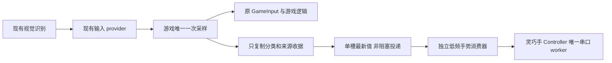

# 固定播放：离线验证方法

本文整理2026-10-23固定播放与输入接入原型的离线验证，保留当时的接口、实验条件和结果。后续双进程接入见[通道验证](BRIDGE_CANDIDATE.md)；当前整机行为与部署见[设计报告](../../report/design_report.md)和[验证报告](../../report/validation.md)。

## 已修正的播放与启动行为

1. **续租不再缩短阶段等待。** 原 `Cancellation.wait` 只等到“阶段时长与当时租约剩余时间”的较小值；若期间续租成功，它会在旧租约截止时提前返回。现以固定阶段结束时刻循环有界等待，续租仅延后租约，不改变阶段时长。假时钟测试验证旧租约1秒、连续续租时3.5秒等待仍完整持续3.5秒；不续租与取消仍在1秒停止，没有轮询 sleep。
2. **启动检查有总预算。** Controller 新增 `startup_timeout=30.0`，在 factory、固定表准备、connect 后核验取消/期限，不再用无限启动 token。30秒是可配置的软件预算，并非已测 ARM 时间或可强制中断 Python 导入的保证；阻塞 factory 只能在返回后发现超时。`wait_connected(timeout)`仍只是调用者等待，超时后必须由拥有者明确 close，不能遗弃 worker。
3. **结束状态闭合。** arm 返回后、动作完成后都在状态锁内再检查取消，防止取消后短暂发布 READY/played；关闭尚未执行的请求时将 running 终结为 cancelled/fault，并清 pending。故障、卸力未知、会话与 enable_epoch 语义保留。
4. **启动校验前置且不重复。** 四键入口先构建 OrcaModel，利用其 `import_orca -> verify_frozen` 完整核验117文件，再打开按键映射。去掉入口额外的一轮相同117校验；候选 source_manifest 核验仍保留，未建立跨会话的免检缓存。测试用故意失败的 GPIO 替身确认完整校验仅一次且发生在任何 GPIO/串口访问前。
5. **日志与模式一致。** 播放模式的持力空闲 CPU 段现标记 `idle_hold`，不再误标 `idle_off`。正常反馈模式保持原标签。

启动包级仿真使用冻结 SCS225Client、生产 BoundedSCSCL/BoundedPortHandler、OrcaBackend 和 Controller；仅把 OS 设备锁、串口设备换成内存响应器。实际顺序为：

`connect 17 READ -> arm 前17 READ -> 17当前位置目标对齐 -> 17 ON -> arm 后17 READ -> READY_IDLE`

正常动作只有位置 WRITE 与其 ACK。退出仍发送17 OFF并回读17个扭矩位；不存在“零READ所以不确认卸力”的变化。温压/范围/限力/扭矩等检查仍在启动执行；运行期温压、堵转、机械到位检测在固定播放模式中仍不存在。

## 验证证据

| 证据 | 覆盖与结果 |
|---|---|
| [p06-regression.json](build/playback-offline-20261023/p06-regression.json) / 同名.log | 160项测试，0失败/错误；117冻结文件与 Python3.10 AST 通过；禁止真实串口及 socket connect |
| test_playback_lifecycle.py | 续租期间阶段等待、取消、启动总预算、失败不写、arm取消边界、关闭排队请求、心跳不唤醒空闲 worker |
| test_playback_startup.py + memory_hand.py | 36种只读拒绝（高温/低压、逐ID残留ON、逐ID设备错误）；51种逐ID对齐/ON/使能后确认失败；正常连续播放；退出ID9不确认时 RELEASE_UNKNOWN |
| 原SDK预算回放 | responsive32、首尾32、原生阶段32、固定播放32组各两次=64次；固定播放路径 READ=0，原384 waypoint回归保持 |
| [p07-game-integration.json](build/playback-offline-20261023/p07-game-integration.json) / 同名.log | 2项可选仓库集成测试：复制既有provider结果不消费边沿；provider→缓存→Controller→真实SDK内存串口三手势闭合及过期卸力 |
| [p05-cpu.json](build/playback-offline-20261023/p05-cpu.json) | PC CPU剖析与10000次内存SDK播放；真实串口打开0，正常播放寄存器READ为0 |

表中的36种只读检查与51种启动边界均为 subTest 场景，由上述160项测试中的相关测试方法覆盖。内存模型验证软件状态、协议和调度；碰撞、绳驱动迟滞、持力温升、供电保护、真实阶段时长及设备拔线需要实物环境验证。

首次 p01 回归只有原资产漂移测试失败：沙箱默认 TEMP 目录不允许写 payload/清理。保留 p01-regression.log；将本次进程的 TEMP/TMP 指向工作区 build 下后，同入口 p03（156项）和最终 p06（160项）通过。没有修改该资产检查或放宽生产保护。p02 为100次短 CPU 探针，量化明显；p05扩展到10000次，不覆盖原件。

## CPU：已做与值得继续做的部分

已实施且可用结构/测试证明的减量：

- 固定路线9个阶段共享6个不可变目标，default不再编译4次；ROM/raw校验仍在构造时完成。该项减少一次性启动计算，运行期负载由独立测量评估。
- `renew()`只延长 deadline，不再每次 notify 空闲 worker；worker在原截止点醒来后读取新期限，输入/取消/关闭仍主动唤醒。阶段等待保持 Event 阻塞，不增加轮询。
- 四键入口省去一轮117文件哈希，完整自检仍先于设备访问。
- 手势侧只有一个不可变最新值，忙时不积压请求、不做每帧JSON/逐帧状态历史，也不另起摄像头/识别/图像回传。

PC Windows/Python3.13 的 p05 记录：单独117校验 CPU约0.094秒；带剖析的模型构造 CPU约0.375秒；10000次理想内存播放 CPU约2.078秒、217501个位置包、0寄存器READ。它包含内存响应器、计数与测试替身开销，没有串口延迟或机械等待。短 route preparation 的 CPU 读数受计时分辨率影响。以上数据用于 PC 软件调用开销分析，板端负载采用独立的 PYNQ 测量。

后续优化按价值排序：

| 方向 | 依据与边界 |
|---|---|
| 启动后复用同一进程和模型 | 已有一次arm与固定表；避免每个手势重新导入/YAML/核资产，收益方向确定 |
| 合并同一启动中的候选清单与冻结清单读文件 | 当前两个清单都必需，但同路径可一次求hash后核两个期望值；须保持路径边界、来源绑定与每会话重验，尚未实施 |
| YAML解析减少重复 | 历史 h169 确认5次 safe_load，PC本次也以导入与模型初始化为主要一次性开销。可研究自有模型构造路径或会话内只读解析结果；不能修改冻结SDK或跨资产复用错误标定。尚未实施 |
| 隔离字节码缓存/预热 | 可减少首次导入编译时间；要单独量初始化总CPU与100ms峰值。当前未为此写公共缓存或改变启动器 |
| 降低控制源采样频率 | 手势生产仍按现有识别速率；灵巧手候选控制源可在独立低频循环读取单槽，频率、稳定时间、max_age须一起核准。无需另开图像流 |
| 预封包或批量发送 | 只有测出逐包Python构造占比后才值得改；现有SDK仍逐颗ACK。SyncWrite/TxOnly会改变错误可见性，本轮未核协议能力、未实现 |

历史 ARM 对照中，限制 BLAS 线程的收益不明显。负载分析分别统计启动峰值、动作 CPU、USB 等待和保持温升，以定位不同阶段的开销。

## 整体游戏的松耦合、只读接入方案

把本次“松读取消费”按**松耦合读取最新分类**实现离线原型。没有修改或装入主游戏运行入口，默认运行行为保持现状。



接入点候选是 `PackagedGameRuntime._sample_live_input` 的实时返回处，另需覆盖 tick0。该路径已返回 `(GameInput, vision_receipt)`；现有 VolumeGameInputProvider 也单独返回视觉收据，手侧无需消费任何音量事件。**禁止手侧再次调用 provider.sample / sample_for_game**，因为它们会消费手势边沿。禁止从 Scene完成、HTTP图像预览或旧缓存目标推测实时手势。

自有 [gesture_consumer.py](src/pynq_usb_hand/gesture_consumer.py) 提供三个层次：

- `GestureObservation.from_game`：只复制匹配同一tick的分类和收据，绑定run/config/frame及server_age+local_age；以采集收据时间评估新鲜度。
- `LatestGesture.offer/read`：单槽替换，生产端try-lock失败直接丢弃；重复/倒序帧不延长新鲜度，来源身份变更锁存撤销，旧来源不能随后复活。数据不包含图像、声学样本、raw电机目标或可执行指令。
- `GestureConsumer.tick`：只接受外部已显式自检/arm的READY_IDLE播放会话，无自动上力。FIST→rock、SCISSORS→scissors、PAPER→paper；未知分类不生成动作。新鲜不同帧连续稳定后才submit，同态不重复播放；MOVING时丢弃并要求后续新帧重新稳定，不补播旧动作。失效/过期/换源/会话变化触发release并锁存停止，不自动回default或重启。

无分类但帧仍有效时保持现有姿态并允许活跃控制源续租；手部valid=false、无帧或帧过期则停止。该历史原型在无手时采用停止策略；当前系统的状态保持、回默认与可恢复等待见整机设计报告。卸力完成以 Controller 的17颗 OFF 确认结果为准。

建议最终部署优先独立手进程，避免 ORCA/NumPy 生命周期和主游戏失败互相牵连；跨进程仅传这个小型最新值合同，采用有界、非阻塞、可断开的通道。该阶段验证覆盖同进程内存单槽；双进程数据报通道的后续验证见 BRIDGE_CANDIDATE.md。由于独立venv与源身份仍有价值，同进程初期试验也应在专门集成候选中完成。主游戏异常不能永久续租手进程；手进程故障不能阻塞render或重启游戏。

未来装入主运行入口时还要验证：实时输入与确定性回放隔离（回放禁止驱动手）、菜单/暂停/切游戏的撤销、初帧与稳定帧、主进程退出和通道断连、来源重新绑定、生产线程不阻塞、游戏黄金输入/状态/Scene哈希不变。该阶段完成输入合同与真实 SDK 内存链路验证，为后续整机接入提供了可复用用例。

## 可重复的纯PC命令

在仓库根目录 PowerShell 中，使用子项目自己的环境；输出名须为新的编号，避免覆盖本轮证据。

```powershell
$handRoot = Join-Path (Get-Location) 'subprojects/pynq_usb_hand'
$handTmp = Join-Path $handRoot 'build/playback-local-tmp'
New-Item -ItemType Directory -Force -Path $handTmp | Out-Null
$env:TEMP = $handTmp
$env:TMP = $handTmp
& "$handRoot/.venv/Scripts/python.exe" -I -B "$handRoot/tools/verify_offline.py" --output "$handRoot/build/recheck-new/regression.json"
& "$handRoot/.venv/Scripts/python.exe" -I -B "$handRoot/tools/verify_game_observation.py" --output "$handRoot/build/recheck-new/game.json"
& "$handRoot/.venv/Scripts/python.exe" -I -B "$handRoot/tools/profile_playback_offline.py" --output "$handRoot/build/recheck-new/cpu.json"
```

预期输出：regression.json/.log、game.json/.log、cpu.json；分别应为 HAND_OFFLINE_PASS、PASSIVE_GAME_OBSERVATION_PASS、OFFLINE_CPU_PROFILE_PASS。游戏合同测试放在独立 integration 目录；不在单手独立部署环境中强制导入主游戏。profile工具仅依赖随子项目保留的内存测试夹具。

该阶段产出包括播放调度、启动边界与输入接入的离线用例。后续整机验证进一步覆盖 ARM 运行、连续手势切换、页面权限交接及退出卸力；当前复现入口见整机设计与验证报告。
